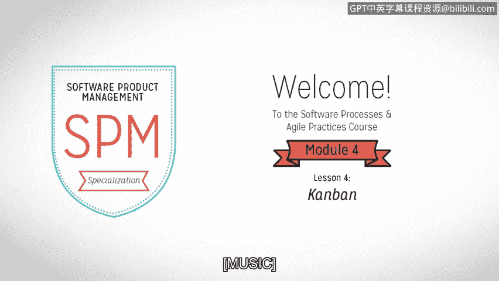
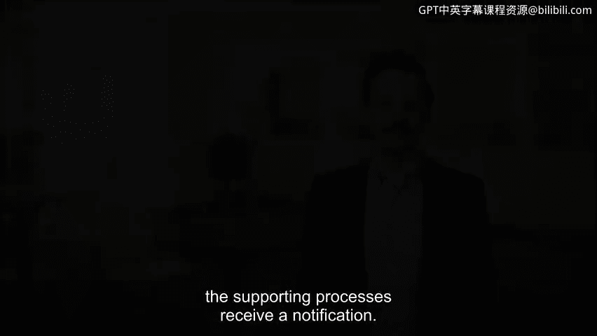
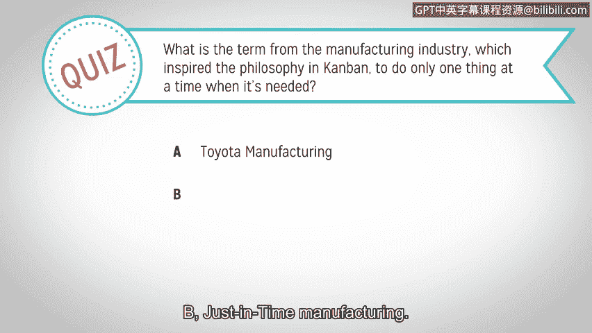
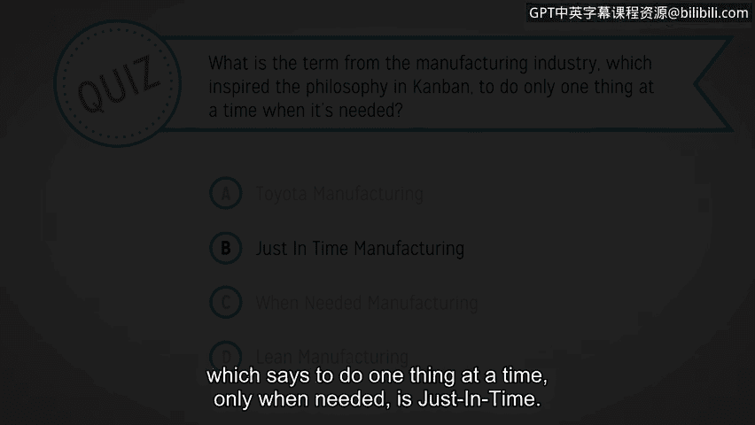
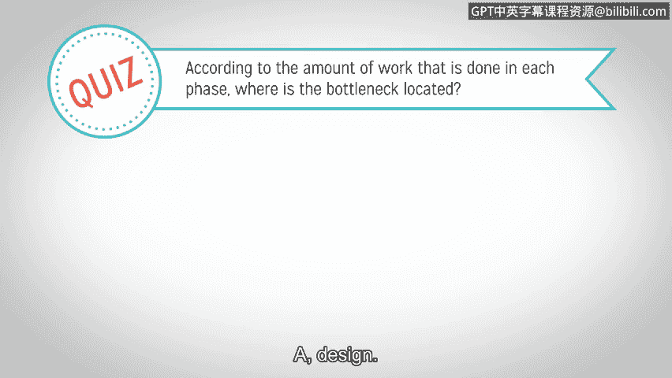

# 044：看板方法 🗂️

## 概述
在本节课中，我们将学习一种与精益软件开发紧密相关的方法论——看板。我们将了解它的起源、核心概念、如何将其应用于软件开发，以及它如何帮助团队可视化工作流程、识别瓶颈并提升效率。

---

## 看板的起源与核心理念
上一节我们介绍了精益软件开发的主要原则。本节中，我们来看看一个源自精益制造、并在软件开发中广泛应用的实践：看板。

看板方法论是与精益制造共同发展起来的。它旨在与精益制造配合使用，但也可以独立应用。回顾上节课，精益制造始于丰田公司，旨在提升产品质量的同时，减少生产时间和成本。看板帮助精益流程量化系统状态，并实现“准时化生产”的理想。

在丰田的生产车间，每个零部件都被精确管理。每个零部件都有一个与之关联的**唯一标识符（ID）**。这个ID系统是看板方法有效的核心。当一个零部件从车间被取走用于车辆组装时，其状态会通过ID更新，相关支持流程会收到通知。

> **核心概念**：每个工作项都有一个唯一标识，用于跟踪其状态和流动。

---

## 准时化生产与拉动系统
你刚刚了解了看板的一些起源及其在精益软件开发中的作用。那么，看板哲学中“只在需要时一次做一件事”的理念，是受制造业哪个术语的启发？
A. 丰田制造
B. 准时化生产
C. 按需制造
D. 精益制造

**答案是B，准时化生产。**

看板源于丰田及其精益制造流程，而“一次只做一件事，只在需要时做”的具体理念就是**准时化生产**。

想象车间里有一组箱子，每个箱子装一个零部件，比如轮胎。在看板中，每个轮胎都被分配一个唯一的ID。工人取走一个轮胎安装到新车上，并扫描其ID。箱子空了，就需要被补充。

在其他车间，空箱子可能直接从现有轮胎堆里拿一个补上。但正如上节课所说，这种系统效率低下，可能导致过度生产等浪费。在看板中，当一个零部件被使用时，补充该零部件的流程会收到通知，从而尽快制造一个新部件放入箱子。这就是“准时化生产”——所有事情都在被需要的最后一刻完成。

这种持续使用和补充车间物品的策略，被称为**拉动方法**。当一个箱子变空，就产生了一个空缺，这个空缺信号会“拉动”后续流程进行补充。将这种方法应用于所有车间活动，通过拉动零部件，你就能洞察系统的实时状态：在任何时刻，你都能看到需要什么、在哪里、何时需要。

---

## 从制造到软件开发：看板板
如果你跟踪一个工作项从一个阶段移动到下一个阶段的时间，就能确定每个制造阶段完成所需的时间，进而计算整个制造过程的总时长。有了这些知识，你就能发现延迟所在，做出有效改变，并跟踪这些改变随时间产生的效果。

看板可以很容易地转化到软件开发领域。只需做一些改变：例如，用**任务板**来可视化你的流程，板上的每一列代表一个软件开发活动。

最左边的列包含待办事项列表中的所有任务。接下来的列可以是开发、验收测试、内部发布阶段和生产发布阶段。这个板被称为**看板板**，是辅助看板方法的常用可视化工具。

> **核心工具**：看板板，用于可视化工作流，列代表不同阶段，卡片代表工作项。

---

## 实践：应用准时化策略
假设你正在为客户开发一个连接手机应用和数据库的软件产品。每个组件都有一套基础功能和一套可在此基础上构建的高级功能。手机应用的发布依赖于数据库，但一个概念验证版手机应用可以仅使用基础功能，无需连接数据库。

根据准时化生产理念，开发该产品的最佳策略是什么？
A. 先开发数据库的所有功能，再开发手机应用的所有功能。
B. 先开发手机应用的所有功能，再开发数据库的基础功能。
C. 先开发数据库基础功能，再开发手机应用基础功能，然后开发数据库和手机应用的高级功能。
D. 先开发手机应用基础功能，再开发数据库基础功能，然后开发手机应用和数据库的高级功能。

**答案是D。** 准时化生产强调只在需要时才构建组件。因此，如果你能在没有数据库的情况下创建一个可运行的手机应用原型，就应该优先做这件事。如果原型证明成功，再在其基础上构建数据库和其他高级功能。这样做的理由是在设计早期发现缺陷。如果你在测试基础功能之前就构建了整个产品，可能会发现那些基础功能从一开始就不需要，那么之前的所有工作就都浪费了。

---

## 在制品与瓶颈管理
在看板中，所有阶段都是协调的。如果一个工作项在某列完成，它就准备好被下一列“拉动”。然而，下一列必须形成一个空位（容量），才能允许该工作项被拉入该阶段，继续循环。这就引入了**在制品**的概念。

在制品顾名思义，就是每个阶段当前正在开发的工作量。实践看板方法时，你会发现某些阶段产生工作的能力大于其后续阶段。这些流程中较慢的部分被称为**瓶颈**，知道如何处理它们很重要。

当某个阶段无法跟上其前一阶段产生的工作速度时，就会发生瓶颈。在我们的汽车例子中，如果安装轮胎的时间比制造轮胎的时间长，那么轮胎安装阶段就会出现瓶颈。

如何处理瓶颈？主要有两种方式：
1.  **在瓶颈处增加产能**：当然，这是非常有效的方式。但增加产能的唯一方法是向该阶段分配更多资源。我们必须假设执行该阶段活动的人员已经在满负荷工作，并据此进行调整。所以，不是要求安装工更快，而是分配更多安装工。
2.  **减少瓶颈前的工作量**：除了在瓶颈处增加产能，你还可以消除在瓶颈之前完成的不必要工作。减少在安装前制造的轮胎数量。这被称为**设置在制品限制**。有效地限制必须等待被拉入下一阶段的工作量。

现在到了我最喜欢的看板部分：那些被告知不要制造更多轮胎的工人怎么办？在软件团队中，这就是为什么**多功能团队**如此重要。如果你在测试阶段遇到瓶颈，让开发人员在需要时能从功能开发转到测试会非常有帮助。因此，设置在制品限制是管理多功能团队瓶颈的最佳方式。平衡两者，你将看到生产力的提升。

---

## 衡量改进：周期时间
你如何知道你的改变是否对项目产生了真正的影响？这就需要**周期时间**。周期时间是看板中的关键指标。它是一个工作项完成一个完整工作周期所需的总时间。例如，周期时间是汽车轮胎从制造到安装所需的时间。

要测量每个阶段的周期时间，你需要知道一个工作项何时开始、何时完成。然后计算这两个时间戳之间的小时数，就得到了周期时间。这不是开发人员积极工作所花费的时间，而是从开始工作到完成工作的全部时间，包括所有人睡觉的时间。这样做的原因是排除个人努力程度的差异，并适应现实情况，比如因缺陷而重新开始工作。它衡量的是流程能处理什么以及你实践的质量，而不是团队的努力程度。

如果你的周期时间在减少，而产品质量保持稳定或提高，那么你就做对了。

---

## 看板中的工作启动
在结束之前，我想谈谈最后一件事：你如何知道何时开始一项工作？在Scrum中，这是在冲刺计划会议期间通过计划完成的。在看板中则不同，没有计划会议。因为工作以其自身的节奏进行，所需的工作不断从产品待办事项列表的顶部被取走。

只要需求始终被正确排序，产品自然会按照功能优先级顺序构建。看板中相当于Scrum产品负责人角色的人，确保产品待办事项列表始终处于正确的顺序。因此，当下一个工作项从待办列表中被拉出时，它已经准备就绪。

---

## 总结
本节课我们一起学习了看板方法。看板与精益软件开发配合得非常好，正是因为它为精益制造而生。它允许团队跟踪随时间推移的进展，并确保遵循准时化开发策略。这减少了浪费，并确保决策尽可能晚地做出，以便基于最新信息。

这就是看板的概要。如果你想了解更多关于此策略的信息，请查看课程资源中包含的参考资料。

---

## 课程总结
在本课程中，我和Morgan介绍了当今行业中使用的一些软件开发流程和实践的基础知识。

*   **在第一模块**，Morgan定义了流程、阶段、活动和任务是什么，以及它们之间的关系。她区分了生命周期流程和子流程，并举例说明了它们如何由阶段、活动和任务组成。然后她详细介绍了软件工程活动，展示了典型生命周期流程每个阶段的活动示例。
*   **在第二模块**，我向你展示了生命周期流程如何随时间演变。我从线性流程开始，逐步介绍了螺旋、统一和持续交付流程模型。我还提到了几种不同类型的原型设计。
*   **在第三模块**，Morgan开始深入探讨敏捷实践。她介绍了一些在敏捷中使用的流行方法论，如极限编程和Scrum，以及它们实施的实践。
*   **在本模块**，我讨论了一些敏捷的变体，以及一种新兴的软件实践——精益软件开发。我们讨论了看板如何在精益中被用来跟踪团队进度，并确保每个人都遵循准时化生产策略。

我和Morgan非常享受教授这门课程，希望你也同样享受学习它。本课程是Coursera上软件产品管理专项课程的一部分。正如我们在介绍课程中所说，这门课程以及我们的“客户需求与软件需求”课程，可以按你选择的任何顺序学习。无论你计划继续学习需求课程，还是已经完成它并准备学习敏捷规划课程，我都期待与你继续这段旅程，共同打造更好的软件和更快乐的客户。

下次见。😊