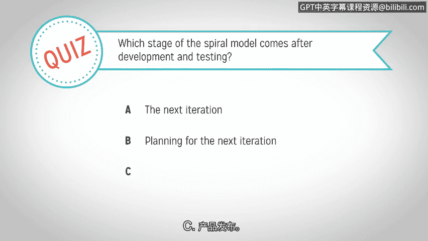
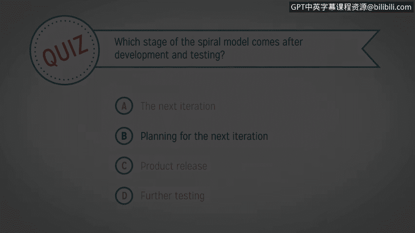

# 艾伯塔大学软件产品管理课程2：《软件流程与敏捷实践》｜software-processes-and-agile-practices｜ - P10：9_第2.2.2节 螺旋模型.zh - GPT中英字幕课程资源 - BV1Xz4y1G74t

In the last lesson， I outlined some of the earliest software development processes， linear models。

I gave you an example of two construction workers each trying to build a railroad with different tools。

And then compared that to choosing between different software processes。

Keep that example in mind as we go through this material to remind yourself why this content is important。

In the next few lessons， I'm going to talk to you about some iterative softwareer process models。

Iterative soccer process models are ones which allow for repeating stages of the process。

 they are cyclical。Iterative models extend upon the linear models which you talked about earlier。

The biggest advantage they bring to the table is that they add the ability to loop back on previous steps。

Each loop back is an iteration， hence iterative model。

Iterations allow for feedback within the process。Iterative models can be considered a sort of forerunner to truly agile practices。

Yet they also embody sequential steps， reminiscent of previous linear processes。

When you begin talking about agile practices with Morgan in the next module。

 try to see if you can find the points of compatibility between agile practices and iterative processes。

In this lesson， I'm going to talk about the spiral process model。

When the spiral model was introduced by Barry Beaam in 1986。

 it outlined a basic process for designing and implementing a soccer system。

By revisiting phases of the process after they've been completed。Before you move on。

 I want to warn you that some of this stuff can get technical。

If you find yourself needing clarification on a concept。

 please look at the course resources for this lesson。

There you will find references to all the content which I will talk about here。Allright。

 so this is a simplified explanation of the spiral process model。

 You can see right away why it's called spiral model on a basic level。

 the model consists of four quadrants。 as you move through this process。

 the idea is that you move from one quadrant to another。

 Consider each of these four quadrants as a phase of it iteration where an iteration is the duration of one full spiral or all four quadrant phases being completed one time Each of these phases contain activities like Morgan defined in the first module。

In spiral， you begin by coming up with the objectives and needs and generating solutions for the current iteration。

 Then you identify and assess risks and evaluate those solutions。

 You then move on to developing and testing the product in the current iteration Once you have a product that satisfies the objectives。

 you move on to planning the next iteration。 If each quadrant is a phase of an iteration。

 then once you complete an iteration， you move on to the next。

That's the basic flow associated with the spiral model。

 You gradually build up a product by repeating the phase cycle。 For example。

 you might start a project in the spiral model by determining the client and user requirements。

 You'll then come up with potential solutions to fit those needs。 After that。

 you might choose to evaluate the solutions you came up with。

 Then you might build an initial prototype of the product。

 and review what needs to be done for the next iteration。 That would be one iteration。

 In the next iteration， you might start again， by defining the objectives of the iteration。

 Perhaps features to be added to the prototype that you just built。😊。

Then you'd evaluate these features and move on to building the features you deem appropriate。

You then review what needs to be done for the next iteration and continue from there。

Until the project has been completed to your client satisfaction。 So unlike linear models。

 which we described in the last lesson， iterative models like spiral tend to repeat elements of the process throughout。

😊，This means that the spiral model allows for a development team to review their product at the end of each spiral iteration。

Doing so can better ensure that your product is being built to specification。

Jonathan is using the Sro model to build his software。

He has extensive experience with programming with punch cards and using the waterfall model。

 So spirals iterations are a big stat for him。😊，He just finished developing and testing his product。

 but can't remember what stage of the model comes next。

Which stage of the spiral model comes after development and testing？A， the next iteration。B。

 planning for the next iteration。C， product release。

Or D further testing。The answer is B， planning for the next iteration。Since spiral is iterative。

 you loop back around and begin determining your objectives and refining your design again。

But you only do that after you first plan your design at the end of the iteration。

Even though some aspects of projects following spiral model may change from project to project。

Six conditions almost always stay the same。These are called the invariants of the spiral model。

They were first described by Beaam in his follow up paper， published in the year 2000。

What's interesting about this is that for the most part。

 the invaris actually also apply to a lot of other process models as well。

Now these invariants can get pretty technical， so instead of going into detail about all six。

 I'm only going to cover the core concepts of a few key invaris。

If you'd like more details about each of the invariants， please check out the course sources。There。

 you'll find detailed descriptions of each invariant。

The first invari of the spiral model states that all work products of a software project should be created concurrently at the same time。

This may seem strange， but the basic idea is that without defining things at the same time。

 you put your project at risk。This is because with the usual method of waterfall。

 doing things sequentially means making decisions based on only a limited amount of information。

The second invariant to the spiral model is really simple。

All the quadrants of the model must be addressed。 There's no skipping steps。

This is because each quadrant of the model brings value， if you skip one。

 you put your project unnecessarily at risk。Because what you're likely doing is making assumptions about the project。

Assumptions can， of course， be false。You don't want to build a project based on false assumptions。

The last foreign variants are pretty technical， so I won't get into much detail。Essentially。

 they say this。Every project implementing the spiralI model should base the amount of time they spend on any particular activity on the amount of risk involved in carrying that activity out。

It focuses a lot on making sure that you base your decisions on risk data。

The other invariantss also mentioned that each iteration of the spiral should result in a tangible work product。

And that the focus of the process should be on improving the process as a whole。

So all these invaris build up to create the spiral model。This helps to define the model。

 but can you see any issues？Although spiral is clearly an improvement upon linear processes in many ways。

 it also has its share of disadvantages。One of these disadvantages？

This planning tends to be done up front at the beginning of each spiral。

Depending on the duration of the spiral， this can make it difficult to make good estimates。

Another disadvantage。Is it the ability to minimize risk in the calculated fashion which this process lays out？

Requires an immense amount of analytical expertise。

Think about the amount of data that you would need in order to know exactly how much time is too much or too little when working on an activity。

These sorts of risk assessment tasks consume a great deal of resources in order to get right。

If you find yourself in an organization which uses a spiral model。

 it's likely that you're working on large projects with years of experience。

 data and technical expertise at your disposal。So there you have it。

The spiral model is a great example of an iterative process。

Things get done in a way that allows for the revision of the product at certain intervals。

Like other process models。It has its disadvantages。

But it's clearly different from what we saw before， right？In the next lesson。

 I'm going to talk about the unified process model。

Try comparing what you learned in this lesson to that。

