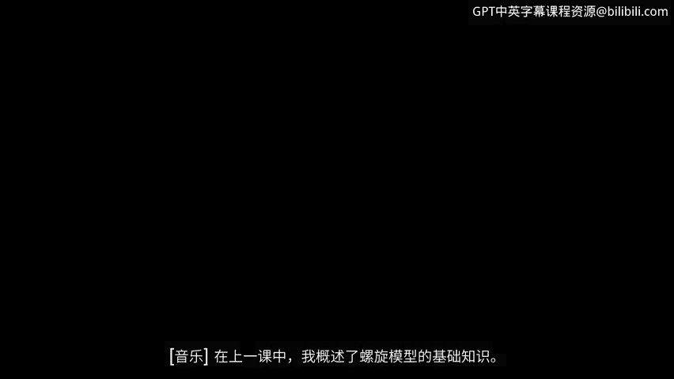
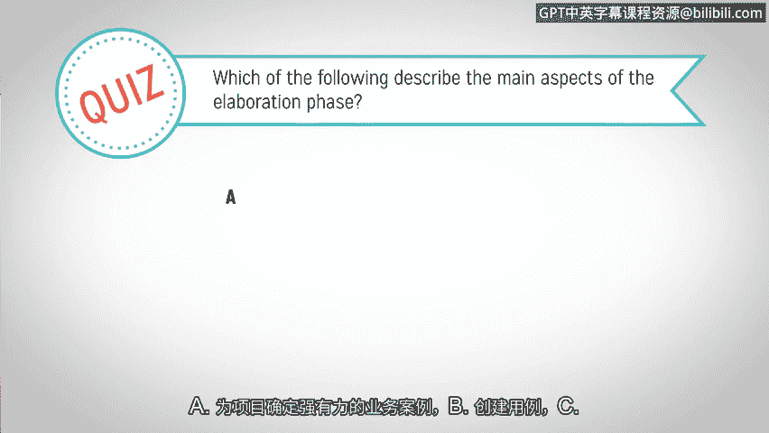

# 艾伯塔大学软件产品管理课程2：《软件流程与敏捷实践》｜software-processes-and-agile-practices｜ - P11：10_第2.2.3节 统一过程.zh - GPT中英字幕课程资源 - BV1Xz4y1G74t

In the last lesson， I outline the basics of the spiral model。

We talked a little bit about its advantages and disadvantages and how it fits into the timeline of the evolution of software development processes。

The spiral model was an iterative model of software development。

 meaning that the product is built in a series of repeated phases。

This is in contrast to linear process models， which we covered at the beginning of this module。

 such as the waterfall model and the V model。In this lesson。

 I'm going to talk about another iterative model of software development， the unified process model。

 or just unified process。As I said before， unified process is an iterative model of software development。

 its basic structure is to work in a series of phases which we repeated until the final phase is deemed complete。

Within most unified process phases， development happens in small iterations until the phase is deemed complete。

Usually， faces are deemed complete when a milestone is reached。

Unified process tries to emphasize gradual development as much as possible。

Instead of narrowing down all your requirements of your software product at the beginning。

Unified process focuses on the importance of developing your product's architecture over time。

Architecture is a set of designs upon which the software product is built。 So in unified process。

 the development team's focus is to develop design models， along with a working product。

While the general structure of Unified is to build iteratively。

 the model allows for tasks done in one phase to overlap with another。

 This is referred to as doing work in parallel。So instead of only going through a sequence of phases。

 developers can actually do things like design the product architecture while developing tests at the same time。

Jeff is building tests for his code as he designs his product's architecture design。

He's also clarifying and eliciting requirements from his client occasionally as he runs into issues。

What style of software development is Jeff using？A parallel development。B， iterative development。C。

 incremental development， or D， synchronized development。The answer is a， parallel development。

Since Jeff is participating in multiple phases of development at once， we call this parallel。

The first phase of the unified process is called the inception phase。

 This phase is meant to be small， just enough time to ensure that you have a strong enough basis to continue on to the next phase。

 In fact， the inception phase is the only phase in unified process or development does not happen in iterations If your inception phase is long。

 this might suggest that you have spent too much time building requirement in the inception phase。

 your main goal is to see if there's a strong enough business case to continue development。

 What this means is that there has to be a good enough financial reason to build a product。😊。

To do this， the inception phase calls for the creation of basic use cases。

Use cases outline the main user interactions with the product。In this phase。

 you also define the project scope and potential risks。

If you'd like to learn more about use cases and how to create them。

 please check out the course on client needs and software requirements。

At the end of the inception phase， you achieved the life cycle objective milestone。At this point。

 you'll have a reasonable description of how viable the product is and be ready to move on to the next phase of the process。

😊，The elaboration phase。The elaboration phase is the first of the unified process phases to implement those small iterations which I mentioned earlier in this lesson。

 the goal of this phase is to basically create a model or a prototype of the product。

 which we'll refine later， we'll talk more about different types of prototypes later in this module。

For now， the purpose of this phase is to define the system architecture。

Developers define the requirements conceived in the inception phase。

They also develop key requirements in architecture documentation。

 such as use case diagrams and high level class diagrams。

This gives the foundation on which actual development will be built。 Remember。

 this phase allows for iterations。So building the prototype in an iteration may go through redesign before the requirements and architectureural models are deemed complete enough to move on at the end of the elaboration phase。

 developers deliver a plan for development in the next phase， the construction phase。

This plan basically builds on what was developed during inception and integrates everything learned during elaboration so that construction can happen effectively。

Remember， in the unified process model， development can happen in parallel。

This means that when you begin the construction phase。

 you'll continue to do work that was being done in the elaboration phase。

The only difference is that the emphasis on the work may change。For instance。

 while testing and programming may have been important in elaboration。

 they become even more important in construction。Similarly。

 assessing risks is important in construction， but it's less important in this phase than in in elaboration。

The construction phase is very straightforward。 It's another phase in which development can happen iteratively。

It focuses on building upon the work， which was done in elaboration。

This is where your product's guts are really built。 and the product comes to life。

In the construction phase， thorough use cases are developed to drive product development。

These use cases are more robust than the ones created in the inception phase。

Construction phase use cases offer more specific insights into how your product should be created。

Your product is built iteratively throughout this construction phase until your product is ready to be released。

At that point， your development team begins transitioning your product to your client and your users。

Now that you've learned about the inception， elaboration。

 and construction phases of the unified process， let's test your understanding。

Which of the following describe the main aspects of the elaboration phase？A。

 identifying a strong business case for the project。

B， creating use cases。C， creating use case diagrams。And or D， creating class diagrams。

The correct answers are C and D。Use case diagrams and class diagrams are main work products of the elaboration phase。

That's not to say that these work products don't also happen in the construction phase。

It's just that there're more focus in elaboration。You identify a strong business case for the project in the inception phase。

In this transition phase， you have a major rollout of your product。

Your development team receives feedback from your users。

It's at this point when you really see how well your design stacks up against your users' needs。

By gathering this feedback， your development team can make improvements to your product。

 creating bug fixes and other releases。After your product has completed its iteration。

 it's possible to cycle back through the phases of unified process again。

This would be in cases where you intend to create further major releases on the product and apply user feedback as a means of influencing plans for later development。

These cycles repeat until you and your development team are ready to release your product。

So that's unified process。Like I said at the top of the lesson。

 Unified is an example of an iterative process。But as you saw throughout this lesson。

 Unified is also a parallel process。 Activities related to requirements。

 design and implementation can happen at the same time。😊，In the grand scheme of things。

 Unified is much more similar to a spike driving machine than to a sledgehammer。

 It's a great process for large projects where a great deal of refinement is needed in order for the product to stay on track。

😊，Having iterations allows your product to grow naturally without becoming limited by upfront plans。

In the next lesson， I'm going to talk about prototyping and how prototypes can be used to drive softwareer development。

 I'll see you there。😊。