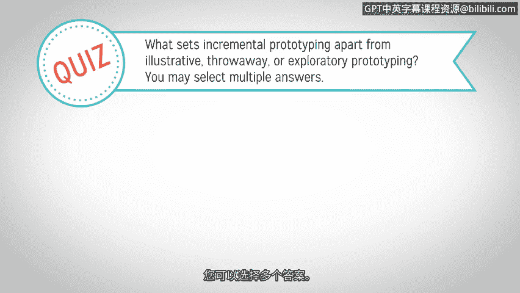

# 艾伯塔大学软件产品管理课程2：《软件流程与敏捷实践》｜software-processes-and-agile-practices｜ - P12：11_第2.2.4节 原型化.zh - GPT中英字幕课程资源 - BV1Xz4y1G74t

🎼。😊。

Welcome back in the last lesson， I talked about the unified process as an example of an iterative process as well as a parallel process。

I talked about each of the phases of the process and defined some key terms like phase。

 cycle and iteration。Before that， I discussed another iterative process called spiral。

Hopefully you can see that as I introduce these processes。

 each becomes more sophisticated than the last。We're building up to more advanced processes。

 but that doesn't mean that learning about these simpler processes isn't important。

Don't forget the analogy of the sledgehammer and the spike driving machine。

While one may be less sophisticated than the other， that doesn't mean that it lacks value。 In fact。

 all the processes which I have covered so far are actually quite frequently used in the industry today。

In this lesson， I'm going to talk about something which applies to the spiral and unified process models。

 which we just talked about。Prototypes。Of course。Prototypes aren't limited to just these processes。

 So you'll see them referred to more and more in future lessons。

There are five types of prototypes which I'll cover in this lesson。These five types are illustrative。

Exploratory。Throw away incremental and evolutionary prototypes。

Let's start with the illustrative prototype。These are the most basic of prototypes。

They can be drawings on a napkin， a brief slideshow。

 or even a couple index cards with components drawn onto them。Whatever the case。

The point of an illustrative prototype is to share an idea using a low fidelity disposable image。

Illusstrative prototypes help to get the systems look and feel right without investing much time or money into developing a product。

They can save a lot of time in development later on。

You can use an illustrative prototype as a way to weed out bad ideas。And as a guide for development。

Instead of having to imagine and program ideas on the fly。

 they can give the development team guidance for creating solutions。When I do prototyping。

 I personally like to mock up prototypes with the functionality which I plan on implementing。

One of my favorite ways of doing this is by sketching my key features in a drawing program and tying them together by using a slideshow editor。

😊，The prototype then ends up becoming a slightly more realistic example of how a product looks without having to expend much extra energy。

You can achieve a similar result with features drawn on paper。

You could demonstrate an idea by swapping out one paper screen for another when the end user selects certain elements。

This technique is usually used when time is short。And only a basic idea is needed in order to get the point across。

You can go really far with this idea。Some prototypes go as far as faking their functionality by having a human control the functionality of the system behind the scenes。

This is like the person behind the curtains as in the movie， The Wizard of Oz。

One of the ways which I've seen this be successful is on a project which used wireless communication between devices as a key aspect of its functionality。

Writing code， which allowed a user to actually communicate wirelessly to another device。

 would take a long time。So instead， the development team got creative and had a slideshow program run on each device。

When one device would send data to another， the developers would cleverly advance the slideshow on the other device。

The development team did this with good enough timing that it seemed like data was actually being transmitted between the two devices。

You can probably see why illustrative prototyping is common。

It takes very little time to flush out the feature set。

It can give you a really good idea of how your product will look when it's finished。

If you have more time。And you want a more comprehensive understanding of what the product will look like。

 Some teams turn to what we call exploratory prototyping。

Expllororatory prototyping allows you to focus just on what the products look and feel is。

You'll also be able to determine the effort it takes to build that product。

You build working code so that you can actually see what's possible。

 fully expecting to throw the workout after learning from the process。Is this method expensive。

 Absutely， It's better than finding out later that the product solution just isn't workable。

The usual motivation behind exploratory prototyping is that the product developers want to study how feasible some product idea is。

It's no longer about just looking at what the product looks like。

It's about how realizable it is to develop the product or how useful the product may be before committing to further effort。

The first version of a product or almost anything， often has various problems。Because of that。

 why not just build a second version from scratch and toss away the first。

The first version you've built is what's called a throwaway prototype。

You should know that all is not lost from the first version。

There could be many useful lessons to be learned and problems to avoid in the second version。

Throw away prototypes， give you the opportunity to learn from past mistakes。

This gives you the chance to make your release software product look more rock solid than it would have been if you had just kept evolving from the first version。

Carly just built her first iteration of her product。

And now has a first generation working product prototype。She intends on adding to this prototype。

 in further increments。The test users are critical of the initial prototype。

After seeing the product design， they suggest a different approach that uses some of the features that were already built。

What kind of prototyping is Carly using。A working。B， illustrative。C， throwaway。Or D， incremental。

The answer is D， incremental prototyping。Carly started with a working prototype that was later expanded upon。

The initial prototype was coded and kept， so it's not throw away prototyping or illustrative prototyping。

Okay， so hopefully you don't end up with an unintentional throwaway prototype。

The three types of prototypes， which I just described。

 are all prototypes which end up not being used directly in the final version of the product。

Doesn't it make sense to reuse work that's been done in prototyping during actual product development？

That's where incremental and evolutionary prototyping come into play。

They let your efforts of prototyping carry through to your final product。

The key idea is to have working software for each successive prototype。

Any of which could be released as a version of your software product。

When you create incremental prototypes， you build and release your product in increments one at a time。

Incremental prototyping works in stages。Based on a triage system。

All that means is you assess each of the system's components and assign them a priority。

Based on that priority， you then develop the product from the ground up。

You would develop your product from most important to least important。

So you assign priorities to a software product's features based on what must be done， should be done。

 and what could be done。You assign your core features to the must do priority。

 then you assign all the features which would support your product。

 but aren't absolutely critical to a should do。Everything else that seems like an extraneous feature would then be assigned to the could do priority。

Based on these ratings， you would then develop your product by starting with the features which you assign to the must do priority。

The resulting software product contains the core features and could be released as an incremental prototype。

Then， as resources permit， you develop features under the should do priority and then features in could do。

Which results in a more fully featured incremental prototype。Here's an example。

 You're developing a messaging app。First and foremost。

 you want your users to be able to talk to each other through the app。Anything related to that。

 like integrating the ability to find another users's message， sending or receiving functions。

 or text editing could be your highest priority。So these features would be assigned to the must do priority。

You might imagine that users would like to be able to add profile pictures or post status updates。

 maybe message groups of people。These features would be considered the should do functionalities。

Any features like being able to change message fonts， send custom drawings to other users。

 or post links would probably be assigned to the could do。With all of these in place。

 all that's left to do is build your app。😡，Since you prioritize your product's features。

 you can easily map out and plan your development。In fact。

 this idea of prioritizing your features and working off your plan is a basic concept。

 which you're going to see recur in the Agile planning for softwareft Rere course。

So you just learned about incremental prototyping。Let's test your knowledge and see what you remember。

What sets incremental prototyping apart from illustrative， throwaway or exploratory prototyping。

 you may select multiple answers。

A incremental prototypes is a triage system。B， incremental prototypes get discarded after they're created。

C， incremental prototypes do not contain any code。And or D incremental prototypes may contain working software for the end product。

The correct answers are A and D。Incremental prototypes are different from the previous ones。

 which we talked about because they allow your development team to create a potentially releasable product。

This is done by developing features which have been prioritized using a triR system。

The final type of prototype， which I'm going to talk about， is the evolutionary prototype。

In incremental prototyping， you begin with a core set of features and add new features over time。

In evolutionary prototyping， you begin with a set of all the features in basic form and refine or revolve them over time。

In either case， the end product is a feature rich product。

Let's compare this using the messaging app example I outlined earlier。In incremental prototyping。

 we prioritize the software of products's features using a triage system。

 Then we built successive incremental prototypes of the product that included the most important features to the least important。

In evolutionary prototyping， you would have an early version of all the features and build successive prototypes by working the features until they are fully mature。

For example。Later evolutionary prototypes could make the existing features easier or more flexible to use。

In the messaging app， consider a feature like adding a profile picture。Initially。

 a user might have to specify the path of the photo to be added to the profile。

And not a very efficient way of doing things， but it works。In another prototype。

 that developer might allow for the user to choose the photo from a drop down menu of available photos。

A little better， but in the next prototype， you might imagine the system to allow for drag and drop functionality。

So in this way， your product evolves from a rudimentary working prototype to something feature rich and robust。

Both incremental and evolutionary prototyping are ways to make working software that can be shown at regular intervals to gain further feedback。

In practice， you can blend both approaches。It's a real morale boost for your development team to see the product as it comes together over time。

All right， so you now know some of the different types of processes。Now。

 think back on what you learned in previous lessons about the spiral model and unified process。

Can you picture how a prototype would fit into these models？In the spiral model。

 imagine where you would start。Usually the places start。Is by creating a prototype， right？

You might go through the first iteration of the spiralre model just creating an illustrtraative prototype。

You could scribble a few drawings onto the paper and get an idea of how your system will work。

The same could be said for the inception phase of unified， couldn't it？By creating prototypes。

 you can better visualize what your product does and therefore make feature decisions based on what the product might look like。

But it doesn't stop there。 I'll bet you're already imagining the possibility of combining the illustrative prototype with an incremental or evolutionary prototype。

 And it makes sense， right？ Your first version is just an idea written on a few pieces of paper。

 Then to further test your idea， Y outline some key features and start building。Before long。

 you could end up with a prototype。You can then take that prototype to a client or potential investors to prove that the product is conceptually viable。

That's really the core idea behind any kind of prototyping to gain feedback on versions of your product。

You can begin by spending a minimal amount of time developing your initial prototypes to make the most efficient use of your resources。

In the next lesson， I'm going to talk about continuous delivery in software development and how that relates to Microsoft Daily builds。

 I'll see you there。😊。