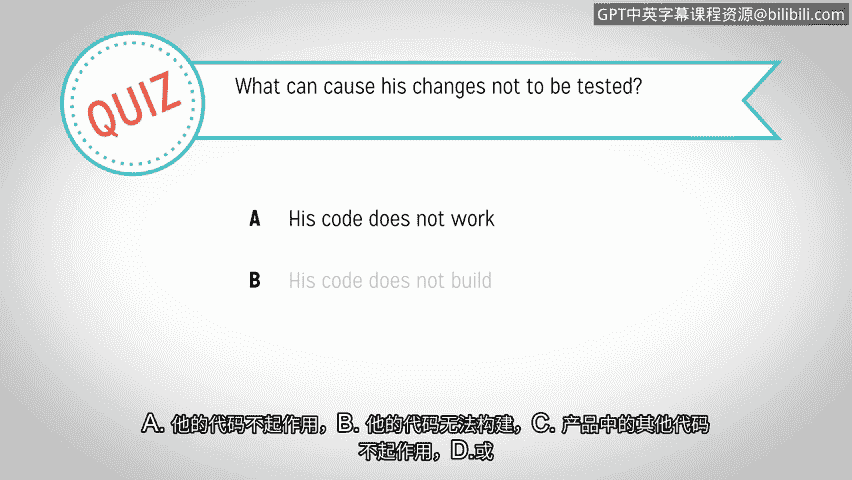

# 艾伯塔大学软件产品管理课程2：《软件流程与敏捷实践》｜software-processes-and-agile-practices｜ - P13：12_第2.2.5节 持续交付.zh - GPT中英字幕课程资源 - BV1Xz4y1G74t

🎼。😊。

Welcome to the last lesson of the second module of this course。In the previous lesson。

 I talked about how prototyping works in software development。Before that。

 I talked about the evolution of different processes throughout history。In this lesson。

 I'm going to complete that history using the spike driving machine element of our railroad building analogy。

In incremental or evolutionary prototyping， the product gets refined over time。

You'd start with a basic product and see where it goes。Over time。

 successive prototypes are constructed。Typically， these prototypes are released to your client for feedback。

However， this notion of a release is quite loose。It might take lots of manual work to build and integrate the code into a runnable prototype。

A prototype that functions well internally may still not work for a client。

They may have a device that hasn't been tested or some other detail could have been overlooked。

One way to avoid these oversights is to automate the build and integration aspects of your project。

That's where continuous delivery comes in。As the name suggests。

 this allows the developers to deliver a product continuously。As it's being developed。

Whenever a developer commits a code change， it will be built， tested， integrated， and released。

The time between making a change and having it released can be very short。

So any problems will be noticed right away。Continuous delivery prepares you to release your product at any point。

 but you're not forced to release the prototype if you don't feel it's ready。

Prototype releases are placed in specific channels or streams intended for different audiences。

This is done so that you can make sure your continuous releases are tested properly before being released to the public。

For example。You could have a developer channel for day to day builds that developers generate。

But aren't ready for widespread use。You could have a test channel for prototypes created for a group internal to a company。

Then you could have a stable channel for releases targeted at the core users。

Developers can gain insight into their product by receiving feedback from each channel。

The continuous delivery practice fits well with iterative process models like Unified process。

Let's see how that works。Remember how unified it was composed of different phases。

 which worked in parallel， those phases were inception， elaboration， construction， and transition。

The most relevant phase to continuous delivery is the construction phase。

You could deliver your product continuously through a series of short iterations。

The product is built iteratively over time and comes together in steps。During any given iteration。

 your development team could be working on constructing the next prototype for release。

 that could include a lot of activities like detailed design， coding and testing of features。

Continuous delivery could also be used in unified process during its elaboration phase。

In the elaboration phase， high level product architecture design and test writing is done。😊。

So in order to support continuous delivery， you could use automated tools。

These tools could be used to build and integrate the code， run tests。

 and package the product into a releasable form。For automated tests of your code。

 a best practice is to write tests before you actually write the code itself。

This approach is called test driven development。And it ensures that you're actually solving the right problem and making the functionality you want。

Initially， when running these tests， they'll fail because the corresponding code doesn't exist yet。

 but that's fine because the code is written， and then the test should eventually pass。

As code is written， features start to take form within the product。

Continuous delivery ensures that the process is happening all the time。

So if nothing breaks during the process， there should be a prototype ready for distribution at any time。

So the prototype should be ready to try out by your end users。Of course， with any system。

 when end users see your product， errors will begin to surface that you never noticed before。

 It's an ongoing process to receive feedback from your users。

You want to learn from that and fix errors that they point out to you。

The continuous delivery practice aims to have a releasable prototype。

 essentially the product at the end of every iteration。That has fantastic advantages。

If you were to abandon your project at the end of it iteration。

 you would still have a releasable product。You could even release the product without completing all the plan features if resources ran out。

Beyond that， your product quality would actually improve。

Integrating your code into a larger product with each iteration will make sure that everything works properly in small doses。

This fixes a lot of problems that would occur if you tried to build， test， integrate。

 and release one big product all at once。Howey and his development team are constructing the support infrastructure to enable the continuous delivery of the product prototypes put together by other developers。

He has automated tools in place to build and integrate code， package the product。

 and install the product in a test environment。In this infrastructure。

 he also needs automated tools to do what？A， make prototypes。B， do detailed design。C。

 write the code or D， run tests。The answer is D。Of these possibilities， making prototypes。

 doing detailed design， and writing the code aren't part of continuous delivery。

If they can even be automated at all， automated testing， however， is。

Let's look at an example of continuous delivery in action， the Microsoft Daily build。In it。

 each iteration of the construction phase is laid out in a day， hence daily build。😊。

The most important part of the daily build is the daily part。

The whole point of the Microsoft Daily build is to ensure that your programmers are in sync at the beginning of each build activity。

By following a process that makes your developers integrate their code into the larger system at the end of every day。

You make sure that nobody wander is too far off the beaten path。To control this。

 Microsoft uses a system of continuous integration。If you haven't heard this term before。

 that's okay。All it means is that when a developer writes a piece of code and wants to share that code remotely with anyone else in the team。

 that code must first be put through a process of automatic testing。

 This ensures that it will work with a project as a whole。

 The implications it has for your team are enormous。If all of your developers are on the same page。

 they can easily see how their work fits into the project as a whole。

 but also how their work affects other members of the team。

This not only keeps your developers morale， but it also increases the quality of the product。

The Daily build does this by giving your developers the ability to catch errors before they become a real problem。

😡，If one of your developers pushes a piece of code to the system and it fails the tests。

 then you know immediately which piece of code is the problem。

Or if you try to run the product and it doesn't work。

 you know that the problem is with something that got integrated into the previous build。

So error checking in this way becomes extremely easy in the daily build。For a large product。

 the automated tests will be run during the night on the build from that day。The next morning。

 developers can see how these tests went and decide what to fix。

So the Microsoft Daily build offers your team the opportunity to act quickly and catch errors before they become a major headache。

By using automation， you also make things much easier on your development team。

And that's the Microsoft DailyBuild in a nutshell。Now that you've seen continuous delivery and the Microsoft Daily build。

 let's see what you learned。Thomas is a developer working for Microsoft。

He has just spent his whole day writing the code， which will become part of the next version of the Windows operating system。

At the end of the day， he uploads his changes onto a server。What can cause changes not to be tested？

8ight。His code does not work。B， his code does not build。

C， other code in the product does not work， and or D， other code in the product does not build。

Of these possibilities， the inability to build a product would really hamper testing。

Code that builds， but does not work， could still be tested。So the answers are B and D。All right。

 so that's it for this lesson。 Let's review a little bit about what was discussed。

I started off by talking about continuous delivery。

 which can be incorporated into an iterative process like Unified。

Continuous delivery is used to release incremental or evolutionary prototypes。

Then I talked about how the Microsoft Daily build is an example of continuous delivery。

So a combination like the unified process with prototyping and continuous delivery is our spike driving machine。

 it's a great tool for large long-term projects in which the product's quality can be severely affected by faulty changes made by the development team。

It's clearly a significantly more robust process than， say， the waterfall process。

 just don't forget that it can't fit every situation。There will be circumstances。

 especially on small projects， where setting up the required infrastructure。

Would take more time than it's worth。And that's why I talked about the sledgehammers of the software world as well。

Those being waterfall， the V model， and Sa tooth。They're all very important。

 even though they're less robust than the later models like spiral and Unified。

Even those processes would be too simplistic for a truly huge project。

I want you to keep an open mind about these processes。I don't want you coming away。

 thinking that iterative or parallel software process models are the best and only tools for software product management。

There are applications for each tool， and it's up to you as a software product manager to apply them in the right situations。

What's more， none of the processes which I mentioned throughout this module are necessarily entirely independent from one another。

 You can reasonably integrate aspects from each process to create your own。

Do what works best for you and your projects。Don't feel like you have to fit a mold which someone else has created。

If， for example， you like the idea of testing your code in iteration cycles。

 but you don't think you need to revisit the design at the beginning of every single iteration。

 Then by all means， do what works best for you。