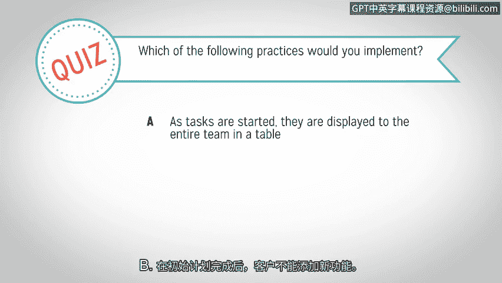
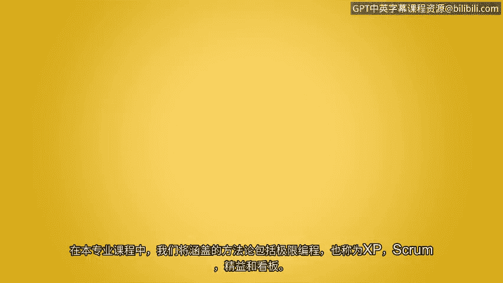

# 艾伯塔大学软件产品管理课程2：《软件流程与敏捷实践》｜software-processes-and-agile-practices｜ - P14：13_第2.3.1节 在流程模型中使用敏捷.zh - GPT中英字幕课程资源 - BV1Xz4y1G74t

🎼。😊，At this point in the course， you have now examined many different process models。

 I've also covered some of the motivation for using agile practices back in the first module。😊。

We are now going to dive a little deeper into some agile practices。

You will use these practices quite a bit when you are working as a software product manager。

If you joined us in the introductory course， you'll recall that we talked about the Agile Mano。

This manifesto outline four core values for software development。

 as well as the 12 principles that you should follow。

If you didn't take the introductory course or would like a refresher。

 you may want to go visit that lesson or read about the Agile manifesto using the link found in the course resources。

First， let's go over some of the terms that we covered in the previous lessons。

Processes are models that you use to organize development into phases。

Practices are techniques or actions that you can use to help manage and track development。

Methodologies are defined groups of practices。Practices and methodologies that are based upon the Agile manifesto are called Agile Praes and Agile Meologies。

We are now going to take a look at how the Agile principles relate to some of the process models that you have examined in the last module。

One of the principles of agile that was covered in the manifesto refers to early and continuous delivery。

Let's try to apply this to the linear lifecycle process models that you examined in the last module。

They were at the waterfall model， V model， and saw tooooth model。

You'll notice that with these models， the product is only truly delivered to the client at the end of the full development process。

 this is not early integration nor continuous delivery。

The waterfall model is also heavily reliant on documentation。If you recall。

 one of the core values of the Agile manifestifo says that comprehensive documentation is not a priority of agile development。

Also in the waterfall model， the document that is the main output of the phase needs to be approved before proceeding to the next phase。

The culture of requiring contracts or sign offs is also not a priority of agile development；

 therefore， the waterfall process model doesn't work well with agile practices。

The V model shares a lot of shortcomings of the waterfall model， however。

 the V model does encourage verification to ensure the product is working the way it is supposed to。

Verification is an important part of agile development。

 but the linear aspect of the model doesn't fit well with agile practices。In Agile。

 the relationship between the client and the development team is very important。

The saw tooooth model recognizes the value of this relationship。

As the development team provides a couple prototypes to the client。

This is closer to agile than the earlier process models because it allows feedback。However。

 just a couple prototypes is not enough。There is not enough opportunity for close collaboration and feedback to include the suggested improvements or changes to the product。

 and that's not very agile。Iterative process models work much better with agile practicesxi because they have iterations。

😊，Iterations are a core concept and agile。Repetitive cycles create many opportunities for reflection and improvement。

Iterative models also encourage frequent and continuous releases to gather feedback。

These releases are redesigned and improved in the next iterations。

Short iterations are also a feature of agile。In the last module， Bradley showed you the spiral model。

The spiral model reduces risks because it's constantly iterating and risks are identified and reviewed at every iteration。

Risk management is also a key consideration in agile planning。啊。In the traditional spiral process。

 iterations tended to be longer and collaboration with the client wasn't frequent。 However。

 you could definitely use agile practices along with the spiral model because it does have iterations。

You can make the iteration shorter and have client meetings and reevaluate the product at the end of the iteration。

Of all the process models we've reviewed， the unified process is most compatible with agile values and principles。

Uivified has short iterations similar to what we see in agile methodologies。

Some agile methodologies have also adopted a focus on architecture from unified。

A methodology has even been created that combines the unified process and supplements it with agile practices。

 This methodology process hybrid is called the Agile Unified process。

You have been called upon to help out a struggling development team。

The team is working on developing a mobile ticket app for a professional baseball franchise and has failed to deliver a working product on schedule。

They think they are about two weeks behind schedule。

 but it's hard to know because nothing is being tracked。They need help， and they need it fast。

You have heard from other product managers that agile practices have helped their projects in the past。

 You only want to implement practices that follow the agile manifesto。

Which of the following practices would you implement。A， as taskser started。

 they are displayed to the entire team in a table。

B， the client cannot add new features after the initial planning is complete C the development plan is reevaluated at regular time intervals。

 or D， the software product manager acts as a messenger between the client and the development team。

If you're wanting to implement agile practices， having a development plan that is reevaluated at regular time intervals is a good place to start。

This fall is the agile value of adapting to change。Therefore， answer C is the correct answer。

A is not correct since in agile， you want to track progress by working software or task completed。

 not task started。Answer B does not allow client collaboration or adapting to change。

And D is incorrect since you want your development team and client to have constant open communication。

Based on the values and principles of the Agile manifesto。

 many different software practices have been established。

These practices are guidelines and rules that you can use as a software product manager to make the development process more effective。

These practices get organized into methodologies。 You may have heard of some of these methodologies。

 Maybe you've even used one before。The methodologies that we will be covering in this specialization are extreme programming。

 also known as XP。

Scrrum， lean， and canban。We'll be going over some of the essentials of each of these methodologies in the next two modules。

All scrum practices take the values and principles from the Agile manifesto and turn them into guidelines and rules to use in software development。

😊，That is why Scrum is classified as an agile methodology。

 and the practices within Scrum are classified as agile practices。

Now it's time to examine your first methodology。You and I will take a look at the extreme programming in the next lesson。

 see you there。