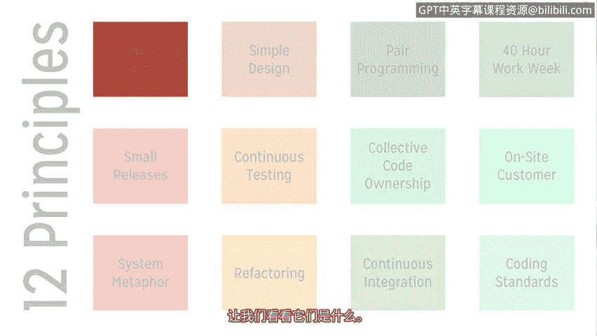
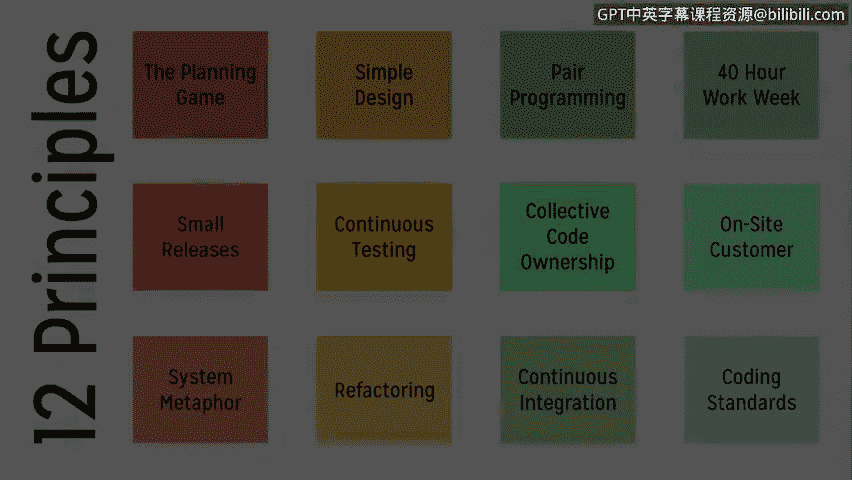
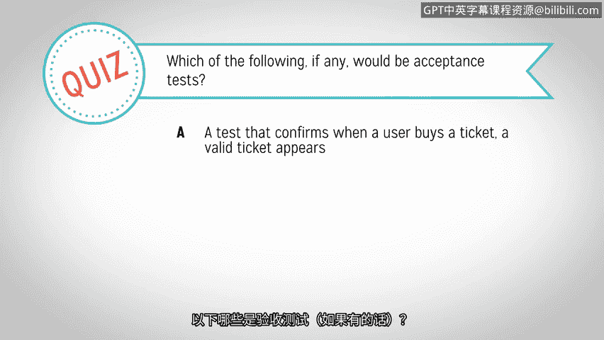
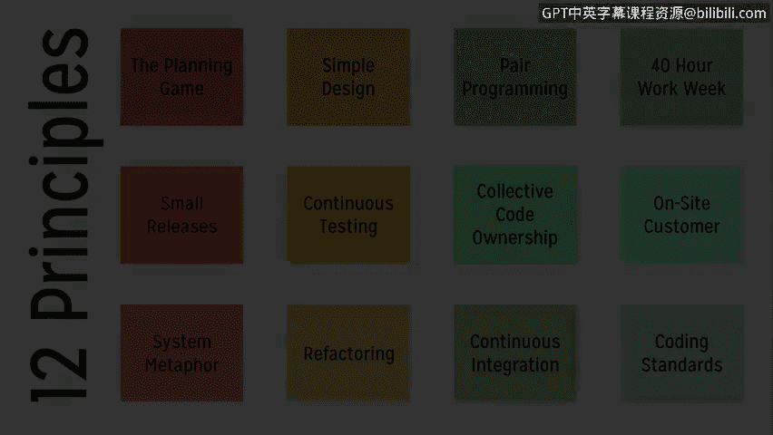
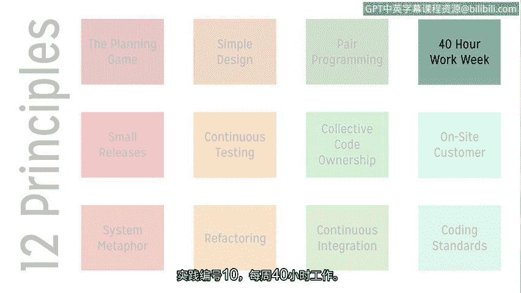

# 艾伯塔大学软件产品管理课程2：《软件流程与敏捷实践》｜software-processes-and-agile-practices｜ - P15：14_第2.3.2节 极限编程.zh - GPT中英字幕课程资源 - BV1Xz4y1G74t

🎼你嘟嘟嘟嘟嘟呼嘟。😊。

Here's where things get exciting。 I'm going to walk you through the practices of extreme programming。

Extreme programming is commonly referred to as X， P。

These are skills and practices that you are going to use time and again as a software product manager。

So why is it called extreme programming， It's not just a cool name。

 It's called extreme programming because it's all about taking good practices and practicing them to the extreme。

XP takes practices used by many other methodologies and takes them to an extreme level。

Extreme programming is all about client satisfaction。

This means it is the job of your development team to make your client as happy as possible。😊。

This seems simple enough。 But what if you get a grumpy client or a flaky client or a client who is not willing to listen and collaborate。

You need to be prepared to deal with all sorts of people。

The practices in extreme programming can help you do that。

Extreme programming also values constantly delivering software， responding to change。

 effective teamwork and self organization。 These are all principles that I covered in the agile manifesto。

There are five aspects of development that extreme programming focuses on improving。

They are communication， simplicity， feedback， respect， and courage。Communication。

 simplicity and feedback are all aspects that you and I have already covered in the manifesto。

But what do they mean when they want to improve respect and courage？

Making a great software product depends heavily on all the people involved in extreme programming。

 everyone is considered equal。 This means that the client。

 the software product manager and the development team are all on the same level。

It is the goal of XP that each individual is respected and valued for what they bring to the table。

This could be business experience， application domain expertise， knowledge of agile practices。

 development skills， or even enthusiasm。As for courage。

 I'm going to read you exactly what it says on the extremereme programming website because they word it beautifully。

It says， we will tell the truth about progress and estimates。

 we don't document excuses for failure because we plan to succeed。

 We don't fear anything because no one ever works alone。

 we will adapt to changes whenever they happen。Personally。

 that positive statement gets me really excited about development。

 It inspires such confidence in yourself and in your development team。

 And as a software product manager， that should be your goal。😊，If you want to read more。

 you can find the link to the extremetreme programming website in our course resources。

You are a software product manager for a small startup that is working on creating an application that matches parents with local babysitters and nannies。

You and your development team decided early on that you will adopt the extreme programming methodology。

Your development team is organized into pairs with each pair working in front of a single workstation。

This is a practice of extreme programming that we will talk about later。

Which of the five aspects of extreme programming do you think that this improves？A， communication， B。

 simplicity。C， feedback， D， respect， and or E， courage。

This practice called pair programming involves all aspects of development。

Pair programming encourages the two programmers to communicate and work collaboratively through problems。

 having two perspectives results in simpler and higher quality code。

You also get immediate feedback since you are working directly with someone。

It also encourages respect since you can use the complementary qualities and skills of the programmers to solve the problem。

Finally， it improves courage since a programmer does not work alone。

Programmers working together are more likely to take a calculated risk than they would alone。

Extreme programming is organized to a set of rules。 Over the years。

 extremet programming has implemented many of the management rules from Scrum。

Scrrum can now almost be seen as a subset of X P。Traditionally。

 XP was known as a set of code centric rules for development and did not focus much on management。

The XP rules have been described as a jigsaw puzzle。Individually。

 these pieces or rules don't make much sense， but when you put them together and see the big picture。

 it all works。Extreme programming is commonly defined by 12 basic principles。

 Let's look at what they are。Practice number one， the planning game。

This is where the client and the development team work together to plan the product This can happen on many different scales。

 for example， there will be a large planning session at the beginning of development。

 but smaller sessions can occur after each iteration。

The initial session determines how often to see a release of a working product。

Regardless of the scale， the rules are generally the same。Number one。

 the client and development team together come up with a list of new features for the product。

 Each of these features is expressed as a user story。

We will go over user stories in more detail in the course on software requirements and client needs。

 but basically a user story describes a feature from a user point of view。Number two。

 the development team creates estimates for how much effort they can allot in the next iteration and how much effort each user story will take to complete。

Number three， the client and development team then prioritizes the stories and decide when to release a working version of each feature。

Practice number two， small releases。With extreme programming。

 you want releases to be as small and as frequent as possible。

Your development team will plan with the client which features make good business sense and can be released early in the project。

You want to develop important features early so that you have more time to refine them。

The development team and the client need to find the right balance between what the client wants to complete and what can be developed early。

You want releases to be as small as possible so that it's easy to make estimations。

It's easier to look at a week or two ahead， rather than a month。Practice number three。

 system metaphor。This is to make your system easier to explain to others。

 You should be able to explain your product easily to a third party who has no technical experience。

Let's look at this example of a system metaphor。Let's imagine that I am your client。

 I come to you with an idea for a face recognition application that can tell you the name and information about a person。

Can you think of a good metaphor？A metaphor that I came up with is that the application is like a popular person at a party who knows everyone there and everything about them。

If I describe that metaphor to you before I explain the application。

 would you be able to determine what the app does， that's the mark of a good metaphor。

Erica is working as a software product manager for a development team that is creating a social media application。

Her team spends two months completely planning out every detail of the project。

 including the design and schedules。The duration of their iterations is in hours， not weeks。

Her team has depicted their system metaphor on a whiteboard in the office。

Which of their practices are considered extreme？A two month planning period。B， iteration。

 duration and hours。And or C system metaphor on a whiteboard。In extreme programming。

 planning should be simple， adaptive， and not a two month upfront orde。Therefore。

 a is not the correct answer。You want iterations to be as small as possible while still delivering a working product。

If the size of the iteration is so small that its duration happens in a matter of hours。

 then that's pretty extreme。Having a system metaphor is also an extreme programming practice；

 therefore B and C are the correct answers。Practice number four， simple design。

This means your designs are as simple as they can be。

Your requirements are going to be constantly changing。

 so there's no point in making detailed designs for something that's not going to stick。

 design what you need to make the requirements you're working on today。

Don't over engineer your design for future that may not come。Practice number five。

 continuous testing。In extreme programming， tests are written for a feature or requirement before the source code is written。

In general， the idea is to use these tests as executable forms of requirements。This way。

 you know when a test passes， the corresponding requirement is satisfied。

 This is referred to as test driven development。As you can see。

 extreme programming also calls for some extreme testing。Each requirement should have tests。

 and each test should correspond to some requirement。

Test should also be simple if a test was hard to write， it's assigned to rework the code。Also。

 automating the tests and having simple tests will allow testing to be done continuously。

There are two ways in which features or requirements are tested in XP。The first is acceptance tests。

 these are for the client to test that each feature of the overall product works as specified。

These tests cover large parts of the product， they can be automated or they can be a script of user interface actions that a human follows。

The second is unit tests。 These are automated tests written by developers to test lower level functionality。

For example， you're developing a social media application that allows users to create， edit。

 and delete posts。You're going to need tests to confirm that when a user creates a post。

 that it actually was created and posted。You also need tests to confirm that if the user deletes a post。

 that it's actually deleted。If a user edits a post。

 you need tests to make sure that those changes have been reflected。

There will be unit tests for every functionality of the application。Practice number six， refactoring。

Refactoring is all about restructuring the design of the code without changing the behavior of the code。

It improves the design so that new features can be added easily。

Refactoring then encourages responding to new changes。For example。

 refactoring involves removing duplicate and unnecessary code。

Because your developers created the unit tests， they can confidently remove the code without breaking the product。

If the tests still pass after a deletion， it was unnecessary code。

This refraing is considered extreme if the coat is the simplest thing that could possibly work。

You are a software product manager working with the development team who is producing an app for a cinema that allows users to check showtime and buy tickets。

Which of the following， if any， would be acceptance tests？A。

 a test that confirms when a user buys a ticket， a valid ticket appears。

B， a test that confirms when a user creates an account， their information is added to the database。C。

 a test that confirms when the user logs in， that their login information matches an account in the database。

 and or D， a test that confirms when a user selects a Showtime， moviesvie plane at that time appear。

Acceptance tests assess large portions of user functionality and not low level functionalities。

Testing that a ticket appears after a purchase and testing that show times appear when a time is selected are both testing user functionality。

Therefore， the correct answers are A and D。Answers B and C are both examples of unit tests。

Practice number seven， pair programming。You were introduced to pair programming in one of the previous quizzes。

this is one of the rules that x p is well known for。

This means that two developers work side by side at one computer to develop code。

This takes code review to the extreme。Instead of periodically reviewing code。

 code is reviewed all the time by the other person in the pair。

You might be thinking that this requires doubling the human resources needed for the feature。

But it actually is the case that two programmers working together can produce more than two programmers working separately and independently。

And it's at a higher quality。Like I said before， this also goes back to fostering courage。

Programmers are more likely to take some calculated risks because they're not doing it alone。

This leads to innovation and high quality products。Practice number eight， Collect code ownership。

This practice suggests that you should encourage the entire development team to contribute new ideas to any part of the product。

This means that anyone can add code to any part of the product。When things go wrong。

 it is the result of the team， not individuals， Similarlyly， when things are success。

 it is the team's success。Practice number nine， continuous integration。

Continuous integration requires that your developers combine the code often。

This could happen at least once daily， but to be considered extreme。

 it could happen a lot more frequently。All tests should pass 100% before and after the integration。

Practice number 10， 40 hour work week， It could seem obvious to be respectful of a developer's work life balance。

 but if you get a team of passionate developers， it may be hard to pull them away from the keyboard。

In crunch time， XPL is up to one week of overtime。If multiple weeks of overtime occur。

 that's a red flag that something is wrong with the management of the project。

Practice number11 on site customer。This practice invites the client to be part of the development team。

They are always around to clarify and answer questions about anything that might come up。

They are involved in every stage of development。Practice number 12 is coding standards。

This means that all developers code to the same standards。

 you shouldn't be able to look at code and tell who wrote it。 Instead。

 you should encourage your development team to follow common coding conventions and format their code the same way。

This standard should be agreed upon at the beginning of development。

This not only makes it easier to read， but it also encourages collective ownership。

