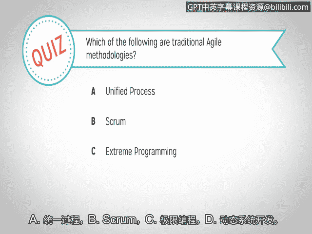
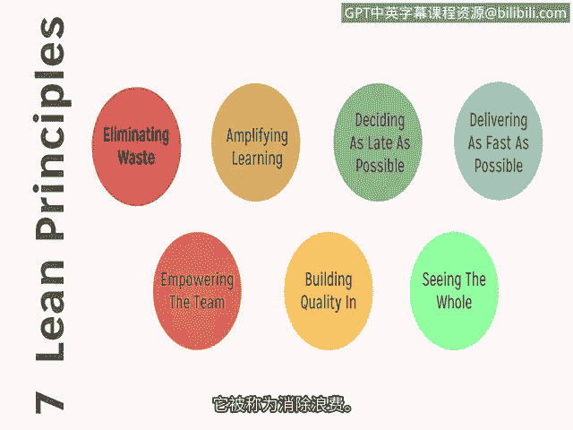
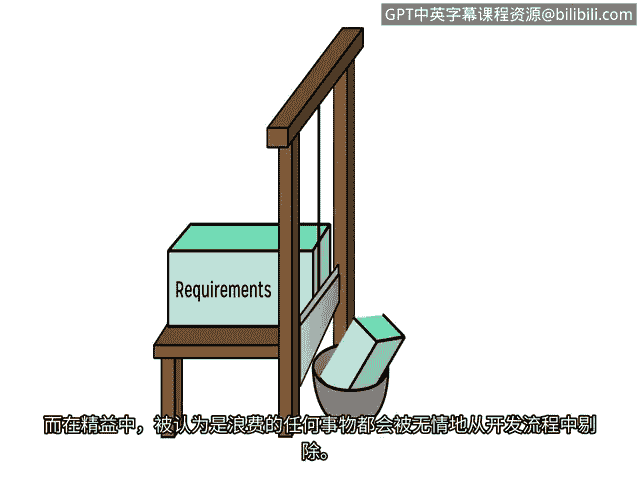
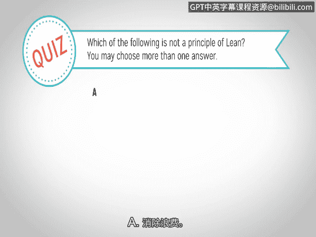

# 艾伯塔大学软件产品管理课程2：《软件流程与敏捷实践》｜software-processes-and-agile-practices｜ - P18：17_第2.4.1节 敏捷变体和精益软件开发.zh - GPT中英字幕课程资源 - BV1Xz4y1G74t

Welcome to the fourth module on softwareft processessses and Agile Praes。In the last module。

 Morgan talked about some of the most popular agile practices， like extreme programming and Scrum。

These are incredibly common practices and have largely taken the product management realm by storm。

In fact， according to a survey conducted by version 1 in 2015。

 Scrum and extremet programming make up more than 66% of the software development methodologies used today。

In this module， I'm going to tell you a little bit about some of the practices which are also considered agile。

This module is going to show you some alternatives to the most common practices so that you can make an informed decision for yourself about which would work best for you。

Keep in mind that throughout the specialization， you'll be expected to know the most about the agile methodology of scrum。

Since Scrum is so widely used in the industry， it will be our focus here， however。

 that's not to say that Scrum is the only or even the best way of managing software。In this lesson。

 I'm going to talk broadly about some of the variations on Agile practices。

Then I'll focus in on a set of practices which is becoming more and more popular in the softwareer development world。

Lean software development。Agile is always changing and evolving。

There is always something new being created， some variation。

 which approves upon the stumbling points of the last。While scrum may be widespread right now。

 you may very well see some other variation of agile practices become popular in the coming years or in particular domains。

 only time will tell。So let's talk about some other practices which have evolved out of Agile。

One variation is called Agile Unified process or Agile up。Just like the name suggests。

 Agile Up combines unified process， which I covered in the second module and Agile practices。

Like the unified process， Agile Up makes use of some parallel development phases to get things done。

However， it also integrates the philosophies of Agile in order to increase developer morale and improve upon collaboration on projects。

It focuses on following a process over specific tools。It focuses on simplicity， empowering people。

 and the customization of the methodology to suit each project's needs。

It also applies agile techniques like test driven development。And small incremental releases。

To improve upon the basic unified process。If you want to learn more about Agile Up。

 check out the references I' included in the course Re。Of course， there's more。

Dynamic systems development method is one。Featureture driven development is another。

Then there's scrum ban and behavior driven development。Really。

 the point is that there are a lot of variations on Agile。If you run into a problem in your process。

 Agile allows you to make the variations you need in order to adapt a process， methodology。

 or set of practices to your needs。Perhaps you need to be more rigorous about your software product architecture or your testing。

If you find that you aren't getting the results you want。After you try out one methodology。

 see if some of these variations， which I just mentioned， will work better for you。

There is one other agile development methodology， which has gained a great deal of traction lately。

 I expect that its practices will only gain in popularity in the coming years。😊。

That methodology is lean software development。You have chosen to start building a product from scratch and are looking at all the options when it comes to how you will manage the project。

You're thinking about using agile practices。Which at the following。

 are traditional agile methodologies。A unified process。B， scrum。C， extreme programming。

Or D， dynamic systems development。B， C， and D are the correct answer。

While unified has been combined with Agile to create Agile up。

 that doesn't mean that unified then becomes an agile methodology。

Lean's software development has its origins in the manufacturing industry。

The concept of lean thinking was proposed in the mid90s as a way of reducing risk within projects。

This is done by reducing waste， starting new work only when necessary， reducing process bottlenecks。

 and working only on the things that will add value to the project。

This approach was adopted by Toyota， and the term leanan manufacturing has been synonymous with their manufacturing process ever since。

At Toyota， the lean approach was predominantly used to reduce waste in the production process and increase the quality of their vehicles。

In 2003， Mary and Tom Poppinick wrote a book dedicated to adapting lean manufacturing principles to software development。

This book is widely considered responsible for the popularization of lean software development。

So what is lean？Lean is a mindset。It's a set of core principles to reduce your project's risks and deliver a high quality product to your clients quickly。

Lean software development consists of seven principles。Those principles are eliminating waste。

Amplifying learning。Deciding as late as possible。Delivering as fast as possible。Empowering the team。

Building quality in and seeing the whole。So let's address each one of these principles one by one。

The first lean principle is the one which gets the most attention。 It's called eliminating waste。

It can sometimes be hard to see how software development can be wasteful。In leanan。

 anything that doesn't add value is considered waste。😡，And in lean。

 anything that is considered waste is ruthlessly removed from the development process。

To understand what ways can be present in software。

 let's consider a parallel in manufacturing to state at true to Lian's origins。

Say you're a manager at a factory which manufactures cars。

Each part of the factory is specialized to create every component of the car from the tires to the radio。

Now， since each part of the vehicle is assembled separately。

 each component takes a certain amount of time to build。

Let's imagine the body of the car takes five days to build。

 and a set of wheels takes one quarter of a day。So in essence。

 in the time it takes to create one full car body， you can make 20 sets of wheels。

The typical mindset in software development is that in order to maximize your team's productivity。

 all of your developers should be working on something at any given time。 This makes sense， right？

 I mean， if some of your developers spent their time watching cat videos online。

 doesn't that seem like a waste。😊，But is this the sort of waste which lean software development aims to eliminate？

Imagine if this philosophy was applied to the manufacturing plant。

Imagine car bodies and wheels both being produced at their full capacity at all times。

It takes five days to create a car body and a quarter of a day to create a set of wheels。

If everything ran at full capacity in just over two weeks。

 you would end up with 60 sets of wheels and only three car bodies。

What do you do with 57 extra sets of wheels？Likely。

 they'll end up stored somewhere on the factory floor， waiting to be used。

Storing these wheels would take up space， which could be used for other more important things。

Not only that， storage space is expensive， and what happens when the car for which they are manufactured becomes obsolete。

Every year a new design is introduced and the car body changes。

If the designers couldn't work their design around the old wheels。

 all of those wheels would have to be thrown out。 Talk about wasteful。

That's the first principle of lean software development， eliminating waste。

Which of the following is not a principle of lean。 You may choose more than one answer。

A eliminating waste。

B， delivering as late as possible。C， deciding as early as possible， and or D。

 deciding as late as possible。The correct answers are B and C。

Lean focuses on delivering as fast as possible and deciding as late as possible。You'll see why soon。

 just don't mix these two up。It would be naive to think that the situation doesn't also apply to software development。

Instead of car parts， your production is based on code， instead of machines that create them。

 your machines are your software developers。If every developer on your team was busy all the time。

 you might find that they become ineffective。Instead of developing core features。

 by having your development team constantly coding new software。

 you could find yourself with a lot of extra features。

These could either bog down the quality of the end product。

Cause issues of the main product or end up not being incorporated into the product at all。

This is a key example of how software production can be wasteful。

It might be easy to think that keeping some of your development team idle on the product would be wasteful。

But by forcing them to be constantly on， you also force them to create unnecessary work。

That's just one of the ways in which software development can be wasteful。

Some other ways are through process delays。Unnecessary meetings。

Unclear requirements and product effectss amongst many others。

