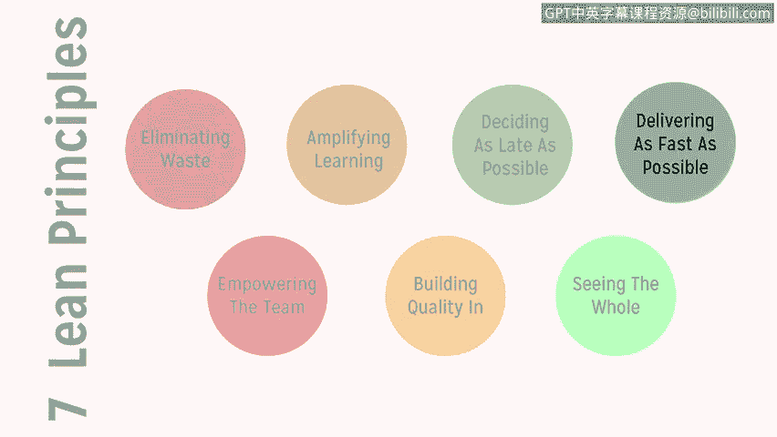

# 艾伯塔大学软件产品管理课程2：《软件流程与敏捷实践》｜software-processes-and-agile-practices｜ - P19：18_第2.4.1a节 敏捷变体和精益软件开发.zh - GPT中英字幕课程资源 - BV1Xz4y1G74t

The second principle of leanan software development is the principle of amplifying learning。

This principle is pretty simple。Don't focus too deeply on one idea before you fully explored another。

Explore ideas thoroughly by thinking through alternatives before proceeding with actions。

Here's what this would look like in a real world scenario。

Your development team creates a very basic list of user requirements to quickly get things off the ground。

They can then very briefly plan out one possible approach for this product and begin to develop that basic functionality。

This is pretty common across most processes， of course。In order to amplify learning， though。

 a good practice is to stop at this stage， don't do any more work on this version。😡，Ask yourself。

 could this be done another way？If so， your development team briefly plans and develops these alternative approaches as well。

As a consequence of allowing your product's feature set to be adjusted like this。

 your product is given its best chance at meeting your clients' needs in the most satisfying way。😊。

But this isn't the only way to amplify learning in a software product。

Lean Soft development encourages running integration and unit tests after each build of the product。

The rationale here is not just to ensure that your code is well written。

Testing can also be a great way of learning how your product should function。

Test can bring key insights to your team， which can be used to inform other versions of the product and future planning。

In lean software development， this happens in very short iterations。

The idea here is to fail and learn quickly。Also， if you spend too much time on one design or one feature。

 you may very easily find yourself too invested in one design to really see its flaws and consider other better approaches。

Another way in which leanan software teams are encouraged to amplify learning。

Is to involve clients throughout the development process in a special way。

Not only should development teams create different versions of their product before focusing in on one version。

These versions should be constantly presented to the client。

This allows the development team to learn through trial and error what the client really needs。

It also allows the client to learn how they want their product to address their specific problem。

Over the course of development， these needs should be refined so that things stay feasible。

This is like natural selection in that many potential approaches are presented to the client。

This allows them to decide on what features they want to see built into the product。

Which then brings focus and refinement to the final product。

So by involving the client in trying different approaches。

 your development team learns how best to tackle their specific problem。

This leads to better software and happier clients。Then if your development team had just chugged straight along with no consideration for alternative designs。

So the point of amplifying learning is to make sure that your team builds the right product through developing alternatives。

 continuous feedback and refinement。Audrey is building a software product with her development team using the leanan software development practices。

She's asked her development team to only focus on one aspect of the project at a time while creating different alternatives for their client。

By asking her team to focus on one aspect of the project at a time。

 Audrey is implementing which principle of leanan。A develop small incremental releases。B。

 amplifying learning。C， focusing on frequent delivery。Or D eliminating waste。The answer is D。

 eliminating waste。Amlifying learning is what Audrey is doing by having her team build different alternatives。

Developing small incremental releases and focusing on frequent delivery are principles of agile。

 not lean， although lean projects could certainly make use of them。

The third principle of leanan software development is deciding as late as possible。Now。

 this may seem like an excuse to delay the product for more development time。 I assure you。

 it's quite the opposite。This principle actually flows well from amplifying learning。

Imagine a software team that builds a basic piece of software for the client。

The client then sees this prototype and says， yep， that's exactly what I need。Build that。

It's pretty clear that continuing along the lines set out by this initial prototype would lead to satisfyatiing the client。

 right？Well， before you decide， consider this。The development team being a lean software development team。

 explores different approaches in order to amplify learning。

They know that the client finds their prototype sufficient for their needs。

So the team asked the client what characteristics about this prototype are appealing？

Given this information， the team goes on to build alternative versions of the product。

Integrating what the client likes about the prototype。

After a few more versions of the product have been completed。

 the client looks everything over and the sizes that the original prototype is just not going to cut in anymore。

It has specific features which would be great for the end product。

 but an alternative version is going to work better for their needs。

So the development team returns to their desks and uses this feedback to integrate features from the original prototype into the new one。

Now the team has a more refined version of the product than they did originally。

The client looks it over and becomes happier than they ever were before。

 This one seems to really hit the nail on the head。And development continues along。

 having learned the lessons they needed to get the right product。

What would have happened if the development team took the client's original decision to build the first prototype as final？

Instead of developing alternatives that better met the client's needs。

The development team could have built a poor product。Not only that。

 they wouldn't have even known that they were building a poor product。

This is the core idea behind deciding as late as possible。

It's not about delaying anything or buying time。 It's about making decisions when the data and information you need is available。

For example， you work hard to ensure that there are many alternatives。

Decisions made before you have enough information are bound to result in poor outcomes。

Deciding as late as possible ensures you have the information you need first。

The fourth lean software development principle is deliver as fast as possible。

Remember how I said that deciding as late as possible is quite the opposite of delaying development。

This principle really solidifies that idea。Actually。

 this principle of delivering as fast as possible is intricately related to deciding as late as possible。

Here's what I mean。When deciding as late as possible。

 the development team presented a lot of different approaches to the client。

This allowed the development team to get the necessary client feedback in order to focus in on what the client needs。

However。What would have happened if the development team took three months to develop each potential prototype？

Imagine he had four alternatives， each taking three months。

That's a whole year before any final product of decision is made。

Who wants to wait a whole year before making a final decision？

That's why leanan software development operates in short， rapid iterations。Field a basic product。

Make sure it works。And get it out the door and then worry about the next steps。No filler。

No unnecessary work， no waste。By operating in short bursts。

 your product not only involves at a rapid rate， but it also allows for the client to give feedback at frequent intervals throughout the process。

What happens when the client changes their mind about a feature？

If it took three months to build a prototype with that feature in it。

Then that feature would have been incorrect for that whole time。

And who knows what else may have depended on it。However， if development happened in rapid iterations。

That issue would have been caught and corrected early。

This minimizes waste and increases the amount of quality built into your product quickly。

 So by building the product quickly， your software is allowed to grow at a fast pace。😊。

But it also ensures you're doing so efficiently by working on parts of the product that will make it to the end。

