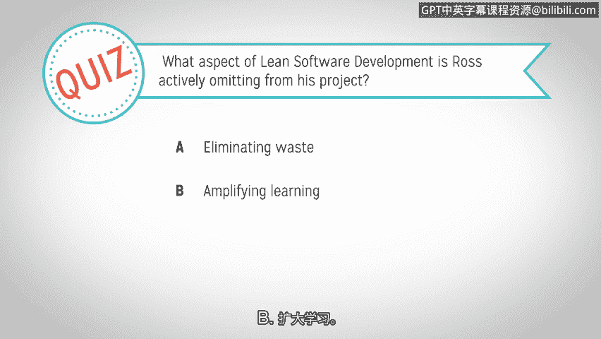

# 艾伯塔大学软件产品管理课程2：《软件流程与敏捷实践》：2.4.1b：敏捷变体与精益软件开发

在本节中，我们将学习精益软件开发的三个核心原则：**赋能团队**、**内建质量**和**整体看待**。我们将探讨这些原则如何帮助团队更高效地工作，并交付更高质量的软件产品。

---

## 赋能团队

上一节我们介绍了精益开发中“尽可能延迟决策”的原则。本节中，我们来看看第五个原则：**赋能团队**。

这个概念的核心是信任你的开发团队。如果你相信团队具备完成任务所需的技能，那么就不应该花费时间去告诉他们具体该怎么做。作为软件产品经理，你的精力最好用在其他方面，例如理解客户需求、为开发者扫清障碍，然后放手让他们去工作。

这与传统管理方式可能截然不同。传统管理通常意味着管理者事无巨细地告诉团队要做什么以及如何去做。这恰恰反映了管理者对团队缺乏信任。而团队成员也能感受到这一点，日复一日的微观管理会让人精疲力竭。

因此，精益软件开发旨在**赋能**遵循其实践的团队。它鼓励管理者倾听开发者的意见，而不是指挥他们。你应该让开发者去构思满足客户需求的解决方案。你的目标是倾听他们的想法并提供建议。毕竟，他们应该是你的盟友。

信任你的开发团队，让他们以自己希望的方式工作，并做出正确的技术决策。这不仅确保了开发者使用对他们而言最高效的方法，也极大地提升了他们的士气。当开发团队感到自己拥有控制权，并且能在不被微观管理的情况下自由完成任务时，一切都会顺畅得多。这就是赋能团队背后的逻辑：一个快乐的开发团队，也是一个高效且多产的团队。

让我们测试一下你对这些原则的理解。在开发软件产品时，软件开发团队和客户应尽可能晚做决定的主要原因之一是什么？

以下是选项：
A. 这为他们争取了更多开发时间。
B. 这允许他们探索其他产品设计。
C. 客户从来不知道他们想要什么。
D. 这允许团队快速构建可工作的软件。

**正确答案是 B**。尽可能晚做决定，可以让你的开发者和客户探索其他可能更好的产品设计。这并不会延长产品截止日期或让事情进展更快，也绝不意味着你的客户不知道他们想要什么。请记住，即使你通过延迟决策为客户提供了最佳选择，也不意味着你可以不按时交付。

---

## 内建质量

理解了赋能团队的重要性后，我们接下来探讨精益软件开发的第六个原则：**内建质量**。

这是一个广泛而全面的原则，其真正目的是确保你的开发团队使用可用的最佳实践来避免错误。那么，这具体如何体现呢？

一种方法是**测试驱动开发**。这意味着在实际需要代码之前就编写测试。与先构建产品再围绕现有代码编写测试不同，测试驱动开发要求你首先关注代码旨在解决的实际问题。本质上，先构建测试意味着你实际上是在测试你的代码是否解决了问题，而不仅仅是代码是否能运行。

另一种内建质量的方法借鉴自**极限编程**，即**结对编程**。这就像是你在构建时身边有一位智能向导。不过需要提醒的是，结对编程在开发者时间成本上非常高。因此，虽然它是开发优秀软件的绝佳工具，但不要依赖它来构建整个产品，否则你可能会违反“尽可能快交付”的原则。

还有其他方法可以将质量内建于产品中，例如：
*   **注释清晰的代码**
*   **良好的文档**
*   **重构代码以提高效率**
*   **自动化测试**

所有这些方法都服务于同一个目的：让你的产品变得更好。精益的核心价值观之一是尽可能消除浪费。通过减少开发者修复代码的时间，你就减少了项目中存在的浪费。通过内建质量，你可以大幅减少发布后的缺陷和修复数量，从而显著降低产品中的浪费。

---

## 整体看待

在学习了如何通过内建质量来减少浪费之后，我们来看本课程将涵盖的最后一个精益原则：**整体看待**。

“整体看待”意味着将你的软件视为不仅仅是许多小部件的简单拼凑。毕竟，最终用户看到的不仅仅是串联在一起的一些功能，他们应该看到一个具有凝聚力、各组件逻辑顺畅地融合在一起的产品。

因此，在精益软件开发中，在发布产品之前，将其视为一个整体来思考非常重要。这意味着你的开发者必须时刻意识到他们的工作如何融入大局。这个大局可能是整个产品，也可能是该产品如何与同一制造商的其他产品相配合。没有这种视角，产品可能会变得脱节、不合逻辑或仅仅是笨拙。

整体看待能让你的开发团队构建出一个具有凝聚力、设计精良的整体产品。

让我们通过一个案例来巩固理解。罗斯正在为医学研究构建一个软件产品。由于他的日常工作关乎生命，他不断尝试改进软件开发流程。他最近接触到了精益软件开发，并开始实施其中一些原则。他鼓励团队将项目视为更大目标的一部分，并让他们在最终确定前创建软件的多个不同版本，同时专注于快速构建。为了节省时间，他要求开发团队不要编写单元测试、编写代码文档或使用任何特定的编程实践。罗斯在他的项目中主动忽略了精益软件开发的哪个方面？

以下是选项：
A. 消除浪费。
B. 强化学习。
C. 尽可能延迟决策。
D. 内建质量。

**答案是 D，内建质量**。通过主动避免这些编程最佳实践，罗斯实际上选择了不内建质量。间接来看，这可能会产生浪费，但并非直接忽略“消除浪费”原则。

---

## 总结

本节课中，我们一起学习了精益软件开发的三个关键原则。我们探讨了**赋能团队**如何通过信任和授权来提升团队士气和效率；了解了**内建质量**如何通过最佳实践（如测试驱动开发和结对编程）来减少浪费并提升产品可靠性；最后，我们明白了**整体看待**产品的重要性，以确保交付给用户的是一个具有凝聚力、设计精良的整体解决方案。掌握这些原则，将帮助你更好地管理软件产品开发过程。