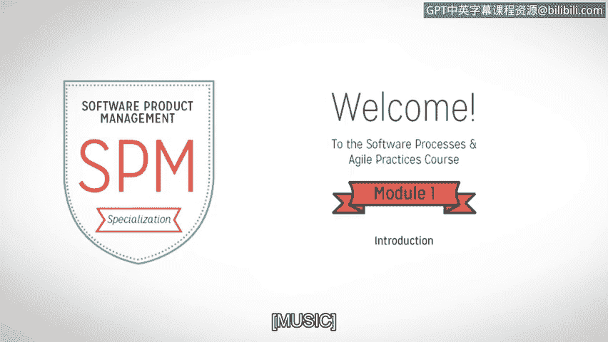

# 艾伯塔大学软件产品管理课程2：《软件流程与敏捷实践》｜software-processes-and-agile-practices｜ - P24：1_05_introduction-to-software-processes-and-agile-practices.en_subtitled - GPT中英字幕课程资源 - BV1Xz4y1G74t

🎼。😊。

🎼，Hi， I'm Ken Wang。Welcome to the Software Prosses and Agile Practices course within the Software Product Management specialization。

This course will provide fundamental elements to the specialization and will serve as one leg in the inoksh that depicts the structure of our specialization。

In this segment， I'll give you a preview of what you will learn。

While describing the general format and objectives for the course。

In the introductory course of this series， I said that Mkey better software involves three goals。

These goals are the right product， done right and managed right。

I also said that developing a great software product requires the coordinated work of many people。

 but what helps to connect your goals with your people。The solution is processes and practices。

In order to avoid project chaos， you need to introduce structure and discipline。In this course。

 you will learn how software projects are organized using processes。

You also learn about practices that can help you to achieve goals for better software。

There are four modules in this course。In the first module。

 Or Ptzel will explain what the software processes is， to describe how it breaks down into phases。

 activities and tasks that will help you to organize work。

If you're not familiar with software development， don't worry。

 she'll also describe key activities in making software。In the second module。

 Ra Pette will describe a series of software process models。

You'll cover these models as they fall from early linear ones to modern。

 iterative and parallel models。You'll also talk about different forms of software prototyping。

 which can help you to deliver a product using a cycle of more refined versions。

This module will help you to choose from different process models and prototyping strategies and to customize them for your project。

In the third module， Morgan returns to guide you through specific Agile practices which tend to work best with modern software processes。

 she cover two popular agile methodologies， extreme programming which is focused on development and Scrum。

 which is focused on management。In the fourth and final module。

 Brad will talk about the principles of leanan software development。

 which will complement the Agile principles。Lan will help you to reduce waste in your project and provide solutions to improve the overall quality of your product。

You also talk about Kband as a way to visualize the progress of your tasks。By the end of the course。

 you will gain a wide repertoire of processes and practices。

You'll be able to apply them to organize people in your next project and to make a better software product。

