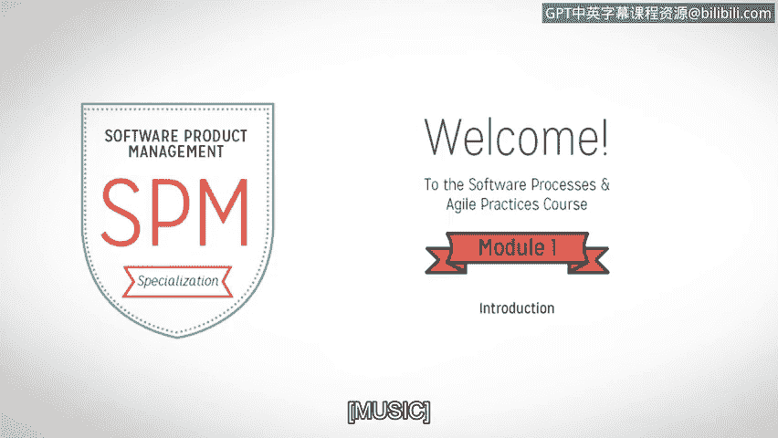

# 艾伯塔大学软件产品管理课程2：《软件流程与敏捷实践》：1_05：课程介绍与概述

在本节课中，我们将对《软件流程与敏捷实践》这门课程进行整体介绍，了解其核心目标、课程结构以及你将学习到的关键知识。

大家好，我是 Ken Wang。欢迎来到软件产品管理专项课程中的《软件流程与敏捷实践》课程。

这门课程将为整个专项课程提供基础要素，并作为描绘我们专项课程结构的知识支柱之一。

在本节概述中，我将为你预览你将学习的内容，同时描述本课程的基本形式和目标。

在本系列课程的导论课中，我曾提到，开发更好的软件涉及三个目标。这些目标是：**开发正确的产品**、**正确地开发产品**以及**正确地管理产品**。

我还提到，开发一款优秀的软件产品需要许多人的协同工作。那么，是什么帮助你将目标与人员连接起来呢？答案是**流程与实践**。

为了避免项目陷入混乱，你需要引入结构和规范。在本课程中，你将学习如何利用流程来组织软件项目。你还将学习有助于实现更好软件目标的实践方法。

本课程包含四个模块。

以下是第一模块的内容简介。

在第一个模块中，Or Ptzel 将解释什么是软件流程，并描述它如何分解为阶段、活动和任务，以帮助你组织工作。如果你不熟悉软件开发，也无需担心，她还将描述制作软件的关键活动。

上一节我们介绍了课程的第一个模块，接下来我们看看第二模块。

在第二个模块中，Ra Pette 将描述一系列软件流程模型。你将学习这些模型，涵盖从早期的线性模型到现代的迭代与并行模型。你们还将讨论不同形式的软件原型设计，这能帮助你通过更精细版本的循环来交付产品。本模块将帮助你从不同的流程模型和原型策略中进行选择，并为你的项目进行定制。

在了解了不同的流程模型后，第三模块将聚焦于具体的实践方法。

在第三个模块中，Morgan 将回归，引导你学习特定的敏捷实践，这些实践往往与现代软件流程配合得最好。她将介绍两种流行的敏捷方法论：专注于开发的**极限编程**，以及专注于管理的**Scrum**。

在学习了敏捷实践之后，最后一个模块将介绍与之互补的精益思想。

在第四个也是最后一个模块中，Brad 将讨论精益软件开发的原则，这将是对敏捷原则的补充。精益将帮助你减少项目中的浪费，并提供提高产品整体质量的解决方案。你们还将讨论**看板**，作为一种可视化任务进度的方法。

在本节课中，我们一起学习了《软件流程与敏捷实践》课程的整体框架。课程结束时，你将掌握丰富的流程与实践知识库。你将能够将它们应用到你的下一个项目中，以组织团队并开发出更好的软件产品。