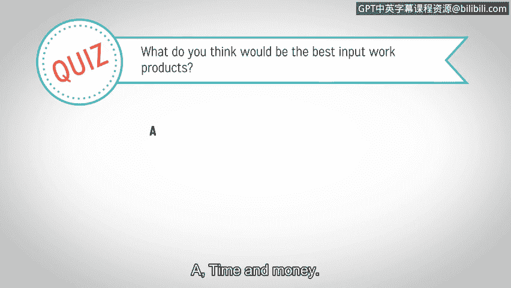

# 艾伯塔大学软件产品管理课程2：《软件流程与敏捷实践》｜software-processes-and-agile-practices｜ - P28：5_01_2-1-2-software-engineering-activities.en_subtitled - GPT中英字幕课程资源 - BV1Xz4y1G74t

🎼。😊。

In the previous lesson， I talked about processes and practices。

 I defined the term activities as a group of related tasks。😊，In this lesson。

 you and I will be looking at activities in more depth。Specifically。

 we will be examining activities of software engineering that occur during development。

Once you have an idea of all the activities that can be covered by a process。

 you will have a better understanding of where processes fit within software development and what they can be used for。

A software engineering activity is a group of related tasks in software development。

Each activity has input work products and output work products。

Think of an activity like a factory machine。 inputput work products go in and output work products are the result。

The input work products are the work products that are required in order to complete the activity。

The output work products are the work products that are generated during the activity。

An example of a software engineering activity is creating code for all the features。

The input work products would be the features designs and the requirements。

 the output work products would be the source code for the feature。

You know this activity is initially done when you've taken all the elements from the designs and implemented all the requirements for the features。

 and you have the source code for the features as an output。

Let's imagine writing an essay as a software engineering activity。

If the completed essay is the output work product， what do you think would be the best input work products？

A time and money。

B， an outline and notes previously generated on the topic。C， a computer in keyboard or D。

 a researcher and writer。Answer A is incorrect， since time and money are both resources。

Both will help you to write an essay， but they are not work products。Similarly。

 answer C is incorrect， since a computer and keyboard are also necessary resources。

 but are not work products。Although it would be really nice to have a researcher and a writer compose an essay for you。

 these are roles and not work products。 Therefore， D is also incorrect。😊。

Answer B is the correct answer， since an outline and notes generated on the topic are work products that were generated in an earlier task。

They will give you the information needed to write your essay。

The first software engineering phase you and I will look at is project management。

Project management activities are ongoing throughout development， and include。😊，Creating a process。

 setting standards， managing risks， performing estimations， allocating resources。

 making measurements and improving process。Choosing or creating a process is an important part of managing a project。

 so that's why it's here。Along with that， setting standards is needed to ensure work is done consistently by your team。

As a team， you need to decide on aspects of development like coding conventions。

 documentation levels， testing strategies， and the definition of done。

An example of done for a development team could be that the source code is written following the convention。

 it's documented for developers and end users， and it's tested。

The next activity you and I will look at is managing risks。

This is done by constantly analyzing and mitigating risks such as potential business， technical。

 managerial， scheduling and security risks。Some inputs for managing risks would include historical project records。

 project estimates， the software detailed design， and the lifecycle process。Essentially。

 any part of the project that could go wrong in some way would be an input work product for risk management。

The outputput work product for risk management would be a risk plan that would outline potential risks and their respective risk mitigation plans。

You will learn about risk management in more detail in the Agile planningning for Software Product course。

Risk management is definitely an activity that you should revisit often by constantly reviewing for risks。

 you will identify and mitigate new risks that might arise throughout the development process。Next。

 let's look at performing estimations。Estimation will be a vital activity for you in software development。

😊，Development timelines are based on estimates of how long it'll take to complete tasks。

When estimates are too far off， your schedule is compromised。

Tasks involved in the estimation activity would be collecting data for estimates。

 calculating estimates， and evaluating estimates。The input work products required for estimation would include a list of tasks that need to be completed。

You would also need to know how long it normally takes your developers to complete a task。

 We'll call this the task development rate。The output work product would be your estimates。

Your estimates will be used as an input work product for when you are generating schedules。

You will get more experience with estimation in the course on Agile planning for software products。

