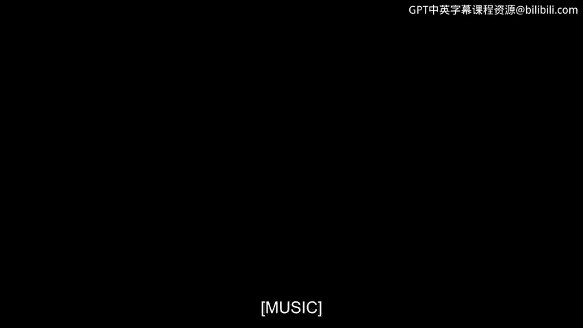
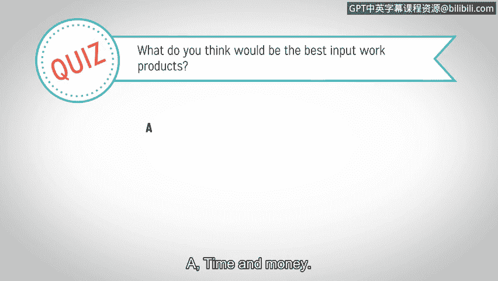

# 软件产品管理课程2：《软件流程与敏捷实践》：P28：5_01_2-1-2-软件工程活动

在本节课中，我们将深入学习软件工程活动。我们将详细探讨在软件开发过程中可能发生的各种活动。了解一个流程可以涵盖的所有活动后，您将对流程在软件开发中的定位及其用途有更清晰的认识。

上一节我们介绍了流程与实践，并将“活动”定义为一组相关的任务。本节中，我们来看看这些活动的具体内容。

## 什么是软件工程活动？

一个软件工程活动是软件开发中一组相关的任务。每个活动都有输入工作产品和输出工作产品。

可以将活动想象成一台工厂机器：输入工作产品进入，输出工作产品是结果。

*   **输入工作产品**：是完成该活动所必需的工作产品。
*   **输出工作产品**：是在该活动过程中生成的工作产品。

**示例**：一个软件工程活动是为所有功能编写代码。输入工作产品是功能设计和需求，输出工作产品是该功能的源代码。这个活动在您从设计中提取所有元素并实现功能的所有需求后完成，最终输出功能的源代码。

## 活动示例：撰写论文

让我们将撰写论文想象成一个软件工程活动。如果完成的论文是输出工作产品，您认为最佳的输入工作产品是什么？

A. 时间和金钱。
B. 关于该主题先前生成的大纲和笔记。
C. 电脑和键盘。
D. 研究员和作家。

**分析**：
*   答案A不正确，因为时间和金钱都是资源。它们有助于撰写论文，但不是工作产品。
*   答案C不正确，因为电脑和键盘也是必要的资源，但不是工作产品。
*   答案D不正确，因为研究员和作家是角色，而不是工作产品。
*   答案B是正确的，因为关于该主题生成的大纲和笔记是在早期任务中生成的工作产品。它们将为您提供撰写论文所需的信息。

## 项目管理活动

我们将要看的第一个软件工程阶段是项目管理。项目管理活动贯穿整个开发过程，包括以下内容：

以下是项目管理活动包含的具体任务：

1.  **创建流程**：选择或创建流程是管理项目的重要组成部分。
2.  **设定标准**：需要设定标准以确保团队工作的一致性。团队需要决定开发的各个方面，如编码规范、文档级别、测试策略以及“完成”的定义。例如，一个开发团队的“完成”定义可以是：源代码按照规范编写、为开发者和最终用户编写了文档、并且经过了测试。
3.  **管理风险**：通过不断分析和缓解风险来完成，例如潜在的业务、技术、管理、进度和安全风险。风险管理的输入可能包括历史项目记录、项目估算、软件详细设计和生命周期流程。本质上，项目中任何可能出错的部分都是风险管理的输入工作产品。风险管理的输出工作产品将是一个风险计划，概述潜在风险及其相应的缓解计划。您将在《软件产品敏捷规划》课程中更详细地学习风险管理。风险管理绝对是您应该经常重温的活动，通过不断审查风险，您将识别并缓解在整个开发过程中可能出现的新风险。
4.  **执行估算**：估算将是您在软件开发中的一项重要活动。开发时间表基于对完成任务所需时间的估算。当估算偏差过大时，您的进度就会受到影响。估算活动涉及的任务包括收集估算数据、计算估算和评估估算。估算所需的输入工作产品包括需要完成的任务列表。您还需要了解您的开发人员通常完成任务需要多长时间，我们称之为**任务开发速率**。输出工作产品将是您的估算结果。您的估算结果将在您生成进度表时作为输入工作产品使用。您将在《软件产品敏捷规划》课程中获得更多关于估算的经验。
5.  **分配资源**。
6.  **进行度量**。
7.  **改进流程**。

## 总结

本节课中，我们一起学习了软件工程活动的核心概念。我们明确了活动是一组具有输入和输出工作产品的相关任务，并通过撰写论文的例子加深了理解。随后，我们深入探讨了项目管理这一贯穿开发始终的关键阶段，详细了解了创建流程、设定标准、管理风险和执行估算等具体活动及其输入输出。理解这些活动是掌握软件开发流程的基础。