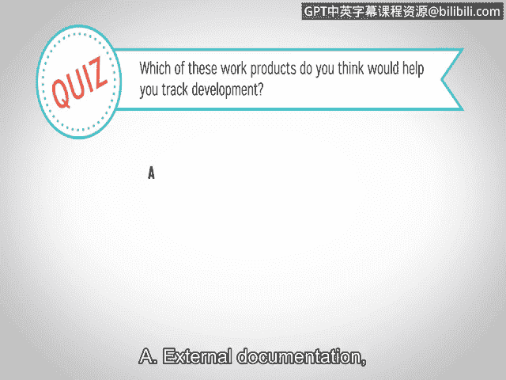

# 艾伯塔大学软件产品管理课程2：《软件流程与敏捷实践》｜software-processes-and-agile-practices｜ - P30：7_03_2-1-2b-software-engineering-activities.en_subtitled - GPT中英字幕课程资源 - BV1Xz4y1G74t

🎼。😊。

Now that your project has been specified， it's time to move on to the next phase。

 the design and implementation phase。These activities are more developers specific。

 so we won't go into too much detail。As a product manager。

 you are going to have to help to track and monitor the work that occurs in this phase。

The activities in the design and implementation phase include designing the architecture。

 designing the database， designing interfaces， creating executable code， integrating functionality。

 and documenting。This is where your development team shines， but before they can get to programming。

 you and your team needs to design and product。This includes designing the architecture。

 databases and interfaces。Then your programmers can start doing their thing and start creating an executable code。

Your team should be integrating or combining their code at regular intervals to ensure that their code is compatible。

The final activity is documenting。You may be thinking， hey。

 didn't the agile manifesto tell me that I don't need documentation。

The manifesto suggests that working software is valued over comprehensive documentation。 However。

 documentation is still a very important part of software development。

Good documentation helps new developers to join the team or work on parts of development that they are unfamiliar with。

This type of documentation is called internal documentation。

Your team may also need to develop documentation for the end user to use。

 such as instruction manuals or training materials。

This type of documentation is called external documentation。As a product manager。

 you're responsible for helping to track and monitor the development process。

Your team has just completed planning for this iteration。

 and they have started writing code for the product。Now that the planning is complete。

 you look around for something to do。You look on your desk and see an instruction manual for a feature created in the last iteration。

You look on the wall and see a list of metrics your team decided to use。

You look at your email and see an email from your boss outlining the resources your team has been allocated。

And you look on your bookshelf and see the latest version of the risk plan。

You decide it's time to start monitoring the progress of development for this iteration。

Which of these work products do you think would help you track development？A external documentation。

B， defined metrics， C， allocated resources or D risk plan。

External documentation is created to be used by an end user， not for tracking。

Allocated resources are used to advance and support development。

Risk plans are very useful once development has begun。 however， they are not used for tracking。

the metrics that your team decided to use are essential for tracking。

You must be recalculating and assessing these metrics to make sure your development is effective and your project is on track。

 Therefore， B is the correct answer。Now， let's look at activities from the next phase of development。

 the verification and validation phase。The verification and validation phase is where you assess whether your product does what it is intended to do。

 as well as assess whether it satisfies the needs of your client。Like the other phases。

 the verification and validation phase is one that is revisited often。

 not just at the end of production。You want to be constantly verifying and validating your product so that you know your development is on the right track。

The verification and validation activities are。Developing test procedures， creating tests。

 executing tests， reporting evaluation results， conducting reviews and audits。

 demonstrating to clients and conducting retrospectives。

Testing is a large part of the verification and validation phase；

 There are many testing activities including developing test procedures， creating tests。

 executing tests， and reporting evaluation results。

These activities help to verify that your product does what it is supposed to do。

To validate that your product meets the needs of the clients and the end users。

 you need to complete activities such as conducting reviews and audits and demonstrating to the client。

This is where you can get feedback to improve your product。

If the end user or the client disapproves of your product， it's probably going to fail。

Retrospectives are exercises done by your development team。

These retrospectives can reflect upon the product and or the development process。

Both the product and the process can always be improved。

 and retrospectives help to identify areas to do better next time。As you can see。

 there are many activities that go into developing software。

 It is important to remember that in agile development。

 you revisit these phases over and over again and that they're not always sequential。😊。

By ordering and determining when and how often you revisit these activities。

 you will have created a process。You can now use the activities that I just covered to create a process that works for your team。

You will be exposed to some established process models in the next module。

