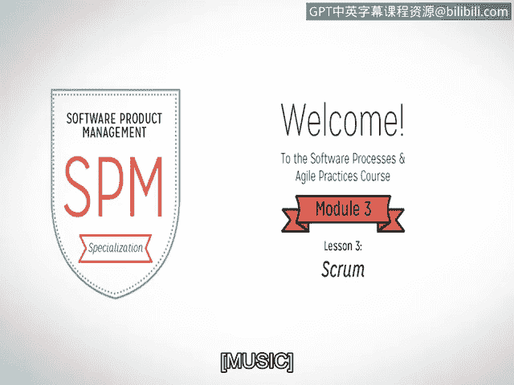
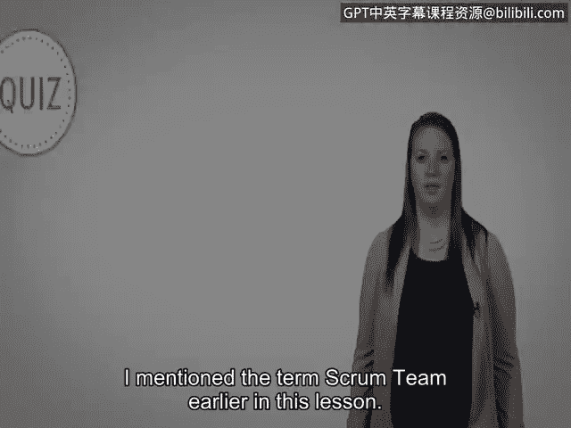
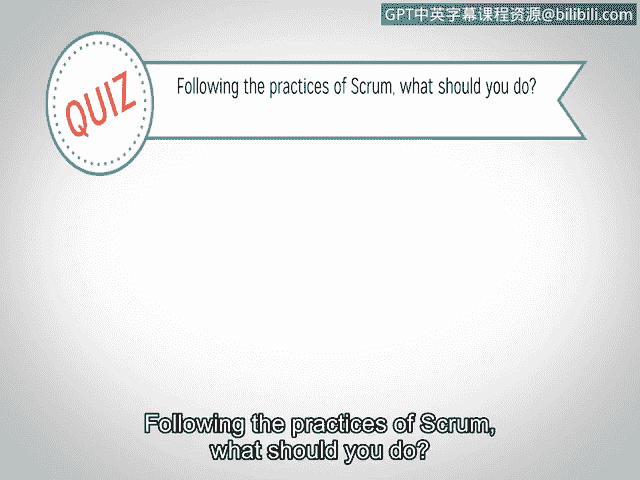
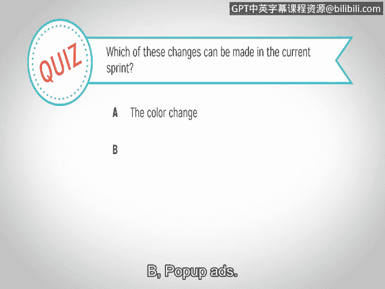
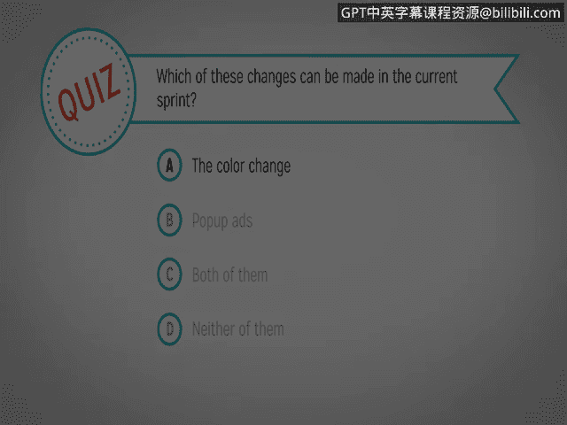

# 艾伯塔大学软件产品管理课程2：《软件流程与敏捷实践》｜software-processes-and-agile-practices｜ - P39：16_01_2-3-3-scrum.en_subtitled - GPT中英字幕课程资源 - BV1Xz4y1G74t

🎼你呼呼呼呼。😊，I've mentioned the agile practice of scrum a couple times throughout this specialization。

 It's come time for you to learn it。😊，In this lesson。

 you will get a basic understanding of the structure and practices of scrum。

You will be learning more of the specific scrum techniques throughout this specialization。

So what's all the hyper on scrum？Scrum is a lightweight practice that doesn't take too much time away from production and has relatively little overhead。

It's simple to understand， but very difficult to master。

Scrrum uses an approach that is both iterative and incremental。

You never go very long before assessing where you are with the product。

This enhances predictability and mitigates risk。Scrrum is based on three pillars， transparencypar。

 inspection and adaptation。First， let's look at transparency。

Transparency means that everyone can see every part of the project。

This visibility is accessible to both the people on the scrum team and those outside。

An important part of transparency is agreeing on common standards for the project。

This means agreeing on common terminology to use throughout development and agreeing on what it means for a feature to be done。

You and I will be talking about what done means later in this lesson。Next， let's look at inspection。

Scrrum encourages frequent inspection of work products and progress to detect undesirable deviations from expectations。

Ken Schwabber， a scrum trainer and author， says scrum is like your mother in law。

 It points out all your faults。And it's true。Develop are sometimes hesitant to adopt scrum because it points out everything they're not doing right。

These inspections should happen frequently， but not so frequent that they get in the way of development tasks。

Finally， let's look at adaptation。During an inspection。

 when someone finds that the product development is starting to stray from the vision。

 the team must adjust and adapt to prevent further deviation。

Scrrum outlines four specific techniques for inspection and adaptation。They are sprint planning。

 daily Scrum， Sprint review and Sprint retrospective。

You will learn these techniques in the courses on Agile planning and reviews and metrics。

I mentioned the term scrum team earlier in this lesson。

One role in the Scrum team is called a product owner。What is the primary task of the product owner？A。

 they purchased the product from a store。B， they pay for the product to be created。C。

 they are in charge of making decisions about the product， or D。

 they organize the development team to be more effective。

The product owner is a role in scrum that we will be examining in more detail。

Their primary task is to make decisions about the product and the product backlog。 Therefore。

 C is the correct answer。A scrum team consists of a product owner， the development team。

 and the Scrum master。You've just learned that the product owner is responsible for making decisions about the product and the product backlog。

They prioritize the requirements in the product backlog and decide what actually gets built。

You will learn about the product backlog in the clientient Nes and softwareftware Requiments course。

The product owner is one person and not a committee。The product owner could represent a committee。

 but only the product owner can implement changes to the product。

It is the responsibility of the product owner to provide the scrum team with a clearly defined product backlog and then prioritize that backlog。

The priorities that the product owner specifies must be respected and developed in that order。

They have the ultimate say on what gets developed。It is also the duty of the product owner to make sure that the development team understands what is expected for the features in the backlog。

You are the software product manager who has been hired to work on a running app for a major athletic apparel company。

In your first meeting with your development team and Penny， the representative from the company。

 the development team decided to use scrubrum。Penny was appointed as the product owner。

Your team is halfway into development， and you get an email from the CEO of the company。

He is requesting premade running playlists users can listen to when they run。

You know that your development team had already talked to Penny about this feature。

 and they decided as a team that they wouldn't implement this feature in favor of another one。

Following the practices of scrum， what should you do？

A， send him an email back saying no， you get no say in this project。B。

 tell your development team to add the feature to the backlog。C。

 tell your development team to develop the feature for this iteration or D。

 send them back an email asking for all feature requests to come through Penny。In Scrum。

 all decisions about the product must come from the product owner。

Does that mean that you reject the CEO of the company？ No， that's just bad business sense。

Your best bet is to send a polite email to the CEO with a copy to the product owner。

 asking that all feature requests come through the product owner。

The purpose of having the one point of contact is to reduce miscommunications。

Too much direction coming from multiple sources will lead to confusion for the development team and most likely wasted development time and resources。

You don't want to bring this to your development team until you've confirmed that this feature is what the product owner wants。

Therefore， D is the correct answer。

Let's look at some aspects of a Scrum development team。Scrrum development teams are self organizing。

This means that no one， not even the scrum master， can tell the team how to take their backlog of features and turn them into increments of working software。

Scrrum development teams are also cross functional。

This means that the team consists of everyone one and everything that they need to complete the product。

This can include involving specialists from different areas。

The team should not depend on anyone who is not part of the team。Also。

 team members take on a variety of tasks， like doing both coding and testing。

 rather than having dedicated coders and testers。So the members of the development teams have no titles。

They should only ever be referred to as developer or their name。

Regardless of whether they are responsible for a specific task。

There are also no sub teamss in a Scrum development team。

Developers may have a specialized skill within the team。 However。

 accountability belongs to the entire team。Scrrum development teams are small。Ideally。

 they are larger than 3 and less than 9。The Scrum master and product owner are not included in that number unless they are contributing to development。

A good rule of thumb is that you should be able to feed your entire team with two pizzas。

Pizzas are also great for team morale。You are at a conference on Scrum practices。😊。

You have been talking to several other software product managers about their development teams。

The first SPM you talked to is named Kelsey。She describes her team as having four programmers。

 two testers， and one user interface designer。Next， you meet Jim。

 he says his current team consists of 20 developers。Next， you meet Billy。

He simply says that he has a very talented team of seven developers。Then you run into an old friend。

 Carrie。She says her team has nine developers， five are on the development team and four are on the testing team。

Finally， you meet a new software product manager， H。

She says her team consists of just three developers and they subcontract out their testing。

Which of these software product managers， if any， have a true Scrum development team？A Kelsey。B Jim。

 C， Billy， D。 Carey， or E。 Hillary。These are all examples of development teams that you will commonly see。

 However， only Billy has a true scrum development team。There are no titles or sub teamss。

 and the team is cross functional and an appropriate size。Kelsey's team had titles。

 Jim's team was too large。 Carrie's team had sub teams。

 and Hillary's team is not cross functional because they subcontract out the testing。 Therefore。

 C is the only correct answer。Finally， let's talk about the role of the scrub master。

It's the Scrum master's duty to make sure that the Scrum team is adhering to scrum theory。

 practices and rules。They have specific duties to both the product owner and the development team。

The scrum master's responsibilities to the product owner include finding techniques to manage the backlog。

 helping the scrum team to understand the need for a clear and concise backlog。

Ensuring the product owner knows how to prioritize the backlog to get maximum value and facilitating Scrum events。

The Scrum master's duties to the development team include coaching the team to self organize。

 removing development roadblocks， and facilitating scrum events。

So what are these scrum events that the Scrum masters are responsible for facilitating？

These scrum events include those four techniques for inspection and adaptation。Sprint planning。

 daily Scrum， Sprint review and Sprint retrospective。Again。

 you will cover these events in more detail throughout the specialization。

All of these events are time boxed， meaning you need to specify a maximum time for the duration of these events and adhere to that。

The idea behind this is to maintain the allotted time and adjust the scope。

 rather than keeping the scope and eventually delaying releases。Another scrum event is a sprint。

A sprint is a development phase of a specific amount of time in which a working prototype is delivered to the client。

These sprints are also time boxed， but more strictly enforced。A sprint lasts one month or less。

 typically one or two weeks。Once your scrum team specifies the length of your sprints。

 they must consistently stay that length for the entire development。

Sprints cannot be made longer or shorter。At the end of each sprint。

 the client is delivered a working prototype。Each sprint contains the four scrum events I mentioned earlier。

Sprint planning occurs at the beginning of the current sprint to determine what will be completed in that sprint。

The Daily Scrum is a meeting that occurs。 you guessed it daily。

It normally takes place at the beginning of each day so that the developers can talk about what tasks they will be doing and what they need to accomplish these tasks。

The sprint review and retrospectives take place at the end of the sprint。During the sprint。

 no changes can be made that will affect the sprint goal。

The sprint goal is the big picture view of what is going to get done that sprint。

Suggestions that will change the sprint goal will go in the backlog and can be implemented in the next sprint if that's what the product owner decides。

Let's say your team is developing a mobile app that allows users to search for food and drink specials at local restaurants。

😊，The sprint goal for this iteration is to set up the user interface。

 This is everything that the end user will see and interact with。😊，Halfway through the sprint。

 the client sends you an email saying that they've changed their mind。

They want the main colors of the application to be blue and white instead of red and black。

This is a quick fix for the development team。The client also requests that they want the application to now support ads that pop up on the screen。

Which of these changes can be made in the current sprint。A， the color change， B， pop up ads。

C， both of them or D， neither of them。Changing the color of the application is a minor change that doesn't affect the s goal。

So that change could be implemented mid sprint。Adding pop up ads will take more development and does not fit with the sprint goal。

This should be added to the product backlog and revisited at a future sprint。 Therefore。

 a is the correct answer。

An important part of scrum is the definition of done。

The working prototype that is delivered at the end of a sprint must be done。

It is the responsibility of the development team to define the qualities that determine when a product is done。

Typically， a feature is considered done when the feature is coded， tested， and documented。

The team must completely agree on what done means。If you recall from the Agile Mano。

 progress should be tracked by done features。The purpose of this is to avoid having work in half done states。

This can result in the team working independently and looking busy without accomplishing anything usable。

To get a feature done requires communication， integration and synchronization。

This sometimes requires that the development proceeds slowly to ensure that each feature is truly done。

Like X P， proponents of Scrum recommend an all or nothing approach。However。

 scrum practices can be implemented individually as they stand alone better than some XP practices。

If you implement the practices individually， then you are not practicing scrum。

True scrum requires that it is practiced in its entirety。As I mentioned in the introductory course。

 Scrum is used by many major tech companies like Adobe， Amazon， Microsoft and Yahoo。

If you want to learn more about Scrum， you can go to scrumguides。org。

Check out the course resources for the latest link。Although scrum is a popular methodology。

 it still has some flaws， What do you think are some downfalls with scrum？

Talk about it in the course discussion。You will continue to examine more practices and methodologies in the next module。

