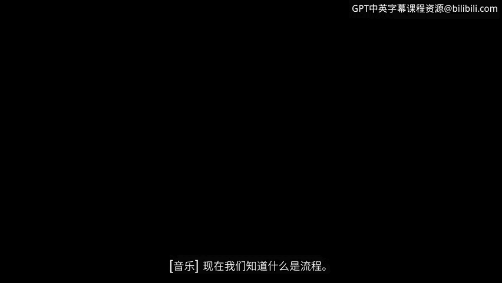
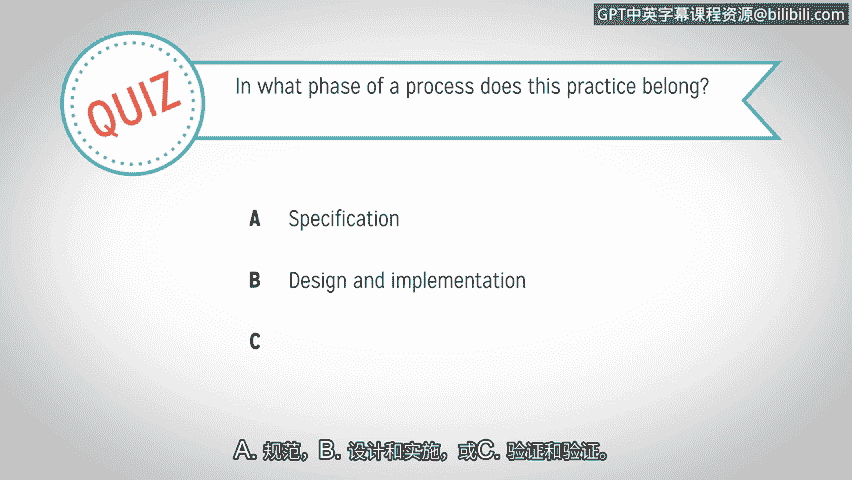

# 软件产品管理课程2：《软件流程与敏捷实践》：2.1.1b：流程与实践 🛠️

在本节中，我们将探讨如何更有效地运用软件流程，并介绍一系列被称为“实践”的具体战术。我们将了解实践如何为流程提供指导，以及它们如何帮助团队规划、沟通、跟踪进度并最终交付更好的软件。

---

上一节我们介绍了软件流程的基本概念，本节中我们来看看如何通过“实践”来让这些流程更顺畅地执行。

实践是软件产品经理用来确保流程顺利执行的战术。它们为开发的各个方面提供指导，例如如何安排和组织任务、防止资源浪费以及监控工作产品的开发。

本课程将涵盖多种实践。以下是几个实践的例子：
*   规划哪些功能应包含在版本发布中。
*   估算任务的持续时间。
*   召开简短的每日站会。

这些实践通常被集合成一套“方法论”。方法论是一组实践的集合。基于敏捷宣言的方法论被称为敏捷方法论，其中包含敏捷实践。Scrum 就是一个敏捷方法论的例子。

可以这样理解：敏捷宣言提供了一种哲学理念，而敏捷方法论则提供了具体的指导方针和规则。

无论你使用何种实践，它们的目的都是为项目所涉及的方方面面提供结构。这种结构可以帮助你有效地规划项目、按时交付、改善沟通、跟踪进度，并最终交付更好的软件。

例如，在**需求规格说明阶段**，有许多实践概述了如何从客户那里获取和表达需求。

在**设计与实现阶段**，你会看到许多指导设计和规划的实践。

还有更多的实践建议开发应如何进行。这些可能包括如何使你的项目更灵活地应对变更，以及如何跟踪开发进度。这些实践可以确定你的项目是否按计划进行。跟踪能让你尽早知道是否落后于时间表。这些实践还可以展示项目已完成多少以及剩余多少工作。这不仅为你的开发团队提供了信息，也使你的项目更加透明。你可以快速、轻松地向客户展示项目状态，并管理项目范围。

**验证与确认阶段**也概述了许多实践。许多方法论鼓励测试和反思。这确保了产品按预期方式工作，并且完全符合客户的意图。

---

现在，让我们通过一个例子来巩固理解。假设你和你的开发团队正努力在开发中实施一些敏捷实践。你选择采用的一个实践是：每两周向客户交付一个可工作的原型以获取反馈。

**请问这个实践属于流程的哪个阶段？**
A. 需求规格说明
B. 设计与实现
C. 验证与确认

每两周向客户提供一个可工作的产品，是确保团队交付的内容符合客户期望并令其满意的绝佳方式。这被称为**确认**。因此，正确答案是 **C. 验证与确认**。

---

深入到任务层面，有许多实践建议如何有效地安排任务。还有一些实践旨在建立开发过程中所涉及角色之间的有效工作关系。

大多数方法论鼓励并促进客户、产品经理和开发人员之间的开放沟通。开发人员之间的开放沟通可以实现高效的开发，因为期望明确，并且每个人都知道其他人在做什么。

采用良好的实践还将减少资源浪费。这种浪费可能是时间、材料或金钱。有效的规划和沟通可以防止工作被多人重复完成，也可以防止开发人员生产出可能不完全符合客户意图的功能。这有助于保持项目按计划进行，从而有助于控制预算。

流程和实践的一大优点是它们具有灵活性和可定制性。你可以借鉴各种流程和实践的方面，创造出满足你所有需求的东西。它们也可以随着时间的推移而改进和发展。

流程和实践有许多好处，它们是产品经理不可或缺的工具。通过学习许多不同的软件流程和实践，你将能够生成或选择一套适合你和你的团队的良好流程与实践组合。

---

**总结**

本节课中我们一起学习了：
*   我们将**流程**定义为将软件产品开发组织成不同阶段或步骤的方式。流程可以是**生命周期流程**（模拟软件产品的整个生命周期），也可以是生命周期流程内的**子流程**。
*   生命周期流程被组织成多个**阶段**，例如：需求规格说明、设计与实现、验证与确认。
*   每个阶段由相关的**活动**组成，活动是一组相关的**任务**，而任务则与**角色**、**工作产品**和**资源**相关联。
*   **敏捷实践**是可以在流程中应用的指导方针。它们已被证明能带来诸多益处，例如增强沟通、跟踪项目进度、管理风险以及减少浪费。

在本课中，我们简要讨论了流程中工作是如何组织的。接下来，我们将更详细地研究软件工程活动，以便你能更好地了解整个软件开发过程。