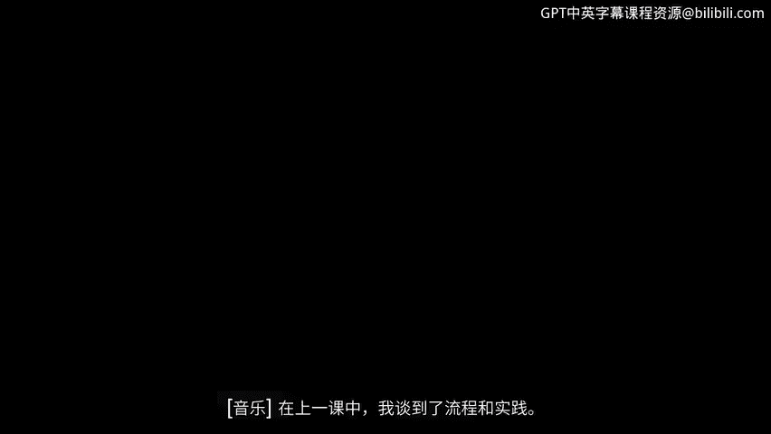
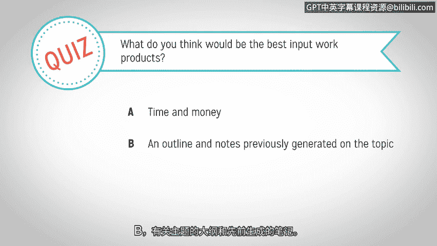

# 软件产品管理课程2：《软件流程与敏捷实践》：2.1.2：软件工程活动

## 概述

在本节课中，我们将深入学习软件工程活动。我们将了解什么是软件工程活动，并详细探讨在软件开发过程中可能发生的各类活动。理解这些活动将帮助你更好地把握流程在软件开发中的位置及其作用。

## 什么是软件工程活动？

上一节我们介绍了流程与实践，并定义了“活动”是一组相关任务的集合。本节中，我们来看看软件工程活动的具体内涵。

一个**软件工程活动**是软件开发中一组相关的任务。每个活动都有其输入工作产品和输出工作产品。你可以将活动想象成一个工厂机器：输入工作产品进入，输出工作产品作为结果产生。

*   **输入工作产品**是完成该活动所必需的工作产品。
*   **输出工作产品**是在活动过程中生成的工作产品。

**示例**：一个软件工程活动是为所有功能编写代码。输入工作产品是功能设计和需求，输出工作产品是该功能的源代码。这个活动在你从设计中提取所有元素、实现了功能的所有需求后完成，并输出功能的源代码。

## 活动示例分析

让我们通过一个例子来巩固理解。假设将“撰写一篇论文”视为一个软件工程活动。

如果完成的论文是输出工作产品，你认为最佳的输入工作产品是什么？
A. 时间和金钱。
B. 关于该主题先前生成的大纲和笔记。
C. 一台电脑和键盘。
D. 一名研究员和一名写手。

**分析**：
*   答案A不正确，因为时间和金钱都是资源。它们有助于你撰写论文，但不是工作产品。
*   答案C不正确，因为电脑和键盘也是必要的资源，但不是工作产品。
*   答案D也不正确，因为研究员和写手是角色，而非工作产品。
*   答案B是正确答案，因为关于该主题生成的大纲和笔记是在更早任务中产生的工作产品。它们为你撰写论文提供了所需的信息。

## 软件开发中的主要活动

现在，让我们逐一审视软件开发中的几个核心软件工程活动。

### 项目管理活动

项目管理活动贯穿整个开发周期。以下是项目管理包含的主要活动：

*   **创建流程**：选择或创建一个流程是管理项目的重要组成部分。
*   **设定标准**：为确保团队工作的一致性，需要设定标准。团队需要共同决定开发的各个方面，例如代码规范、文档级别、测试策略以及“完成”的定义。例如，一个开发团队的“完成”定义可能是：源代码按照规范编写、为开发者和最终用户编写了文档，并且经过了测试。
*   **管理风险**：通过持续分析和缓解风险来完成，包括潜在的业务、技术、管理、进度和安全风险。风险管理的输入工作产品可能包括历史项目记录、项目估算、软件详细设计和生命周期流程。本质上，项目中任何可能出问题的部分都可以作为风险管理的输入。风险管理的输出工作产品是一个**风险计划**，该计划会概述潜在风险及其相应的缓解策略。你将在《软件产品的敏捷规划》课程中更详细地学习风险管理。这是一个你应该经常回顾的活动，通过持续审查风险，你可以在整个开发过程中识别并缓解新出现的风险。
*   **执行估算**：估算在软件开发中对你来说是一项至关重要的活动。开发时间线基于对完成任务所需时间的估算。当估算偏差过大时，你的进度计划就会受到影响。估算活动涉及的任务包括收集估算数据、计算估算值和评估估算值。估算所需的输入工作产品包括需要完成的任务列表，以及你通常需要了解开发人员完成任务所需的时间（我们称之为**任务开发速率**）。输出工作产品就是你的估算结果。这些估算结果在你制定进度计划时会作为输入工作产品使用。你将在《软件产品的敏捷规划》课程中获得更多关于估算的经验。
*   **分配资源**：为任务分配合适的人员、设备和预算。
*   **进行度量**：收集数据以评估项目进度和流程有效性。
*   **改进流程**：基于度量和反馈，持续优化开发流程。

### 其他工程活动（简要提及）

除了项目管理，软件开发还涉及其他关键工程活动，例如需求分析、设计、实现（编码）、测试和维护等。每个活动都有其特定的输入和输出，共同构成了完整的软件开发生命周期。

## 总结

本节课中，我们一起学习了软件工程活动的核心概念。我们明确了活动是一组具有明确输入和输出工作产品的相关任务。我们重点探讨了项目管理中的关键活动，包括创建流程、设定标准、管理风险和执行估算。理解这些活动是理解如何构建和应用软件流程的基础。在接下来的课程中，我们将继续探索如何将这些活动组织成有效的开发流程。