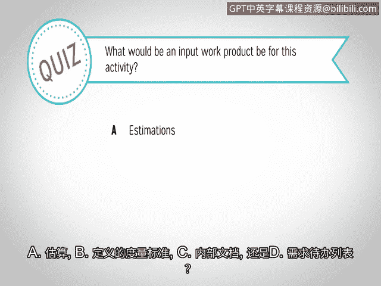

# 软件产品管理课程2：《软件流程与敏捷实践》：2.1.2a：软件工程活动

在本节中，我们将学习软件工程中的核心活动，特别是项目管理与需求规范阶段的关键任务。我们将了解如何分配资源、进行度量、改进流程，并深入探讨需求规范阶段的具体活动。

## 项目管理活动

上一节我们介绍了软件工程的基本框架，本节中我们来看看项目管理所包含的具体活动。项目管理是确保项目按计划进行的关键。

### 分配资源

分配资源是项目管理的重要活动。资源是指任何能够推进、促进或资助项目的事物，例如时间、资金或设备。分配资源活动包括规划和安排人力资源，这意味着需要分解工作计划并分配任务。

### 进行度量

进行度量是另一个重要的项目管理活动，它涉及定义、计算和分析度量数据等任务。度量用于跟踪和评估产品和/或流程。这些度量可以衡量产品中的缺陷密度、团队完成任务的速度、已完成的功能数量等等。你将在关于软件改进的评审和度量的课程中了解更多关于度量的知识。

### 改进流程

认识到这一点很重要：就像产品一样，流程本身也可以进行改进。对你而言，测试和评审流程与你的开发团队测试和评审产品同样重要。你可以在这里应用一些度量数据的结果，以便在下一次计算时，你的流程能获得更好的评分。

## 案例分析：凯文的项目管理

凯文是一个开发团队的软件产品经理，该团队正在为本地外卖餐厅开发一个订餐应用。他因流感在家休息了一周。当他返回时，他想知道在他离开期间完成了哪些项目管理活动。

他环顾办公室，看到了一份待完成的任务日程表，以及一份标有昨天日期的风险计划。然后他登录电脑，看到新的任务开发速率已被录入，并且进度跟踪图表是最新的。

凯文需要完成以下哪项活动？
A. 分配资源。
B. 管理风险。
C. 进行估算。
D. 进行度量。

**解析**：当所有输入工作产品被消耗且所有输出工作产品被生产出来时，一项活动才算完成。迭代日程、风险计划和进度跟踪图表都是项目管理活动的输出工作产品。任务时间估算是进行估算活动的输入工作产品。由于凯文只看到了更新的任务开发速率，而没有看到估算，因此该活动尚未使用其所有输入并产生所有输出。所以，正确答案是 **C**。

## 规范阶段

接下来，我们来谈谈规范阶段。这个阶段通常被视为初始阶段。产品需求在此阶段确定，但这并不意味着它只发生在开发初期。规范阶段会经常被重新审视，以更新和改进产品需求，为后续开发服务。规范阶段的活动在关于软件需求和客户需求的课程中有详细讲解。

规范阶段的活动包括：
*   识别想法或需求
*   获取需求
*   表达需求
*   确定需求优先级
*   分析需求
*   管理需求
*   制定潜在方案

现在让我们更仔细地看看其中的一些活动。

### 识别想法或需求

识别想法或需求是软件开发中一项非常重要的活动。没有想法，就没有产品可开发。花时间认真思考产品将有助于创造出优秀的软件。

### 需求相关活动

一旦有了想法，下一步就是处理需求。需求活动有五项：获取需求、表达需求、确定需求优先级、分析需求和管理需求。你将在软件需求和客户需求的课程中更详细地重温这些需求活动。

### 制定潜在方案

一旦需求就位，你就可以准备制定潜在方案了。

## 案例分析：咖啡店应用

你是一家连锁咖啡店的产品经理。你的客户希望你的开发团队创建一个应用程序，允许最终用户通过该应用支付咖啡费用。你正在与你的开发团队一起进行制定潜在方案的活动。

以下哪项会是这项活动的输入工作产品？
A. 估算
B. 已定义的度量
C. 内部文档
D. 需求待办列表

**解析**：你将在开发过程的某个阶段使用所有这些工作产品。估算通常在创建日程时用作输入。已定义的度量在你计算和分析度量时用作输入工作产品。内部文档在开发可执行代码和测试时使用。你将使用需求待办列表来制定潜在方案，因为你需要确切知道你在开发什么。因此，正确答案是 **D**。

## 总结

本节课中我们一起学习了软件工程中的关键活动。我们探讨了项目管理的核心任务，包括分配资源、进行度量和改进流程。我们还深入了解了规范阶段，涵盖了从识别想法到制定潜在方案的一系列活动。理解这些活动是有效管理软件项目和确保产品成功的基础。