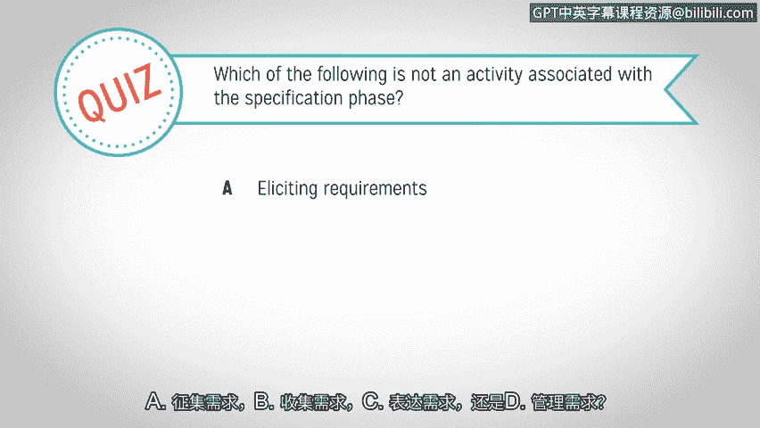

# 004：需求活动

## 概述
在本节课程中，我们将学习软件产品管理中的核心环节——需求活动。我们将了解如何区分客户的“想要”与“需要”，并掌握需求活动的五个主要步骤：**获取**、**表达**、**优先级排序**、**分析**和**管理**需求。

---

作为一名软件产品经理，你的工作是梳理清楚客户的“想要”和“需要”。

**想要** 是指客户希望在产品中看到的期望功能。
**需要** 是指为解决产品预期要解决的特定问题所必需的核心功能。

这些需要具有优先性，因为它们针对的是客户和用户的真实需求，而非仅仅是他们认为有价值的东西。这并非意味着客户的愿望无效或无法实现，而是说必须从技术角度对产品进行考量，以确保产品能够成功完成。

如果你只是简单地询问客户想要什么，你只会得到一份他们期望的功能列表，而无法将范围缩小到他们真正需要的东西上。这会迫使你陷入被动应对的境地。

为了变得主动，最好始终进行**需求获取**这项活动。通过深入参与产品的定义过程，你能够将需要从想要中区分出来。

以下是一个例子。想象我之前描述过的相同场景。

你第一次与客户坐在桌前定义产品。你可以这样开始对话：“很高兴能与您合作，我迫不及待地希望项目启动。让我们整体谈谈您希望在产品中看到什么，我和我的团队将尽力为您提供一些关于最佳创建方式的见解。”

就像之前一样，客户拿出了他们希望在产品中看到的功能列表。在对话结束时，你已确定他们一半的功能涉及某种用户界面设计，另一半则涉及最终用户将如何使用产品来解决问题。

你们一致同意，最好首先解决这些最终用户的需求，并构建一个满足这些需求的界面。如果最终结果与之前设计的界面相同，那很好。但不要在需求中将自己限制在特定的设计里。

你可以通过客户的界面设计洞察用户需求，并据此添加更多需求。你和客户在离开会议时，都清楚地知道在项目过程中可以期待什么。更重要的是，你知道对你和团队的期望是可管理的，因为你帮助定义了这些期望。

你的客户可能得不到他们设计的同一个用户界面，但他们仍然会感到惊喜。他们相信你知道自己在做什么，并且理解他们的最终用户需求。更重要的是，他们现在将你视为一个协作、积极的领导者，而不是一个只会听从指示的人，即使那些指示不会带来最佳结果。

然而，不要轻易丢弃客户提出的用户界面设计或其他潜在的“想要”。虽然某个特定界面对于满足客户需求可能不是必需的，但它们对于讨论和发掘之前可能未被注意到的其他需求仍然非常有用。

---

让我们测试一下你的知识。以下哪一项不属于**需求规格说明阶段**的相关活动？
A. 获取需求
B. 收集需求
C. 表达需求
D. 管理需求

正确答案是 **B. 收集需求**。请记住，**收集需求**与**获取需求**在软件产品经理与客户的互动方式上是不同的。**获取需求**是一项正确的活动，而非收集需求。

---

现在，你已经弄清楚了客户需要什么以及你需要创建什么，这很棒。那么，你如何以团队可以用来创建产品的方式来构建这些需求呢？这就是**需求表达**活动的意义所在。

如果说需求获取是从“想要”中梳理出“需要”的行为，那么需求表达就是将那些“需要”转化为某种可用形式的行为。

大多数时候，你的需求最初是与客户进行需求征集会议时在记事本上记录的一系列草稿。它们通常过于简化且没有经过深思熟虑，但这没关系。毕竟，你只是刚开始与客户一起定义事物。这是一个好的开始，但有更好的方式来表达客户的需求。

这些需求可以表现为**用例**、**用户故事**、**故事板**以及许多其他表现形式。它们可以是文本的或图形的，详细的或简化的。不同的项目需要不同的表达方式。在本课程中，我们将涵盖许多这类表达方式。

---

现在，你已经获取了客户需求，并以团队可以用来创建产品的方式表达了它们。你有一个客户需要的大需求列表。接下来是什么？在Scrum中，下一步是**对这些需求进行优先级排序**。

这里的想法是，将这个大的列表进一步提炼成**必须做的**、**应该做的**和**可以做的**。一旦你以这种方式对需求进行了优先级排序，下一步就是**计划和估算**这些需求。

创建需求列表的另一项重要活动是**分析**它们，以确保它们是**完整的**、**清晰的**和**一致的**。你需要确保基于这些需求构建的产品能够满足客户的需求。你还需要确保你创建的所有需求能够很好地协同工作。

你可能会遇到一些最初看起来能很好协同的需求，但经过进一步检查，实际上存在冲突。因此，通过分析你的需求，你可以确保它们准确地反映了你打算构建的产品。这也有助于确保产品能够尽可能做到最好。

Morgan和我将尽最大努力，通过持续评估和改进，确保你知道如何创建好的需求。

---

在Scrum中，当需求从客户那里获取并表达出来，并放入一个大的列表（也称为产品待办事项列表）之后，下一步是什么？
A. 开发
B. 需求优先级排序
C. 产品架构设计
D. 进一步的需求获取

这里的正确答案是 **B. 需求优先级排序**。一旦你从客户那里获取并表达了所有需求，下一步就是让客户对需求进行优先级排序。

---

我要提到的创建良好需求的最后一项活动是**管理**它们。毕竟，需求很重要，你不想丢失它们。

每个需求都需要被开发人员从许多地方引用，比如他们的代码、测试和变更日志。当一个需求发生变化时，你需要知道它发生了，并理解对其他需求的影响。此外，你可能希望以不同的方式对需求进行分组和重组，可能在其他产品中复用子集。这些方面都属于需求管理的范畴。

---

## 总结
在本节课中，我们一起学习了需求的基础知识。**需求**是对客户需求的具体描述，可以采取多种形式。创建和管理需求涉及五个主要活动：**获取**、**表达**、**优先级排序**、**分析**和**管理**。

现在你已经了解了需求及其相关活动的基础知识，我们准备进行更深入的探讨。在下一课中，我将告诉你不同类型的需求。