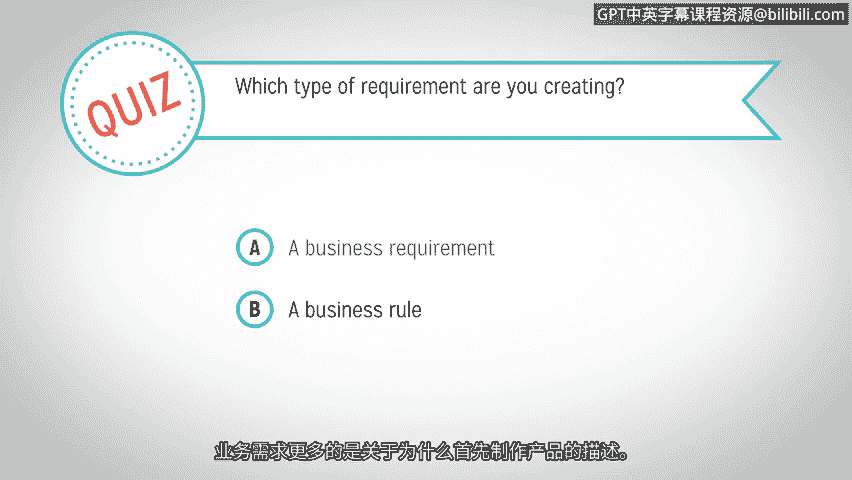

**软件产品管理课程3：《客户需求与软件需求》：3.1.2：需求类型**

在本节课中，我们将要学习软件产品开发中涉及的不同类型的需求。理解这些类型有助于我们更有效地捕捉、表达和管理需求。

在上一课中，我们讨论了什么是需求以及与之相关的各种活动。我们了解到，需求本质上是一种将客户需求转化为可构建成实际产品的方式。我们还认识到，当开发团队与客户协作时，这些需求最容易地被获取和表达。

现在，我们已经有了初步了解，让我们更深入地探讨一下。为了理解如何从需求中获得最大价值，我们必须了解软件产品可能需要哪些不同类型的需求。

当你想到“需求”这个词时，脑海中会浮现什么？或许你想到的是产品最终版本应包含的功能列表。或许你想到的是关于产品在不同情况下应如何表现的一系列描述。或者，你可能想到了产品为何应该存在的根本原因。

事实证明，所有这些都是有效的需求类型。它们共同描述了产品应该是什么样子、应该如何工作以及为何应该存在。让我们更详细地讨论这些。

**业务需求：产品的“为什么”**

我们首先提到的需求类型，即产品为何被需要，被称为**业务需求**。

业务需求概述了软件项目的目的。它们为产品负责人提供了启动项目的根本理由。你可以将这些需求想象为与产品的实际开发是分开的。这些需求不仅仅是个人或道德层面的原因，例如“必须在市场上领先”或“必须被尽可能多的用户使用”。一个业务需求必须定义能提供具体、可量化商业价值的产品需求。

一个业务需求的例子是：“我需要这款产品吸引印度的服装设计师，以便每年增加5万美元的收入。”这就是一个业务需求。你的客户在制定商业战略和计划时会使用业务需求。它们是业务分析师审视产品最终商业目标的一种方式。

需要注意的是，业务需求也可能有其他名称。术语“业务需求”有时可能用来描述我们将在本课后面讨论的其他需求。就我们的目的而言，业务需求仅指构成“产品为何应该存在”的那些需求。

**业务规则：产品的“约束”**

有时，业务需求的概念会与预算、政策或法规等词语相关联。这些是我们所称的**业务规则**的例子。

这些规则比业务需求更具体。业务规则约束了产品的功能。它们还规定了项目要被视为成功甚至合适所必须遵循的规则。

以下是业务规则的一些例子：
*   一项隐私政策，要求企业必须安全存储数据，并且不与不必要的人员共享。
*   一项品牌统一性要求，规定待开发的产品在视觉上必须与客户拥有的其他产品保持一致。
*   一项政府法规，例如根据当地或国际法律，要求将用户数据及其任何操作信息保存特定时长。

所有这些都属于业务规则。它们概述了产品的一些限制。你可以将业务规则理解为规定了软件开发必须在哪些限制条件下进行。

**小结与回顾**

我们刚刚讨论了两种需求类型：业务需求和业务规则。

假设你正在为一个需要计算销售税的发票产品制定需求。你正在创建哪种类型的需求？A. 业务需求，还是 B. 业务规则？

答案是 B，业务规则。征收销售税是政府对进行销售的公司提出的法律要求，它约束了与销售相关的产品。最佳答案是业务规则。业务需求则更像是描述你最初为何要制作这个产品。

在本节中，我们一起学习了需求的两个基本类型：**业务需求**（定义产品的商业目标和存在价值）和**业务规则**（定义产品必须遵守的具体约束和法规）。理解这两者的区别是有效需求管理的第一步。接下来，我们将继续探讨描述产品“是什么”和“怎么做”的其他需求类型。