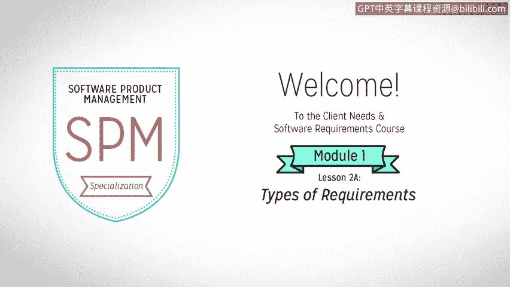
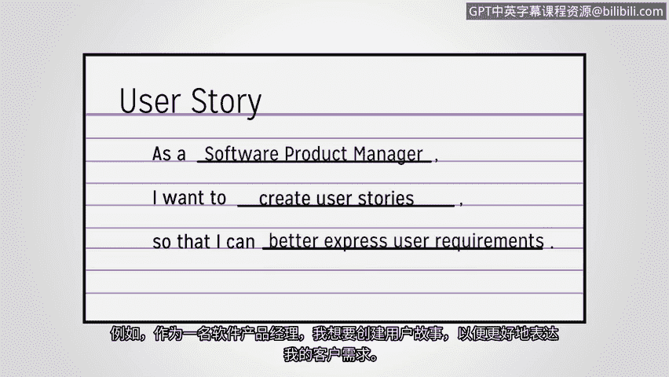
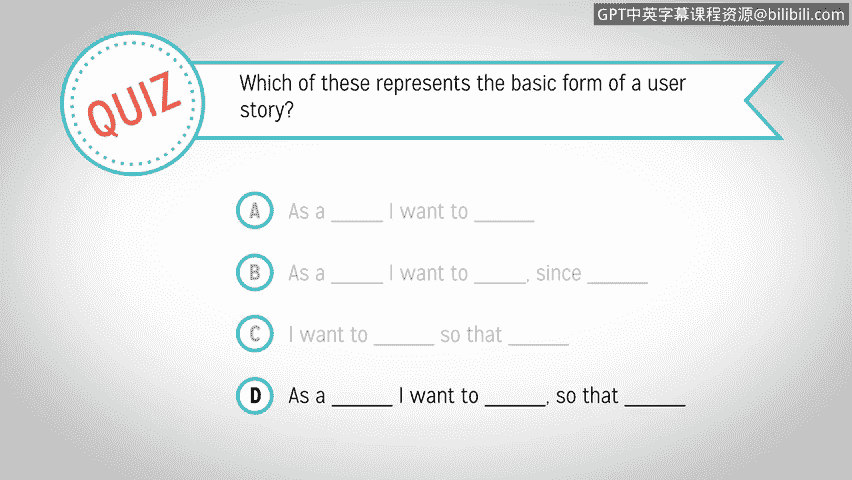

**软件产品管理课程3：客户需求与软件需求：第3.1.2a节 用户需求**

在本节中，我们将学习**用户需求**。用户需求描述了用户能够使用产品完成的具体任务，是连接业务目标与最终产品功能的关键桥梁。

---

上一节我们讨论了业务需求和业务规则，它们关注的是产品整体存在的**原因**以及构建时必须遵循的**约束**。了解这些术语对您的职业生涯很有帮助，即使产品经理对其创建没有直接影响。

接下来，我们将介绍一系列与产品经理及其开发团队直接相关的需求类型。首先，让我们深入了解**用户需求**。

用户需求明确界定了用户能够使用产品完成哪些任务。这里的“用户”指的是最终会使用您软件的个人，因此也常被称为“最终用户”。鉴于最终用户对产品成功至关重要，通常需要投入大量时间来制定这些需求。

事实上，用户需求很可能是开发团队最需要准确把握的需求类型。因为它们定义了最终用户如何与产品互动，以及产品应为用户提供什么功能。我们可以将其视为所开发产品的**核心功能**。

在本课程后续部分，我们将详细探讨如何恰当地**获取**用户需求，并将其转化为具体、可操作的开发任务。我们还将讨论如何创建高质量的用户需求，以及表达这些需求的不同方式。

**用户需求的核心是用户能用您的产品做什么**。它们可以通过多种形式来表达。

以下是表达用户需求的两种常见方式：

*   **用例**：用例是展示系统与用户之间关系的有效方式。在您看到的这个例子中，它具体展示了不同的用户场景及其与系统的交互方式。我们将在下一个模块中更深入地介绍用例。
*   **用户故事**：用户故事是另一种表达形式。我们将在本课程后面更详细地介绍用户故事，但其基本结构是：**作为一个<角色>，我想要<进行某个操作>，以便于<实现某个价值/目标>**。这种结构确保我们在思考需求时，始终将用户需求放在首位。

例如：**作为一名软件产品经理，我想要创建用户故事，以便于我能更好地表达客户的需求。**

然而，客户最初提出的需求往往并非如此清晰。通常，客户需求会以这种模糊、非具体的形式出现：“客户应该能够在系统中查看并支付账单。”

这当然不是客户的错，但这是软件产品经理必须解决的一个常见障碍，以确保开发团队明确知道如何最好地构建产品。对我而言，这正是软件产品管理中最有成就感的方面之一：能够将客户模糊的需求提炼成具体、实在的东西，通常会带来一种满足感和条理感，仿佛一切各归其位。

**小测验**：以下哪一项代表了用户故事的基本形式？
A. 作为一个<空白>，我想要<空白>。
B. 作为一个<空白>，我想要<空白>，因为<空白>。
C. 我想要<空白>，以便于<空白>。
D. 作为一个<空白>，我想要<空白>，以便于<空白>。

**正确答案是 D**。用户故事遵循“作为一个<角色>，我想要<操作>，以便于<价值>”的形式，这确保我们能捕捉到需求的**角色**（谁）、**操作**（做什么）和**价值**（为什么）。

---

在本节中，我们一起学习了**用户需求**。我们了解到用户需求定义了最终用户与产品的交互任务，是产品的核心功能。它们通常通过**用例**和**用户故事**（格式：`作为一个<角色>，我想要<操作>，以便于<价值>`）来表达。同时，我们也认识到将客户模糊的初始需求转化为清晰、具体的用户需求，是产品经理的一项关键且富有成就感的工作。