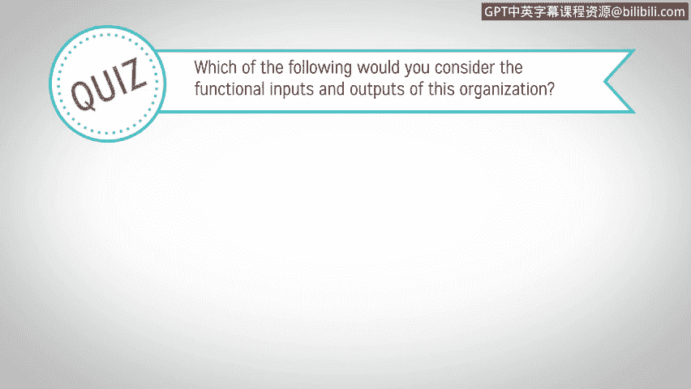

# 007：功能需求

在本节中，我们将学习**功能需求**的概念。功能需求是软件开发过程中的核心，它描述了系统“必须做什么”。我们将了解如何定义功能需求，并通过实例和图表来清晰地表达它们。

---

上一节我们介绍了需求的不同类型，本节中我们来看看其中一种关键类型——**功能需求**。

功能需求属于开发团队的工作范畴。它是一种描述产品应执行或支持的行为的需求。

功能需求可以通过**输入**、**输出**以及行为本身的描述来表达。

设想一个场景：一位客户向你提出一个项目构想。他们想要一款移动销售点产品，该产品能通过客户专有的信用卡读卡器接收信用卡付款，然后向用户发送包含交易详情的收据。客户还提到，该产品必须符合最高的安全和视觉设计标准。

请记住，功能需求涉及输入和输出。在这个简单的例子中，我们有一个输入（来自信用卡读卡器的数据）和一个输出（交易收据）。因此，你可以说：**系统必须从信用卡读卡器读取数据**，并且**系统必须向最终用户发送交易收据**。

为了简化说明，我们在此省略了许多功能需求。实际上，你可能会想到系统还应接收来自商家的交易信息作为输入，然后在某些确认操作后，系统应向买家展示交易信息并最终接收其PIN码信息。仅在这个例子范围内，就可以想到相当多的功能需求。

需求本身也具有一定的**深度**。一个声明“用户应能使用密码键盘支付”的功能需求并不具体。这可以分解为几个更深入、更具体的要求，例如：
*   用户应能刷卡（借记卡或信用卡）。
*   用户应能将信用卡或借记卡插入芯片读卡器。
*   当卡片被刷卡或插入后，用户应能输入其PIN码。

如果需求不够具体，可能会导致规划出现问题。你可能以为自己需要做的工作很少，但实际上工作量可能相当大。关于这一点，我将在本课程后面更详细地探讨。现在只需意识到需求具有深度即可。

表示功能需求的一种方法是使用**信息流图**，如下图所示。

信息流图为你提供了一种图形化方式，来展示系统所有组件的数据流和依赖关系。本质上，它展示了系统的各个组件是如何连接在一起的，让你了解系统作为一个整体是如何运作的。信息流图提供了一个逻辑上审视整个系统的上下文。如果你想了解更多关于信息流图的信息，请查看课程资源。

---

为了巩固理解，让我们看一个练习题。

设想一个场景：你正在建立一个非营利组织，为社区中的低收入通勤者翻新自行车。你从捐赠者那里收到自行车（由铝制成）以及用于购买工具的资金。然后，你利用这些资源让自行车恢复功能，并将它们交付给你的客户。

以下哪一项应被视为该组织的功能输入和输出？

A. 输入：捐赠的自行车和购买的工具；输出：客户。
B. 输入：捐赠的资金；输出：可用的自行车。
C. 输入：捐赠的资金和自行车；输出：可用的自行车。
D. 输入：自行车中的铝材和捐赠的资金；输出：可用的自行车。

答案是 **C**。该组织接收资金和自行车，然后进行维修并交付给客户。输入是捐赠的自行车和资金，因为工具是使用捐赠的资金购买的。这些工具是用于修复自行车的过程的一部分。

---

本节课中我们一起学习了**功能需求**。我们了解到功能需求定义了系统必须执行的行为，通常通过输入、输出和行为描述来表述。我们探讨了需求需要足够具体（具有深度）的重要性，并介绍了**信息流图**作为可视化功能需求和数据流的一种有效工具。最后，我们通过一个实例练习应用了这些概念。理解功能需求是准确规划和构建软件产品的基石。