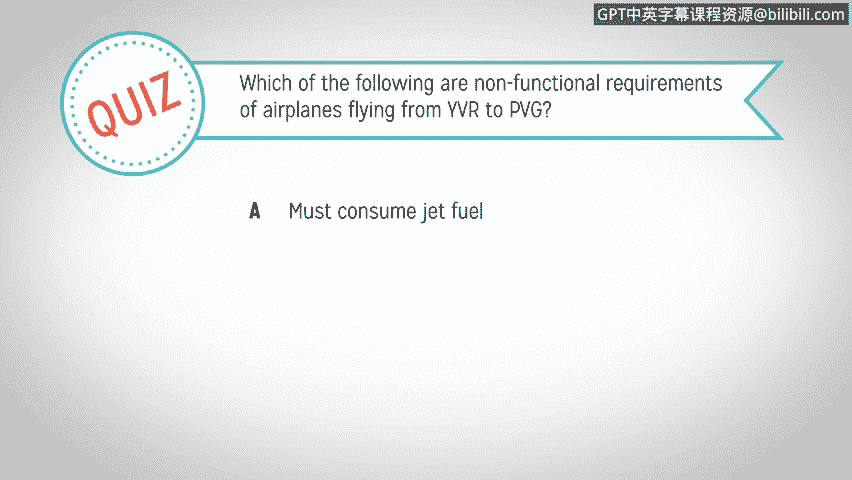

# 008：非功能需求 🎯

在本节中，我们将学习**非功能需求**的概念。非功能需求描述了产品必须**表现得多好**，它们与功能需求互补，共同定义了产品的完整规格。

上一节我们介绍了功能需求，本节中我们来看看非功能需求。

## 非功能需求概述

功能需求定义了产品**应该做什么**，而非功能需求则定义了产品**应该做得多好**。非功能需求主要关注产品的**质量因素**，因此有时也被称为**质量需求**。

## 非功能需求示例

以下是不同类型非功能需求的几个例子：

**1. 准确性与安全性需求**
以驾驶辅助系统为例。系统需要感知前方车辆的距离，并在距离过近时自动刹车。这里的非功能需求是**系统传感器的准确性**。仅仅说“系统应读取距离并在达到阈值时刹车”是不够的。如果测量存在中等误差，后果可能是灾难性的。因此，**准确性**和**安全性**是非功能需求。

**2. 可靠性需求**
假设客户希望建立一个存储重要文档的数据库。该系统需要能够从灾难中恢复，以避免数据丢失。这种**可靠性**要求是非功能需求。

**3. 安全性需求**
如果上述数据库存储了包含用户个人信息的敏感文档，那么系统必须安全，不易受到攻击。这就需要建立强大的信息**加密**机制，并使整个系统难以被攻破。这些**安全性**要求是非功能需求。

**4. 可用性需求**
以一个简单的网站邮箱注册表单为例。表单通常会检查用户邮箱的有效性，以尽量减少输入错误。如果没有这种**错误预防**检查，许多邮件可能无法送达。此外，注册表单是否易于导航、各项信息填写位置是否清晰（例如有明确的姓名标签），这些**易用性**或**可学习性**要求也是非功能需求，它们统称为**可用性需求**。

**5. 效率需求**
考虑一个由客户提出的水下研究设备，它依靠电池供电。设备必须足够小巧轻便，以便存放在小船上；同时必须足够高效，能提供至少数小时的水下续航。其所有仪器都必须能够**实时**、无延迟地执行功能，并且电池应能快速充电。这些关于**空间、功耗、时间和资源**的要求，都属于以**效率**为核心的非功能需求。

**6. 性能需求**
性能需求同样是非功能需求。例如，系统需要维持特定的**响应时间**，或在短时间内处理一定数量的请求。

**7. 可维护性需求**
想象一下，客户希望开发一款软件，用于查询本地餐厅数据库并将其标注在地图上以便导航。客户还设想未来将该软件扩展用于其他产品，例如在地图上标注纪念碑和旅游景点，并在输入地点后立即显示。这种要求软件**足够灵活**以超越原始用途进行扩展的需求，就是**可维护性需求**。

## 非功能需求类型总结

让我们快速回顾一下提到的非功能需求类型：
*   **准确性**
*   **可靠性**
*   **安全性**
*   **可用性**
*   **效率**
*   **性能**
*   **可维护性**

## 知识检查 ✈️

每天都有飞机从加拿大温哥华国际机场飞往中国上海浦东国际机场。这些飞机必须遵守航班时刻表，其航程受所载燃油量的限制。

以下哪几项是这些飞机的非功能需求？
A. 必须消耗航空燃油。
B. 航班时刻表不得延误。
C. 必须能够单箱燃油完成从YVR到PVG的飞行。
D. 满载乘客必须在90秒内完成撤离。

**正确答案是C和D。**
C项是关于**性能**的非功能需求（续航能力）。
D项是关于**可用性/安全性**的非功能需求（紧急疏散效率）。
A项涉及飞机的**输入**（燃料类型），B项涉及**航班计划**，与飞机本身的性能或质量属性无关。

---

本节课中我们一起学习了**非功能需求**。我们了解到，非功能需求与功能需求相辅相成，它们不定义产品“做什么”，而是定义产品“做得多好”，涵盖了准确性、安全性、可用性、性能等多个关键质量维度。明确非功能需求对于构建高质量、可靠且用户满意的软件产品至关重要。