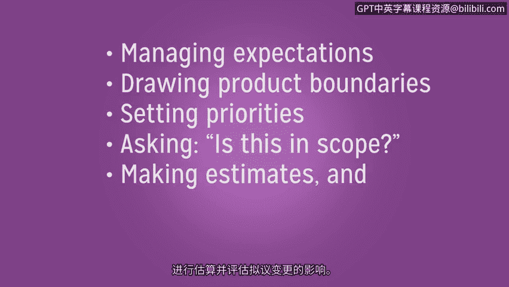

# 010：控制范围

## 概述
在本节课中，我们将要学习软件产品管理中一个至关重要的环节：如何定义并控制项目的范围。我们将探讨产品愿景与范围的区别，理解范围蔓延的危害，并学习一系列实用的技巧来有效管理需求变更，确保项目在可控的轨道上运行。

## 产品愿景与范围
上一节我们介绍了不同类型的软件需求。本节中，我们来看看在形成和维护需求集合时面临的一些挑战。

定义需求时需要投入时间并保持谨慎。同时，也必须认识到需求在整个开发过程中不可能保持一成不变。需求必定会发生变化。当我们接受这一点时，就能更好地应对这些变化。根据软件工程领域的知名专家罗伯特·格拉斯所述，软件项目失控的两个最常见原因之一就是**不稳定的需求**。

许多项目经理都遇到过这种情况：开发团队开始根据一组特定需求进行工作，但在项目中途，客户改变了某些想法。突然间，开发团队不得不中途改变工作重点。在这种常见的情况下，你该怎么办？

如果开发团队每次客户提出变更都改变方向，项目很快就会失控。这会造成大量的开发任务积压，并降低产品质量。不仅如此，开发团队的士气也会一落千丈。然而，如果产品团队坚持原计划不做任何调整，最终产品很可能无法满足客户需求。这将浪费开发团队的时间和客户的资金。

我们需要在这两个极端之间找到一个平衡点。让我们从产品创意最初诞生时开始思考。产品的初衷是什么？客户想要解决什么问题？这就是**产品愿景**。软件工程领域的作家兼顾问卡尔·维格将产品愿景描述为“一个新系统最终目的和形态的长期战略构想”。本质上，产品愿景勾勒了产品对客户的价值及其在市场竞争对手中的地位。

产品愿景与你的产品有何关系？可以将产品愿景视为产品的指导原则。无论产品发生什么变化，产品的设计仍应支持其愿景。然而，这并不意味着产品愿景总是现实可实现的。

让我用一个例子来解释。假设一位客户找你开发一款手机游戏项目。根据需求，你和你的开发团队估计需要三个月时间。客户给出的产品愿景是：通过模拟项目经理的视角来创造独特的身临其境的游戏体验，以此进行项目管理。

现在，假设开发进行了一个月，一切顺利，这时客户找到你。他们告诉你，由于虚拟现实技术最近取得了进步，他们希望开始为虚拟现实平台进行开发。从技术上讲，切换平台可以让你遵循产品最初的愿景。然而，这种转变意味着产品和开发资源的重大调整，因此并不现实可行。我们将客户要求的这种转变称为**范围变更**。

在上面的场景中，客户通过建议你切换平台来改变了范围。那么，以下哪种情况会构成**愿景变更**？
A. 客户选择转向移动游戏而非虚拟现实。
B. 你的开发团队决定更改一些产品实现细节。
C. 你的项目超出预算，被迫暂停。
D. 你的客户决定产品不再是一款关于项目管理的手机游戏，而是选择创建一个允许客户设计定制家具的应用程序。

答案是 **D**。当你的客户选择创建一个具有完全不同指导原则的产品时，他们就是在改变愿景。通过选择制作一个家具设计应用，而不是一个关于项目管理的游戏，产品的愿景已经改变。

**范围**和**愿景**是相互关联的。愿景涵盖了产品最终将做什么以满足用户需求，而范围则涵盖了在当前项目中现实可以实现的内容。虽然客户的总体产品目的没有改变，但对开发人员的要求已经改变。因此，**范围**是对开发团队及其产品经理影响最大的因素。所以，范围是思考软件产品时需要考虑的最重要的事情之一。

再次引用卡尔·维格的话：“**范围划定了项目中包含什么和不包含什么的界限。**”

## 管理期望与定义边界
好的，这很简单。范围告诉你你将做什么和不做什么。但是，如何为特定项目决定这意味着什么？我们又该如何确保保持在范围内？

最好的起点是在项目的**需求获取阶段**。与你的客户讨论对产品的期望。如果你避免过度承诺产品的功能，就可以避免日后让客户和开发团队都感到失望。

想一想：你告诉客户你能开发什么，并且能在三个月内完成。但做到一半时，你意识到你根本无法交付那个产品。考虑到客户期望你能交付一个完整的产品，你认为他们会说什么？如果你想维持满意的客户关系，这不是正确的方法。

最好尽早管理客户的期望，以避免导致失望的情况。一种方法是识别用户可能期望但从当前项目中排除的功能。

例如，假设你正在为一个乐队创建网站。网站用户可能期望能够与其他粉丝发送消息和购买音乐会门票。然而，如果你认为在截止日期前，你的团队没有足够时间实现这些功能，那么完全可以向客户说明这一点。通过这种方式，你可以管理期望，并帮助确保项目结束时没有人感到失望。

## 防御范围蔓延的技巧
管理期望听起来不错，但我们具体该如何做呢？让我们来谈谈一些防御**范围蔓延**的技巧。顺便说一下，范围蔓延是指产品需求不断累积的情况。不受控制的范围蔓延会随着时间的推移显著降低项目成功的可能性。

在介绍防御范围蔓延的不同方法之前，你认为以下哪些是防御范围蔓延的方法？
A. 让客户对需求进行优先级排序。
B. 明确期望。
C. 与客户一起划定范围。
D. 询问“这在范围内吗？”

实际上，所有这些答案都是正确的。所有这些技巧都是有效的，尤其是当它们结合使用时。

以下是防御范围蔓延的具体技巧：

首先，在客户和你自己之间**明确期望**。即，确保每件事都有明确的开始和结束日期，并尽可能遵守。

其次，**与客户一起划定范围**。使用用例图来展示不同用户角色之间的预期交互以及产品支持的任务，并围绕此进行设计。

第三，**确保客户对需求进行优先级排序**。当客户指定哪些需求价值最高时，就很容易确保产品最重要的部分得到优先开发。这样，即使项目时间或资金减少，你仍然满足了关键需求。

第四，在形成需求时，**询问“这在范围内吗？”**。很容易忽视在细化不必要需求上浪费的时间。如果你强迫自己询问每个需求的相关性，就可以确定当前项目中包含什么，并为未来的版本记录功能。

## 评估与决策
在制定需求时，**估算完成每个需求所需的工作量**也很重要。随着你和你的开发人员在构建产品方面经验越来越丰富，这会变得更容易。随着时间的推移，你可以发现团队的平均生产力，并以此为基础进行估算。

当你估算完成产品需求所需的工作量时，可以将估算值相加，看看是否能满足截止日期。这有助于你决定一个需求是否现实可行。

当对产品提出变更时，花时间**评估该变更的影响**。它将如何影响你的人员资源、资金、产品质量、时间表和成功的可能性？在考虑变更时，所有这些因素都会起作用。当然，当接受一个变更时，你应该修订你的估算和计划以反映这一变化。

理解了这一点，很容易为了简单起见而走极端，拒绝所有提议的变更。变更的引入通常是为了增加项目的商业成功机会。**逐个评估每个变更，并根据具体情况做出决策**，将使你能够在扩展产品的同时，最大限度地提高其成功的机会。这也是敏捷宣言的核心原则之一。

## 总结
本节课中我们一起学习了以下内容：
1.  首先，我们定义了什么是**愿景**，以及它与软件项目的关系。
2.  然后，我们定义了什么是**范围**，以及它如何可能失控。
3.  接着，我们讨论了通过以下技巧来避免范围蔓延：
    *   管理期望。
    *   划定产品边界。
    *   设定优先级。
    *   询问“这在范围内吗？”。
    *   进行估算。
    *   评估提议变更的影响。

在下一课中，我们将讨论设计中的需求。我们下节课见。