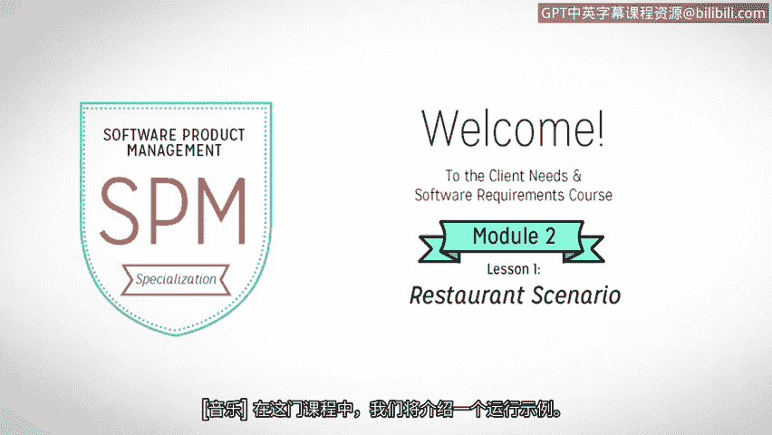

# 012：餐馆场景

在本节课中，我们将介绍一个贯穿课程始终的示例。通过跟随这个示例，你将能看到需求活动如何从开始到结束逐步推进。

## 认识客户

现在，很高兴向你介绍你的客户。

> 你好，我是杰米。我是名为“布拉姆顿披萨与意面”的家庭连锁餐厅的高管。我们正在寻求为我们的餐厅内部使用开发一些软件。
>
> 我的目标是优化餐厅的点餐流程，使其更高效。
>
> 我的设想是，顾客应该能够查看他们所在餐厅的菜单，并在准备好后下单。我非常希望有一个儿童页面，可以展示儿童菜单，或许还有一些小游戏供孩子们玩。但最重要的是，它应该足够简单易用，让孩子们能够自己下单。
>
> 此外，顾客应该能够指定他们对餐食的任何修改要求，并且在下单到厨房之前，能够列出他们可能有的任何饮食限制。
>
> 厨房应该能够实时查看这些订单。
>
> 顾客应该能够在系统内查看并支付账单。
>
> 我想就这些了。我期待在这个项目上与你们合作。

## 开始构建需求

好了，现在你已经认识了你的客户并听取了他们的初步构想，接下来让我们开始构建一些需求。

在本节中，我们引入了一个具体的餐馆场景作为后续学习的案例。通过客户杰米的描述，我们初步了解了项目的目标和核心功能设想。

---

本节课中我们一起学习了贯穿本课程的餐馆示例场景，并初步认识了客户及其对软件系统的核心期望。在接下来的章节中，我们将以此为基础，逐步展开客户需求与软件需求的分析与定义工作。