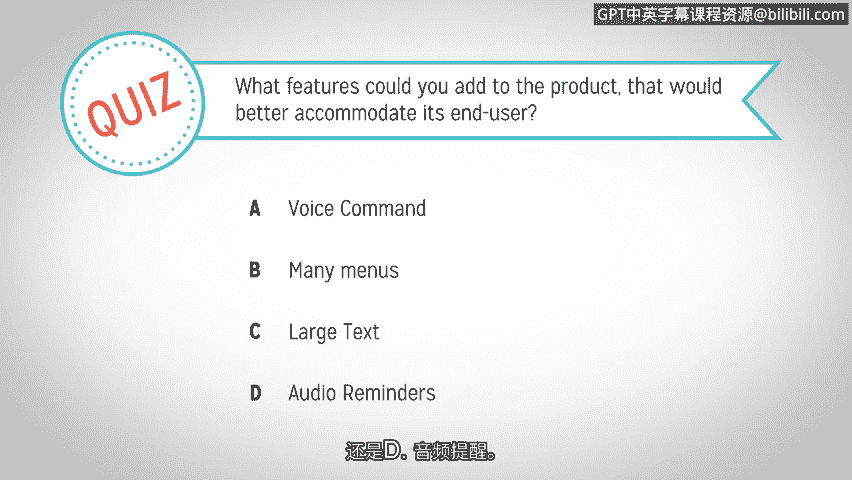

# 014：用户考虑因素 👥

在本节中，我们将学习如何根据目标用户的需求来定制产品。我们将探讨识别主要用户群体的重要性，并理解在开发过程中考虑用户能力与限制的必要性。

---

上一节我们明确了产品的目标用户。本节中，我们来看看如何根据他们的需求来调整产品。

识别产品的主要受众至关重要。这有助于我们根据用户的导航和功能需求来定制产品设计。以儿童菜单为例，我们的主要用户是儿童。有许多方法可以让产品迎合儿童，例如使用鲜艳的色彩、图像和声音。

研究最终用户如何与技术产品互动的学科被称为**人机交互**。人机交互本身可以是一门课程。我们将介绍一些基础知识，但如果你对此感兴趣，建议你进一步研究。这是一个非常引人入胜的计算领域，我对此充满热情。关于这个主题有大量可用资源，你可以在我们的课程资源中找到一些。

为最终用户开发产品可能令人沮丧，原因有很多。用户往往难以表达他们的需求，但他们通常会告诉你他们不喜欢什么。这通常源于他们不知道软件可以实现什么。开发人员必须创造性地思考，以开发出新颖、引人入胜的产品。

用户可能会受到已知事物的影响。用户通常更愿意使用他们知道如何操作的劣质产品，而不是对他们来说是新的、更优质的产品。这让我思考，我们在这里试图做什么？为什么我们要为那些只会使用旧产品的客户开发新产品？这就是为什么开发用户友好、直观的用户界面如此重要。它鼓励用户走出他们的舒适区。但这只有在产品易于学习和使用的情况下才有效。

开发人员常常在创建直观、用户友好的产品方面遇到困难。你可能已经注意到的一件事是，工程师、科学家和程序员并不能代表主流人群。所以，欢迎来到“非正常”的世界。我想说的是，开发人员的思维方式与普通最终用户不同。对开发人员来说完全合理的事情，对外行人来说可能毫无意义。开发人员可能优先考虑后端技术的进步，因此他们有时很难为更广泛的人群设计出直观的产品。

作为软件产品经理，理解用户的思维方式非常重要。有建议认为，为初学者和专家这两个极端设计产品是理想的。如果你这样做，中间部分往往会自行解决。当你与开发人员一起设计产品或测试产品时，请牢记最终用户：他们能够理解这个产品是如何工作的吗？

---

以下是关于为特定用户群体设计的思考练习：

一个代表患有糖尿病的老年人的协会联系了你的团队，希望开发一款移动应用程序，让老年人能够跟踪他们的血糖水平。该协会的代表明确指出，用户年龄将在65岁以上。此外，应用程序必须足够简单，无需协助即可使用。

你可以为产品添加哪些功能以更好地适应其最终用户？
A. 语音命令
B. 多层菜单
C. 大号文本
D. 音频提醒

---

为老年人开发产品可能很困难。他们的感官可能不太好，这可能会限制他们能做的事情。由于他们不是在技术时代长大的，他们的技术技能往往不太先进；因此，一个拥有多层菜单的产品可能让他们难以操作。

添加语音命令和大号文本等功能是适应老年最终用户的好方法。语音命令可以帮助那些无法在小键盘上打字的人，而大号文本则更容易阅读。为他们设置提醒将是一个很棒的功能。但是，你可能希望通过多种模式发送通知，而不仅仅是音频。也许可以让手机发出声音、在屏幕上显示弹出窗口并振动。这会吸引大多数用户的注意力。因此，最佳答案是A和C。

---

现在，让我们讨论更多关于人类局限性的内容。

---

本节课中，我们一起学习了如何根据主要用户群体的需求来定制产品设计。我们探讨了人机交互的基本概念，理解了开发人员与普通用户在思维上的差异，并通过一个具体案例分析了如何为老年人设计易用的应用程序功能。记住，始终将最终用户放在心上，是创造成功产品的关键。