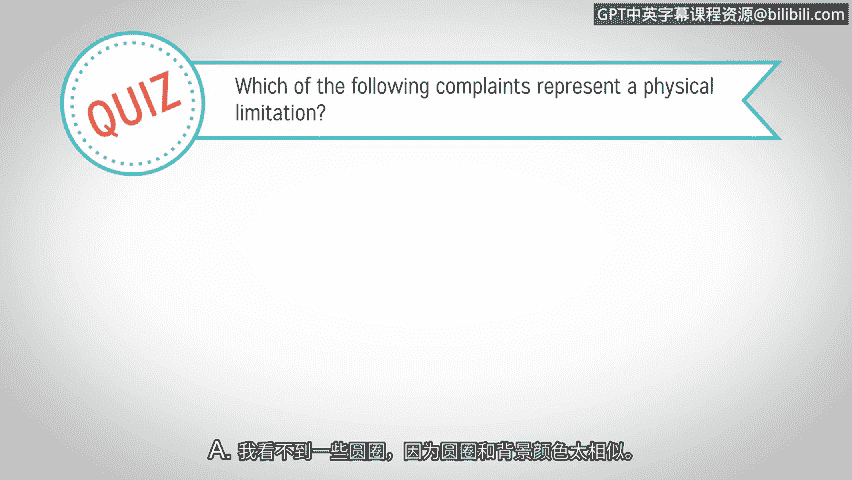

# 015：客户需求与软件需求

## 第3.2.2b节 用户考虑因素 👤

在本节中，我们将探讨人类的各种局限性，并了解这些局限性如何影响用户与软件产品的交互。理解这些限制对于设计出包容性强、用户体验良好的产品至关重要。

人类存在许多局限性。我们阅读的速度、奔跑的距离或玩电子游戏的时长都是有限的。许多人类特征会限制用户使用产品的能力。在设计软件时，考虑这些局限性非常重要。优秀的软件产品会适应其目标用户群体。

以下是一些人类局限性的例子：感知局限、生理局限、认知局限和文化局限。

### 感知局限 👁️

上一节我们介绍了人类局限性的几个大类，本节中我们首先来看看感知局限。我们五种感官的限制影响了我们感知周围环境的能力。因此，感知局限是指那些受我们感官限制的局限性。感知局限有时也被称为感官局限。许多感知局限会影响人们与技术交互的方式。

以下是感知局限的一些常见例子：

*   **色盲**：大约4.5%的人口有色盲问题。约8%的男性是色盲，而女性中只有0.5%。色盲人士难以区分某些颜色，因此彩色图像在他们看来可能不同。从开发角度，应对色盲的最佳方法是**增加产品的对比度**。使用浅色背景配深色文字（或反之），不仅能适应色盲，还能适应大多数视觉局限。你也可以通过模拟不同形式的色盲来测试配色方案是否可接受。许多UI库和图形设计工具支持此功能。
*   **其他感官局限**：我们可以开设一整门课程来讲解如何为感知局限进行设计。例子包括使用视觉提示或振动来适应听觉局限。

### 生理局限 🏃

现在让我们谈谈生理局限。这指的是任何影响用户与产品进行物理交互的因素。

以下是生理局限的一些例子：

*   **儿童与成人差异**：专为儿童设计的产品应考虑他们较低的手部灵活性、较矮的身高和较小的手掌。他们需要**大按钮**和能够触及并抓握的控件。
*   **左利手与右利手**：通过提供左手选项，可以使产品对用户更友好。许多界面设计得便于右利手人士使用，将大部分按钮和菜单放在右侧，便于右手拇指点击。你可以设计一个选项，将按钮和菜单放在屏幕左侧，从而使产品易于左利手用户使用。

### 认知局限 🧠

接下来，我们讨论认知局限。认知局限通常基于记忆限制。

以下是认知局限的一些关键点：

*   **识别与回忆**：识别某物通常比从记忆中回忆更容易。因此，用户界面应具有**可见的、熟悉的或具有提示性的元素**以促进识别。
*   **短期记忆容量**：哈佛心理学家乔治·A·米勒提出了关于“神奇数字七”的著名概念。他认为普通人的短期记忆容量足以容纳**7±2个项目**。基本上，这个概念告诉我们，人类的工作记忆一次可以容纳5到9个项目。在有干扰的情况下，情况会更糟。在开发过程中应牢记此限制。例如，你不希望最终用户在你的产品中从一个屏幕到下一个屏幕时，需要在记忆中携带一堆任意项目。

### 文化局限 🌍

最后，我们来谈谈文化局限。这些本身往往不是局限，而更像是文化差异。

以下是文化差异的一些例子：

*   **颜色含义**：例如，考虑颜色在不同文化中的含义。在西方文化中，白色用于婚礼，代表和平。然而，在许多其他文化中，白色代表死亡和哀悼。同样，粉色在许多文化中被视为女性化的颜色，但并非所有文化都如此。
*   **设计元素**：除了颜色，设计的许多方面都可能因文化而异。例如语言翻译、符号和图标、布局和多媒体都可能因文化而不同。
*   **交互符号**：另一个与软件开发相关的文化差异例子是复选框中使用“X”。想想选举选票，你在候选人名字旁边用“X”标记你的选择。我了解到在日本，他们使用一个称为“丸印”的圆圈来表示选择。他们用“X”标记代表拒绝。因此，“X”可能具有非常模糊的含义。因此，现代用户界面现在在复选框中**使用对勾标记**来表示选择。

### 总结

本节课中，我们一起学习了影响软件设计的四类主要用户考虑因素：感知局限、生理局限、认知局限和文化局限。理解这些因素有助于我们设计出更包容、更易用、更能满足全球多样化用户需求的软件产品。记住，优秀的设计始于对用户的深刻理解。