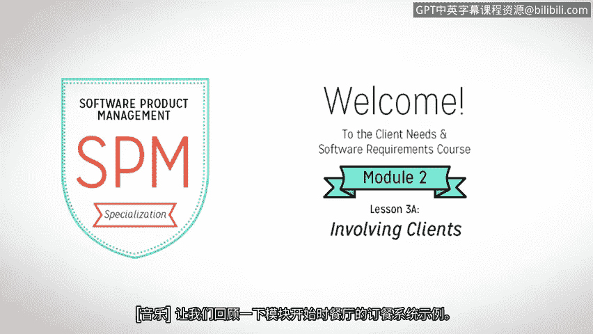

# 017：让客户参与

## 概述
在本节中，我们将学习如何通过让客户参与需求澄清过程，将模糊的需求转化为清晰、具体的功能描述。我们将通过一个餐厅点餐系统的例子，演示如何提出直接的问题来理解客户的真实意图。

## 从模糊需求到具体细节
上一节我们讨论了需求的不同类型，本节中我们来看看如何通过与客户互动来细化这些需求。客户最初提出的需求往往比较模糊，需要产品经理通过提问来挖掘具体细节。

让我们回顾本模块开始时提到的餐厅点餐系统例子。你的客户提出的一个功能是：顾客可以使用系统下单。这个描述非常模糊，因为实现这个需求的方式有很多种。这是一个提出更直接问题的好机会，以弄清楚Jamie究竟设想这个功能如何工作。

以下是你可以提出的一些问题：
*   **顾客如何选择菜品？**
*   **一桌有多位顾客时，系统应如何处理？**
*   **每桌的点餐是否有最低或最高限额？**
*   **顾客如何将订单发送到厨房？**

## 客户的具体设想
通过提问，我们可以获得客户清晰、具体的设想。例如，客户Jamie可能会这样回应：

“我为之前描述得如此模糊而道歉。我设想的是，每张餐桌上应有一台或多台平板电脑供顾客点餐。顾客可以浏览食物图片；如果他们想了解某道菜的更多信息，可以点击它；如果他们想点这道菜，就点击‘下单’按钮。这会将他们带到另一个页面，在那里他们可以指定对餐点的修改以及可能有的任何饮食限制，然后再将订单发送到厨房。”

“当一桌有多位顾客时，我希望它能像在线购物系统的购物车一样工作。我希望当平板电脑在餐桌上传递时，每位顾客都可以选择自己的订单。或者，也可以由一个人输入所有人的订单，这都没关系。同一账单上的所有订单必须从一台平板电脑提交。额外的平板电脑是供人们浏览菜单或为不同账单下单用的。”

“点餐不应有最低或最高限额。当所有订单都已输入并定制完成后，顾客可以通过点击‘提交订单’将订单发送到厨房。”

## 客户持续参与的重要性
在听到对直接问题的回应后，你就能更清楚地理解当客户说“顾客可以使用点餐系统下单”时的实际含义。让你的客户参与进来并考虑最终用户，是你工作中非常重要的一部分。

即使在需求获取之后，你的客户也应该在整个开发过程中持续参与。他们应该在那里回答问题，就设计选择提供建议，并对可工作的版本给出反馈。

我们为你提供了一份资源，列出了许多你可以向客户提出的好问题。如果你在客户会议中遇到困难，可以带上这份资料并参考它。你可以在课程资源中找到它。

## 总结
本节课中，我们一起学习了如何通过主动提问让客户参与需求澄清过程。我们看到了一个将模糊的“顾客可以下单”需求，通过具体问题转化为关于交互流程、多人场景和订单提交机制等清晰描述的完整例子。记住，让客户持续参与是确保软件产品符合预期、减少返工的关键。现在你已经获取了需求，接下来需要学习如何表示它们，这将是本模块剩余部分的内容。