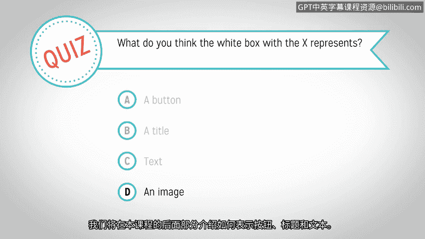

# 019：线框图 🎨

在本节中，我们将学习线框图这一在软件开发中非常有用的技术。我们将了解它的定义、作用、创建原则以及如何在实际项目中应用它。

线框图是产品的基本视觉表示。线框图的另一个名称是模型。

可以把它想象成房屋的蓝图。承包商在建造房屋之前需要绘制房屋的黑白图像。这能让所有相关人员对将要建造的东西达成共识。

线框图不仅是开发团队可视化需求的好工具，也是向客户展示想法的宝贵技术。在开发团队讨论需求后，他们可以快速制作一个线框图模型给客户看。这样，客户就能在流程的早期看到产品的雏形。这使他们能够提出修改意见，并通常能确保每个人对产品有共同的愿景。

你需要保持线框图非常简单。这不是界面的详细演示，而是产品的演示。不应在线框图中放入将在界面中实现的华丽颜色和图像。线框图侧重于要支持的基本功能和最终用户任务。它们可以帮助你思考按钮、文本字段和图像的放置位置。它们从上到下的布局应遵循用户执行每个任务的流程。基于这些想法，在项目的设计和实施阶段后期，才会完全模拟或完全实现用户界面设计。

再次以房屋蓝图为例。你无法知道墙壁的颜色，也无法知道照明或管道装置的外观。你只能了解轮廓的基本概念以及装置将放置的位置，但你无法了解房屋的完整外观。

我们使用线框图来创建本课程。我们会确定演示者站立的位置以及图像和文本字段出现的位置。以下是本课程的一个线框图。如你所见，我们的线框图与实际课程看起来非常不同。我们没有包含图像的具体样子，只是简单地指出了我们希望它放置的位置并描述了它将代表什么。演示者的图像也完全不像我，但这没关系。你能明白那是正在说话的人。我们会将这些线框图发送给我们的制作团队，以便他们了解我们对课程的大致构想。然后他们进行制作，创造出你所看到的精美课程。

让我们看一个线框图示例。这是一个提供作者传记的网站的线框图。

你认为带有X的白色方框代表什么？A，一个按钮；B，一个标题；C，文本；或D，一个图像。在线框图中，内部带有X的方框代表图像；因此，D是正确答案。你无需指定有关图像的任何细节。在线框图中，这种表示形式只是作为图像放置位置的占位符。我们将在本课后面介绍如何表示按钮、标题和文本。

因此，如你所见，线框图可以用于许多事情。你可以使用它们来设计将要开发的内容、向客户演示以及与团队沟通。

线框图的另一个常见用途是让客户与你沟通。客户通常对产品的功能和外观有一个想法。有时，客户通过绘制线框图来表达他们的想法会更容易。我以前就有客户这样做过，这使得从他们的线框图中提取需求变得容易。如果你的客户难以表达他们真正想要的东西，你可以考虑这种方法。

在上一个模块中，布拉德利谈到了需求与设计之间的细微界限。在通过线图获取需求时，请确保不要越过这条线。进行一些设计是可以的，但你需要小心，不要过早地开发解决方案。线框图应该引发关于问题是什么以及最终用户需要执行哪些任务的讨论。

有许多不同的工具可用于开发线框图。你可以在纸上绘制它们并进行数字扫描，也可以使用计算机上的任何绘图工具。无论哪种方式，你都应该允许纸质和数字版本，以便于沟通和讨论。我们使用谷歌文档来绘制线框图。像PowerPoint这样的演示工具也常用于绘制线框图。还有许多专门用于绘制线框图的网络应用程序，我们将在课程资源中发布其中一些。

让我们回到餐厅的例子。以下是主菜页面部分内容可能的样子。在线框图中，图像通常用内部带有X的正方形表示。文本通常用阴影框模拟。你可以在按钮和标题上添加文本，以便与客户有更多讨论内容。使用阴影框表示通用文本。按钮通常用正方形模拟。

接下来，我们将看一种类似的设计技术——故事板。

在本节中，我们一起学习了线框图。我们了解到线框图是产品的基本视觉蓝图，用于在开发早期与团队和客户沟通需求、功能和布局，避免过早陷入细节设计。它使用简单的占位符（如带X的框代表图像）来聚焦于核心任务流，是确保项目各方对产品愿景保持一致的重要工具。