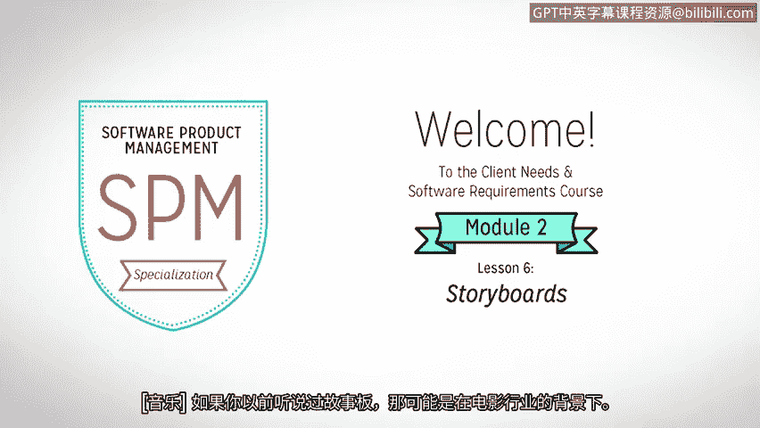
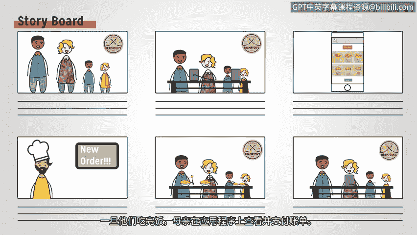
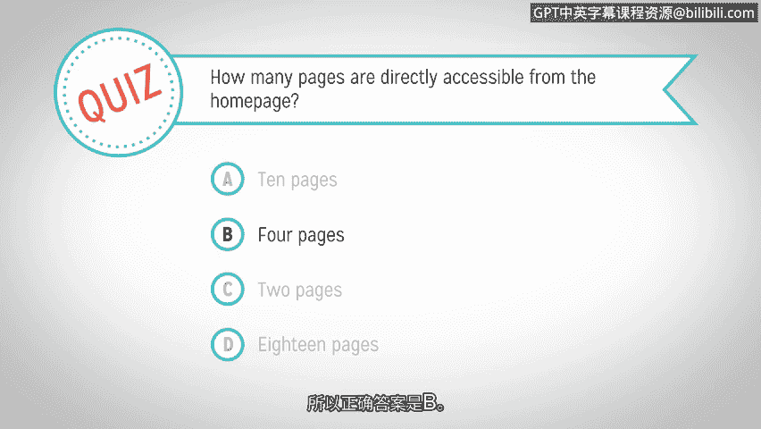

# 020：分镜头剧本 📖🎬

在本节课中，我们将要学习分镜头剧本这一工具，了解它如何帮助我们将用户需求与软件功能可视化，从而更好地规划产品开发。

---

如果你曾听说过“分镜头剧本”，那很可能是在电影行业的语境中。这是因为这项实践起源于电影行业。想一想制作一部电影所涉及的所有角色。分镜头剧本有助于让每个人都围绕导演的愿景达成一致。

分镜头剧本是对交互过程的顺序视觉化呈现。连环漫画就是一种分镜头剧本，它按顺序视觉化地讲述一个故事。在电影行业，分镜头剧本用于规划画面中的元素位置、镜头如何移动，并提供场景的氛围感。他们会在投入服装、道具、摄影、特效和剪辑之前完成这项工作。

在软件开发中，分镜头剧本可以通过几种不同的方式使用。无论如何使用，它们都按顺序讲述了最终用户如何与产品交互的故事。

---

## 电影风格的分镜头剧本 🎥

第一种使用方式类似于电影分镜头剧本。这种类型的分镜头剧本梳理的是高层次的用户体验。

以下是创建此类分镜头剧本的步骤：

首先，你需要识别涉及的角色以及他们将如何使用产品。这里指的不是电影演员。如果你还记得关于用例的课程，你会记得我们将情境中的主动用户称为“参与者”。如果产品有多个功能，那么你需要为每个参与者在每种情境下使用产品的情况创建一个新的序列。

让我们用一个餐厅应用的例子来看看。

> 史密斯一家决定去Brampton Pasta餐厅。他们坐在餐桌旁，使用桌上的平板电脑浏览菜单。他们在应用上浏览菜品并下单。厨房的厨师收到了他们的订单。食物准备好后被送到餐桌，史密斯一家享用了一顿美味的晚餐。用餐结束后，母亲在应用上查看并支付了账单。

这种类型的分镜头剧本涵盖了产品被使用的各种情境。通过观察每个用户何时以及如何使用产品，你的开发团队可以创建或改进功能。正如之前所说，考虑用户是开发的重要组成部分。

你还可以通过为每个用户赋予一个“用户画像”来扩展分镜头剧本，增加更多关于用户的背景故事。例如，在我们刚刚看到的史密斯一家的场景中，你可以详细说明他们的年龄、喜欢的菜肴、过敏史、文化背景和/或收入水平。你可以细化这个场景，展示分镜头剧本和需求如何扩展以解决某些问题。

如果产品有多个功能，你需要为每个功能制作一个分镜头剧本。例如，这个应用有一个儿童菜单，就需要一个新的分镜头剧本。你还需要用另一个分镜头剧本来涵盖账单支付功能。

这种电影风格的分镜头剧本对于让整个开发团队达成共识也很有用。它有助于让大家牢记产品的愿景。分镜头剧本的另一个用途是用于营销或演示目的，你可以轻松地向他人展示产品的预期使用方式和时机。

---

### 示例分析

你正在开发一个道路救援应用。该应用有一个检查路况的功能。你的开发团队为你提供了这个功能的电影风格分镜头剧本。

> 弗兰克即将开始一段公路旅行，他望向窗外，看到正在下雪。他想知道道路是否因此被雪覆盖且湿滑。弗兰克打开他的道路救援应用，检查他路线的路况。应用告诉他最短路线有危险，他应该选择替代路线。弗兰克采纳了建议的路线，安全抵达目的地。

以下哪些（如果有的话）会是与此分镜头剧本相关的需求？
A. 作为司机，我希望输入出发地和目的地，让应用计算路线。
B. 作为司机，我希望应用能追踪我的行程，如果我没有到达目的地，就通知紧急联系人。
C. 作为司机，我希望危险路线用红色高亮显示。
D. 作为司机，我希望建议更安全的路线。
E. 作为司机，如果我的车辆在高速公路上静止45分钟，我希望自动向我的位置派遣道路救援。

从这个分镜头剧本中，我们可以看到路线是根据提供的出发地和目的地计算的。高风险路线用红色高亮显示，并且建议了更安全的路线。因此，A、C和D是正确答案。B和E可能是应用的功能，但并未在此特定分镜头剧本中描绘。

---

## 软件设计风格的分镜头剧本 💻

上一节我们介绍了用于高层次用户体验规划的电影风格分镜头剧本。本节中，我们来看看另一种更深入软件设计的分镜头剧本。

这种分镜头剧本的目的是更详细地展示用户将如何与产品的用户界面交互。这种类型的分镜头剧本展示了用户与产品之间所有交互的顺序。它是线框图和用例基本流程的结合。它展示了产品的每个状态，以及用户如何到达该状态。在大多数产品中，每个状态将由用户界面中的一个独立线框图或页面来描绘。每个状态之间的用户转换点用带箭头的线表示。

让我们继续使用餐厅的例子，看看这种类型的分镜头剧本是什么样子。

> 顾客看到的第一个屏幕是主页。从该页面，顾客可以点击一道菜进入菜品详情页，或点击儿童菜单按钮进入儿童菜单页。在菜品详情页，顾客可以点击下单该菜品，然后进入菜品定制页面。菜品定制完成后，顾客可以点击下单并返回主页。

这种类型的分镜头剧本是在开发前可视化需求的好方法。它提供了一个机会来讨论支持用户任务可能需要的额外或缺失的元素。用户应该能直观地知道他们在产品中的位置以及下一步该做什么。分镜头剧本展示了线框图。在分镜头剧本中，只要有箭头存在，线框图中就需要一个用户界面元素（如按钮）来进入下一个线框图。技术作者也可以使用分镜头剧本来指导和构建培训材料。

---

### 示例分析

你拿到一个包含10个不同页面的分镜头剧本。从主页出发，有四个箭头，每个箭头指向一个不同的页面。有两个页面有箭头指向主页。分镜头剧本上总共有18个箭头。从主页可以直接访问多少个页面？
A. 10个页面
B. 4个页面
C. 2个页面
D. 18个页面

在分镜头剧本中，每个屏幕代表一个页面。从特定页面可以直接访问的页面，有从该页面出发并指向可访问页面的箭头。因此，既然有四个箭头从主页出发并指向四个不同的页面，那就意味着有四个页面可以直接从主页访问，所以正确答案是B。

---

## 总结 📝

本节课中，我们一起学习了两种类型的分镜头剧本。

两种类型的分镜头剧本都很有价值，因为它们有助于形成需求，并且都关注用户做什么以及产品中需要什么。你会发现产品的视觉化呈现，在与客户和开发人员讨论时非常有帮助。用分镜头剧本演示功能将帮助你引出更多需求并完善现有需求。

电影风格的分镜头剧本擅长在高层面上模拟用户与产品的交互。它也是让整个团队在产品目标上达成共识的好方法。第二种类型的分镜头剧本是增强版的线框图，用于更详细地确定与产品的交互。这种类型更多地被开发团队用来设计需求。它是确保整个开发团队了解产品功能和流程的有用技术。

在下一个模块中，Bradley将带你了解一些用于表达需求的敏捷实践。