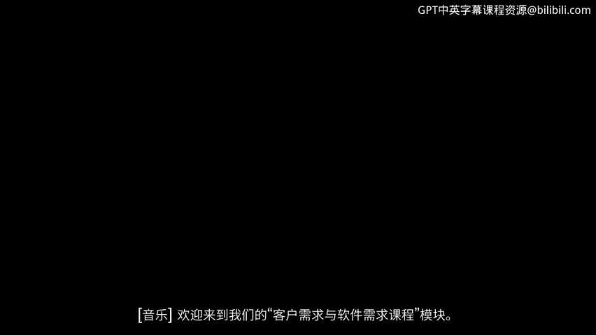
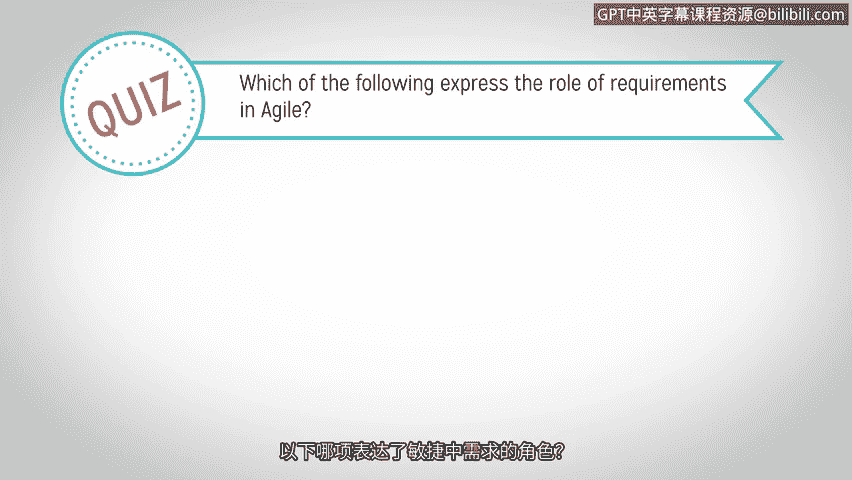

**软件产品管理课程3：客户需求与软件需求：3.3.1 敏捷需求**

**概述**

在本节中，我们将探讨如何在敏捷软件开发框架下理解和表达客户需求。我们将回顾敏捷的核心原则，并重点分析其中与需求管理最相关的部分，理解需求在敏捷开发中的动态角色。

---

在上一模块中，摩根详细介绍了用户考量，包括如何让客户和最终用户参与进来以确保构建正确的产品，以及如何通过用例、线框图和故事板来表达这些需求。该模块主要关注如何确定客户需求。在本节中，我将重点介绍如何将这些需求置于敏捷框架内进行表述。

我将展示需求如何融入敏捷软件开发的范畴，介绍多种表达需求的方式，以及如何管理它们。

**敏捷原则回顾**

在入门课程中，摩根曾讨论过敏捷及其12条核心原则。让我们快速回顾一下摩根介绍的这些原则：

1.  通过早期和持续交付有价值的软件来使客户满意。
2.  频繁地交付可工作的软件。
3.  将可工作的软件作为衡量进度的主要标准。
4.  **欢迎需求变更**。
5.  关注技术卓越和良好设计。
6.  以可持续的开发节奏开展工作。
7.  专注于简洁性，以最大化未完成的工作量。
8.  围绕有动力的个体构建项目。
9.  关注自组织团队。
10. 业务人员与开发者之间每日协作。
11. **鼓励面对面的交流**。
12. 定期反思团队行为并相应调整。

**与需求相关的敏捷原则**

在12条敏捷原则中，哪些与需求最相关？
A. 欢迎需求变更
B. 鼓励面对面的交流
C. 专注于简洁性
D. 频繁地交付可工作的软件

实际上，以上所有答案都是正确的。它们各自以不同的方式反映了需求。然而，为了讨论需求与敏捷，我想特别指出其中两条。

**第一条是“欢迎需求变更”。** 这可能显而易见，但至关重要。敏捷基于这样一个理念：软件是动态的、开放式的，无法一次性定义完毕然后基于这个单一定义进行构建。在开发过程中，客户经常会对产品功能产生新的想法。对于那些没有考虑到需求变更必然性的项目来说，这可能是灾难性的。在构思需求时，“欢迎需求变更”这一敏捷原则至关重要。要带着贯彻执行的意图去制定需求，但不要自欺欺人地认为随着产品发展需求不会改变。这只是软件开发的自然规律。

**第二条是“鼓励面对面的交流”。** 这对于获取正确的需求同样关键。根据敏捷思想，需求应在开放、协作的环境中从客户那里获取。产品的愿景应由客户决定。然后，作为软件产品经理，你的工作是共同解决问题，细化该愿景，以确定项目中哪些需求在范围内。这需要所有人聚在一起，公开讨论产品中希望包含的功能，识别可以或必须完成的事项。这不仅能在当下更有效地确定有价值的内容，也为团队与客户未来的沟通设定了先例。

**需求在敏捷中的角色**

以下哪项表述了需求在敏捷中的角色？
A. 需求中等重要，定义截止日期更重要。
B. 需求完全不重要，敏捷是编写代码的过程。
C. 需求应预先定义且不改变。
D. **需求很重要，并且应能在整个开发过程中变更。**

需求在敏捷中极其重要。它们帮助我们理解客户，确保我们为客户构建正确的产品，同时也帮助我们确保正确地构建产品。因此，正确答案是D。

与客户坐下来讨论那些必然会变化的需求，是Scrum中经常使用的实践。Scrum是一种敏捷方法论，我们在“软件过程与敏捷实践”课程中有详细讲解。

**总结**

本节课中，我们一起学习了需求是敏捷不可或缺的一部分。同时，敏捷也为需求管理增添了许多质量保证，前提是你在创建需求时遵循其实践。既然我们已经建立了敏捷与需求之间的联系，接下来我们将进入下一课，在那里我将详细介绍表达敏捷需求最常见的形式：用户故事。