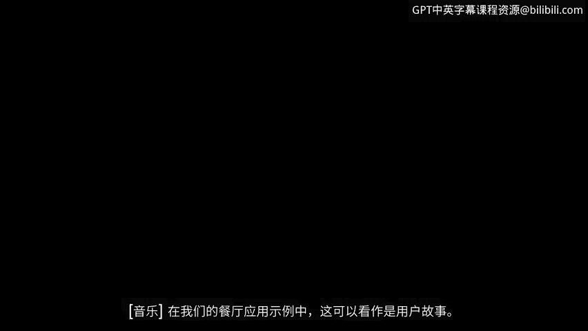
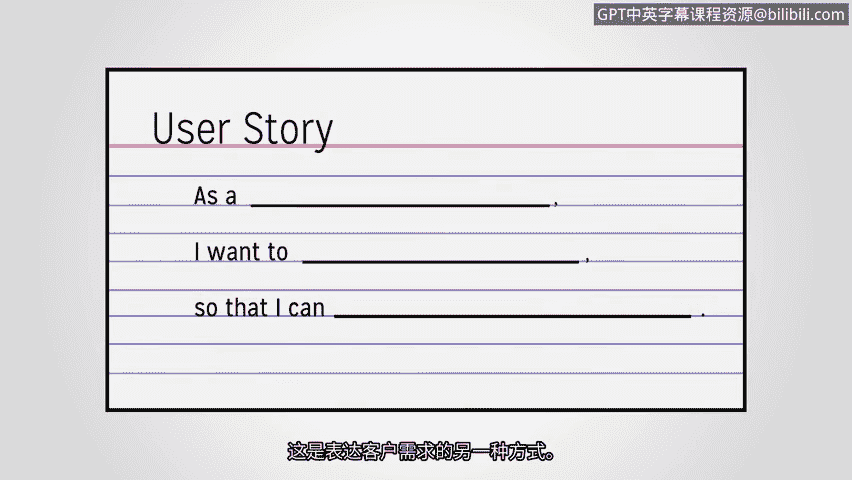

# 024：用户故事 📝

在本节课中，我们将学习用户故事的概念，了解如何编写高质量的用户故事，并认识什么是“史诗”以及如何避免它。

## 什么是用户故事？

上一节我们介绍了需求的不同表达形式，本节中我们来看看用户故事。用户故事是从用户角度描述软件功能的一种简洁方式。它通常遵循一个简单的模板：**作为[某类用户]，我想要[执行某个操作]，以便于[达成某个目标或获得某种价值]**。

在我们的餐厅应用示例中，一个用户故事可能如下所示：

> 作为一名顾客，我想要支付我的账单，以便于我能快速结清欠款。

## 如何编写高质量的用户故事？

一个看似简单的用户故事可能包含许多未明确的细节。例如，用户是在应用内支付账单吗？接受哪些支付方式？这些问题在故事中都没有得到解答。因此，实现这个故事所需的工作量是不明确的。

为了编写出高质量的用户故事，我们可以使用一个名为 **INVEST** 的助记符。以下是其核心原则：

*   **独立的**：每个故事应尽可能独立，不依赖于其他故事的完成。
*   **可协商的**：故事是需求的占位符，其细节应在开发团队和客户/产品负责人之间讨论确定。
*   **有价值的**：每个故事必须为最终用户或客户提供明确的价值。
*   **可估算的**：开发团队应能估算完成故事所需的工作量。
*   **小的**：故事应足够小，以便在一个迭代或冲刺中完成。
*   **可测试的**：必须能够定义明确的验收标准来验证故事是否完成。

一个好的实践是提供足够的信息，让开发人员能够理解并实现它，但又不能过多，以至于开始指定实现细节。

## 什么是“史诗”以及如何避免？

当一个用户故事过于庞大、模糊，以至于无法准确估算或在一个迭代内完成时，它就被称为“史诗”。我几秒钟前提到的故事“作为一名顾客，我想要支付我的账单”就是一个史诗。

问题在于，估算通常遵循一种称为“不确定性锥”的模式。我们将在敏捷规划课程中详细介绍它。但基本思想是：**开发一个用户故事的时间估算，距离其计划开发的时间越远，准确性就越低**。因此，如果你计划在几个月后开发一个功能，你的估算肯定不如你为本周要开发的功能所做的估算准确。

为了避免编写史诗，第一步是要意识到你可能正在创建一个。如果你将史诗分解为多个更小的故事，你会发现管理起来更容易。

以下是将“支付账单”这个史诗分解的一种方式：

*   作为一名顾客，我想要能够看到包含该订单所有项目的账单，以便于我能了解我的订单将花费多少钱。
*   作为一名顾客，当我查看账单时，我想要能够选择“立即支付”选项，以便于我能立即支付账单。
*   作为一名顾客，我想要能够输入Visa或Mastercard信用卡的支付信息，以便于我能使用一种便捷的方式付款。

所有这些都属于“支付账单”这个广泛主题，但它们更加具体和有用。

## 练习与总结

想象一下，你正在构建一个软件产品，用户可以从客户网站上选择眼镜进行购买。以下哪个用户故事会被视为该产品的“史诗”？

A. 作为一名戴眼镜的人，我想要看到，以便于我能屠龙。
B. 作为一名戴眼镜的人，我想要购买新眼镜，以便于我能快速收到它们。
C. 作为一名戴眼镜的人，我想要查看可供购买的眼镜列表。
D. 作为一名戴眼镜的人，我想要查看可供购买的眼镜的价格。

**正确答案是 B**。A不是一个史诗，因为它甚至不是一个与产品相关的用户故事。C和D都是概述了特定功能而没有深入技术细节的故事。

本节课中我们一起学习了用户故事。它是表达客户需求的另一种方式。然后，我介绍了构成一个好用户故事的标准，引入了代表“独立、可协商、有价值、可估算、小、可测试”的 **INVEST** 助记符。最后，我讲解了什么是史诗以及如何避免它。

在下一课中，我将讨论如何使用户故事可测试，并介绍用户故事验收测试的概念。我们下节课见。

