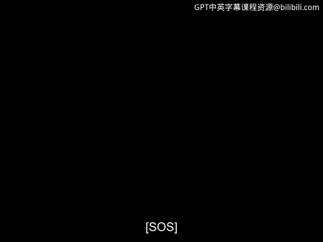
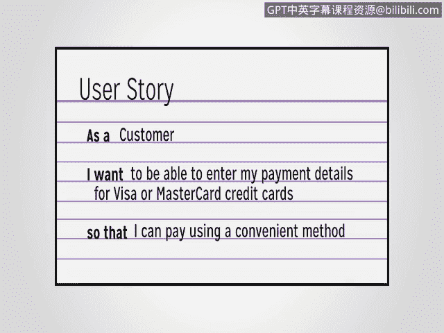
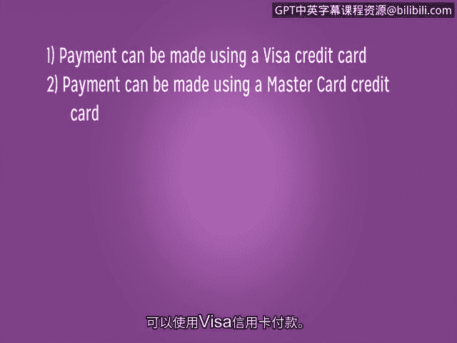
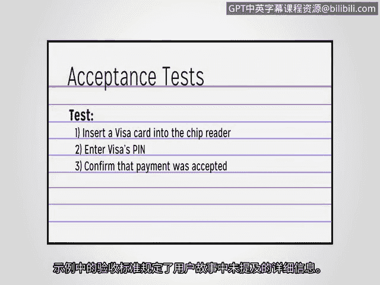

# 025：验收测试 🧪

在本节课中，我们将要学习一个与用户故事直接相关的概念——验收测试。我们将了解什么是验收测试，它与验收标准有何区别，以及如何编写有效的验收测试来确保用户故事被正确实现。

在上一节中，我们介绍了用户故事，并讲解了如何使用“INVEST”助记符来编写一个好的用户故事。本节中，我们将聚焦于“INVEST”中的最后一个字母“T”，即可测试性。既然用户故事应该是可测试的，那就意味着我们需要为它们编写测试。

## 什么是验收测试？

验收测试本质上是一种检查，用于验证某个需求是否被满足。这种测试方法几乎应用于所有工程领域，软件工程也不例外。验收测试具体说明了你的客户将如何验证一个用户故事是否已得到满足。如果验收测试通过，那么该用户故事就被认为是已完成的。

验收测试是基于**验收标准**创建的。验收标准是一个必须满足的特定条件，而验收测试则是验证该条件是否已满足的方法。

## 如何编写验收测试？

与用户故事一样，验收测试也应使用简单、直接的语言编写。每个验收测试都应该是一个易于理解的操作，并附带一个可验证的条件，以确保用户故事被正确实现。每个测试应验证用户故事的一小部分。如果所有测试都通过，那么验收标准就被视为已满足。

还记得我们在上一课中创建的用户故事吗？

> 作为一个客户，我希望能够使用Visa和Mastercard信用卡输入我的付款信息，以便我能通过便捷的方式付款。

以下是为这个用户故事编写的一些验收测试示例：

以下是该用户故事的一些验收测试示例：
*   付款可以使用Visa信用卡完成。
*   付款可以使用Mastercard信用卡完成。
*   付款可以使用在线金融服务完成。
*   当使用信用卡付款时，填写卡号字段会自动检测卡类型。
*   客户根据所选的付款方式，仅看到相关的输入字段。

这些只是几个例子，实际可能会有更多，验收标准的内容通常由客户的具体需求决定。请注意，所有这些标准都遵循相似的结构：它们简单、易于验证，并且都与用户故事中指定的不同付款类型相关。

## 从标准到测试

既然这些都是标准，我们就需要验收测试来验证它们。让我们以“能够使用Visa信用卡付款”这个标准为例。

为了将这个标准转化为验收测试，我们可能会为此标准编写几个测试，例如：
1.  将Visa卡插入芯片读卡器。
2.  输入Visa卡的PIN码。
3.  确认付款被接受。

通过执行这些步骤，你就验证了验收标准。当你通过了所有的验收测试，那么该验收标准就被视为已满足。如果一个用户故事的所有验收标准对应的测试都通过了，那么这个用户故事就成功地通过了验收测试。

## 知识测验

现在你已经了解了验收标准和验收测试是如何创建的，让我们来测试一下你的理解。

你正在与客户合作开发一个酒店管理应用程序，并收到了以下用户故事：
> 作为一名客房服务人员，我希望能够在房间概览屏幕上将房间标记为已清洁，以便我能跟踪我的清洁进度。

以下哪一项可被视为该用户故事的验收测试？
A. 从房间概览屏幕中，选择“将房间标记为已清洁”。
B. 房间可以从房间概览屏幕标记为已清洁。
C. 房间应该被清洁。
D. 作为一名客房服务人员，我希望能够清洁一个房间。

正确答案是 **A**。它概述了使用应用程序将房间标记为已清洁的一个基本步骤。它可能是众多步骤之一，但它仍然是一个测试。

**B** 是一个验收标准，因为它是一个必须满足的通用条件。其他两个选项既不是验收测试也不是验收标准。事实上，**D** 完全是另一个用户故事。

## 验收测试的价值

示例中的验收标准规定了用户故事中未提及的细节。通过列出验收标准，你为开发团队提供了一个参考框架，让他们知道如何将故事分解为开发任务并最终完成。

当验收标准和测试与它们所伴随的用户故事一起编写时，你就能确保你想要实现的功能确实可以验证其实现。

与用户故事一样，验收标准和测试也应由你的客户来制定。然而，让开发人员与客户一起创建验收测试也是一个好主意。这能让客户就他们希望需求如何运作提供意见，同时也让开发团队能够从用户的角度来思考每个需求的具体表现。

因此，客户对产品功能有很大的发言权，而开发团队也能够设想每个功能将如何构建。通过这样仔细思考每个需求，也有助于你避免创建那种令人畏惧的“史诗级”用户故事。一个用户故事有太多的验收标准，可能意味着你可以把这个用户故事再拆分得更细一些。

## 总结

本节课中，我们一起学习了验收测试。它只是一个简单的条件列表，用于检查用户故事是否正确实现。它们可以以直接的方式进行验证，并使项目中的每个人都能轻松地思考每个功能的具体作用。

在下一课中，我将介绍产品待办事项列表，这是一种用于跟踪需求的流行Scrum实践。我们下节课见。