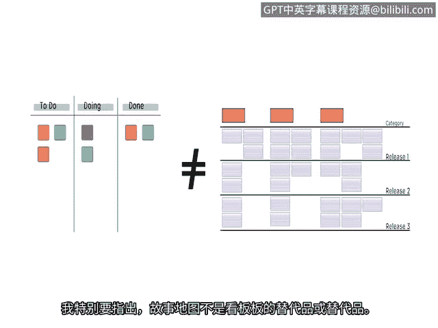

**软件产品管理课程3：客户需求与软件需求：3.3.5：故事地图 🗺️**

在本节课中，我们将要学习一种用于组织和可视化需求的新工具——故事地图。上一节我们介绍了Scrum产品待办事项列表，本节中我们来看看故事地图如何以更直观的方式呈现和管理用户故事。

故事地图是一种将产品待办事项列表中的用户故事，按照更具体的功能类别进行分组和可视化的方法。它本质上是一个二维结构，能够更清晰地展示产品功能的整体脉络和用户故事的关联性。

以下是一个故事地图的构建示例。假设你正在开发一个简单的电子邮件程序，客户提供了一系列用户故事，例如：

*   作为一名作者，我希望能够撰写纯文本消息，包含收件人、主题行和正文，以便我能以基本方式传达消息内容。
*   作为一名读者，我希望在收到邮件时能够打开它们，以便阅读最新消息。
*   作为一名读者，我希望能够将消息存储到存档中，以便将来参考。
*   作为一名读者，我希望能够在我的存档中搜索消息，以便快速找到相关消息，而无需手动浏览。
*   作为一名作者，我希望能够将文件附加到我的消息中，以便为消息添加额外信息。
*   作为一名读者，我希望能够打开消息中的任何附件，以便查看接收到的消息中的额外信息。

你可以根据产品的基本功能来创建类别标题，对上述故事进行分组。例如，基本功能可以是“撰写与发送”、“阅读、接收与存储”以及“搜索”。将每个故事放入相应的类别后，你就能立即看出哪些功能已覆盖，哪些可能缺失。随后，客户可以在各个类别内根据其判断对这些故事进行优先级排序。这样一来，一个可能令人望而生畏的需求列表，就变成了一套组织有序、便于管理的待实现功能集。

现在你已经了解了故事地图的创建过程。请思考一下，创建故事地图能为你的项目带来哪些好处。

以下是故事地图可能带来的益处，请选择你认为正确的选项：
A. 在初始规划阶段节省时间。
B. 简化优先级排序。
C. 让你对项目将如何发展有一个整体视图。
D. 提供详细的开发计划。

正确答案是B和C。故事地图能简化优先级排序，并让你对项目的发展有一个整体视图。它不会在初始规划阶段节省太多时间，但可能会在后续阶段节省时间。同时请记住，故事地图本身并不是一个开发计划。

与经典的产品待办事项列表相比，故事地图还提供了许多改进。首先，它赋予待办事项列表更强的可追踪性和视觉感受。你不再需要费力管理一个庞大列表的优先级，而是被迫将事项分解到不同类别中。

另一个改进是，它让你能够看清各个用户故事之间的关系。故事地图允许你看到这些需求是如何组合在一起的，而不是处理一堆按优先级排序的孤立需求。通过可视化需求之间的联系，你可以非常容易地发现是否有遗漏之处，从而相应地填补这些空白。

故事地图的另一个巨大好处是，它能让你的开发人员了解产品应如何作为一个整体来构建。许多产品都有多个可被视为主要功能的类别或功能组。在经典的一维产品待办事项列表中，来自一个功能组的用户故事很容易压倒来自另一个功能组的故事。然而，在故事地图中，位于地图顶行的所有用户故事都具有相同的重要性级别。这不仅简化了优先级排序，还让你能了解产品在每次迭代中实现了什么。

如果你将每个水平行视为产品的一个发布版本，那么你就可以看到产品如何随着你逐行向下移动地图而演进和增长。例如，在你之前看到的例子中，产品可能会从仅支持基于文本的交互，发展到支持多媒体文件的传输。故事地图确保你将开发精力均匀地分配到各个功能上，而不是只专注于构建某一个类别（这可能无法完全满足客户需求）的功能。它为开发人员的工作提供了上下文，表明在转向更复杂的工作之前，最好先实现简单的功能。你不会构建一个能发送多媒体和文本邮件，却无法阅读它们的电子邮件系统。故事地图提供了有时识别这些依赖关系所需的上下文。

这是敏捷原则中“构建可工作的软件”的一个绝佳实践示例。你不是在构建一个任意的需求列表，而是在实际展示整个产品在各个阶段如何组合在一起。

如果你之前学习过我们的软件过程与敏捷实践课程，你应该见过看板（Kanban board）的样子。这里需要特别指出，故事地图并不是看板的替代品。看板是一种展示项目当前状态和跟踪任务进展的方式，而故事地图是一种在二维结构中规划和组织用户故事的方式。实际上，你可以同时使用故事地图和看板来规划和跟踪项目，这并不少见。

因此，故事地图的核心是一种让你的需求变得更好的方法。它为项目中的每个独立需求提供了上下文，并为项目带来了更强的组织结构。当然，故事地图仍然支持软件产品中不可避免的变更。甚至可以说，它比经典的产品待办事项列表更好地支持变更。它让开发人员和客户对产品的整体性有所感知，快速了解各个部分是如何组合在一起的。

在本节课中，我们一起学习了故事地图的概念、构建方法及其优势。故事地图通过将用户故事按功能分组并可视化，简化了优先级排序，提供了产品发展的整体视图，并帮助识别需求间的依赖关系和潜在遗漏。它是一种强大的工具，能为开发团队提供必要的上下文，确保产品均衡发展。在下一个模块中，Morgan将与你探讨更多改进需求的方法。