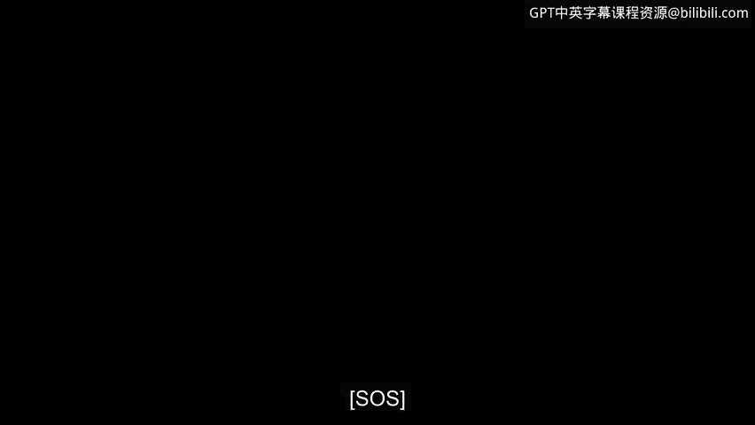
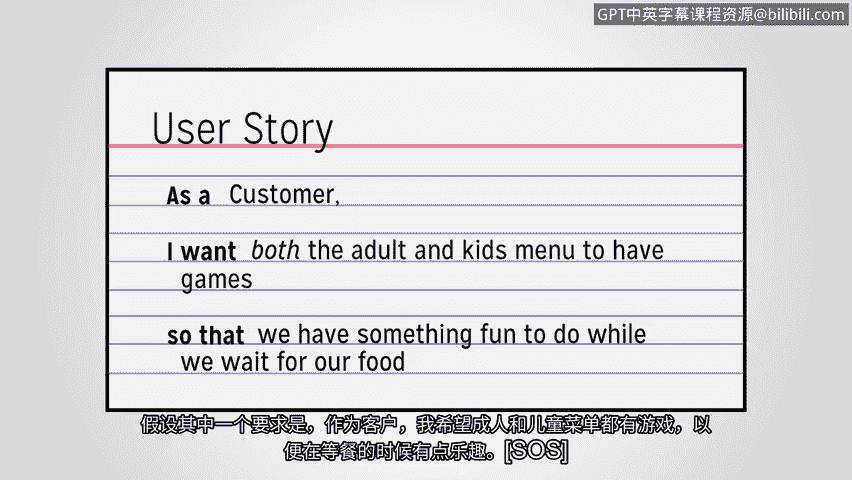

# 030：客户需求与软件需求

## 第3.4.1a节：用户故事标准 📝

在本节课中，我们将学习如何评估和撰写高质量的用户故事。用户故事是描述软件需求的简洁方式，但为了确保开发过程顺利并最终交付符合期望的产品，它们需要满足一系列明确的标准。

上一节我们介绍了用户故事的基本概念，本节中我们将深入探讨用户故事应满足的具体质量标准。

### 用户故事应完整

首先，我们希望用户故事是**完整**的。这意味着描述问题所必需的所有需求都应被包含在内。

由于您的开发团队将根据产品待办事项列表中的用户故事来开发解决方案，如果缺少某些需求，相应的功能将无法被实现。

像故事地图这样的工具对于判断是否遗漏用户故事非常有用。

### 用户故事应清晰

接下来，让我们看看如何使用户故事**清晰**。这意味着用户故事应易于理解、精确无误，并且只有单一的解释。

这个标准要求很高。当您仔细审查用户故事中的歧义时，会发现一个句子竟然可以有多种不同的理解方式，这非常令人警醒。

希望您能理解一个可被多种方式解读的用户故事所带来的风险。如果客户以一种方式理解，程序员以另一种方式理解，而测试人员又有不同的理解，那么很难判断谁是正确的，以及究竟应该开发什么。

一项有助于减少歧义的重要实践是进行**需求技术评审与修复**练习。在这个练习中，最好由项目外部人员根据本课的所有标准来评审需求，其中就包括审查需求的歧义性。

我们将在下一课详细讲解如何撰写无歧义的用户故事，但这里先看一个例子。

假设有一条需求是：“**作为一名顾客，我希望成人和儿童菜单上都有游戏，以便我们在等待食物时有有趣的事情可做。**”

“都有”这个词在这个用户故事中造成了歧义。这个用户故事可能意味着儿童菜单上有儿童游戏，成人菜单上有成人游戏；但也可能被解释为儿童菜单和成人菜单上的游戏是相同的。

为了使需求更清晰，除了依赖自然语言描述，另一种方法是使用视觉描述（如线框图和故事板）来补充您的需求。

我们将在本模块的后续部分进一步探讨如何识别和修复有歧义的需求。

### 用户故事应一致

现在我们来谈谈用户故事的**一致性**。保持用户故事一致意味着各项需求之间互不冲突。这显然会在后续开发过程中引发问题。

您的客户和开发团队已经完成了一份用户故事列表，并希望您在下次讨论会前进行评审。在这次评审中，您需要确保用户故事是一致的。

以下是判断练习：

您的客户和开发团队已完成一份用户故事列表，并希望您在下次讨论会前进行评审。在这次评审中，您需要确保用户故事是一致的。

**以下哪些用户故事彼此冲突？请选择两个互不一致的用户故事。**

A. 作为一名儿童顾客，我希望可以自己点餐，以便得到我想吃的食物。
B. 作为一名顾客，我希望在点餐后能查看订单，以确保我们点得正确。
C. 作为一名厨房员工，我希望查看已接收的订单，以便知道需要准备哪些菜品。
D. 作为一名顾客，我希望能够为我的家人点餐，以便监控他们吃了什么。

**答案 A 和 D 不一致。** 因为在答案 A 中，儿童顾客可以自由点餐，而在 D 中，顾客（家长）要为家人点餐以监控饮食，这两者存在矛盾。其他组合彼此一致。因此，答案 A 和 D 是正确答案。

### 用户故事应可行

接下来，我们讨论用户故事的**可行性**。这意味着每项需求都能够在指定的成本和进度约束内，利用现有的技术、工具、资源和人员来实现。

如果您经常遇到不切实际的用户故事，我欣赏您的雄心，但这是一个不满足就会带来风险的标准。您需要诚实地审视您的资源、团队、进度和预算。您真的能完成所有承诺的需求吗？

不满足此标准将导致额外成本和客户不满。我个人非常希望避免这两点。

### 用户故事应可追踪

我们希望满足的最后一个标准是用户故事的**可追踪性**。这意味着每项需求都以某种可追踪的方式与相关的设计和实现工件（如代码、测试）相关联。

简单来说，对于每项需求，都有对应的代码和测试。同时，每一段源代码都对应某项需求，并且每一段源代码都有测试。

保持用户故事可追踪意味着只编写必要的代码，并且所有需求都经过测试。这两点都是开发过程中期望具备的优秀品质。

您可以为每项需求设置一个唯一标识符，以帮助开发人员在代码、测试、错误报告和变更日志中引用它。

### 课程总结

现在您已经了解了用户故事应满足的标准。

在上一个模块中，您学到用户故事应满足 **INVEST** 标准，即**独立**、**可协商**、**有价值**、**可估算**、**小规模**和**可测试**。

在本节课中，您进一步学习了用户故事还应是**正确**、**完整**、**清晰**、**一致**、**可行**和**可追踪**的。

改进您的用户故事以满足这些标准，将能防止项目中出现错误或不必要的工作。高质量的用户故事最终将导向高质量的产品。