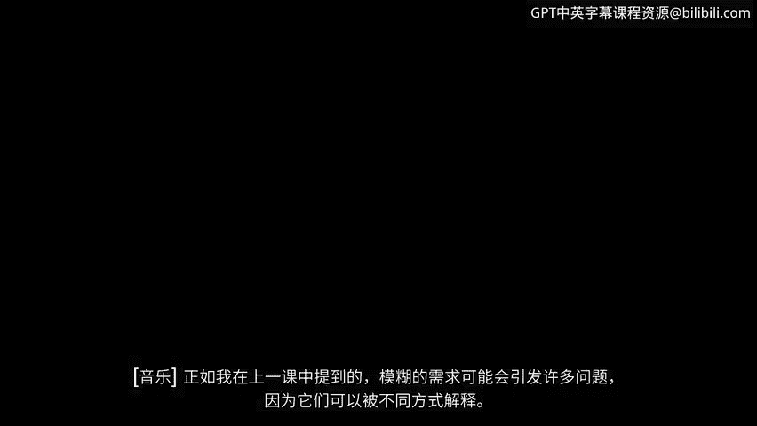
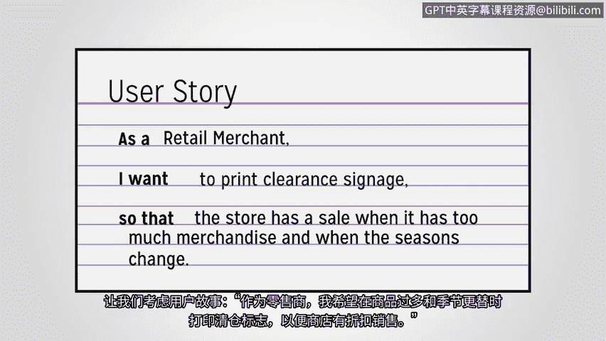

# 031：含糊需求

## 概述
在本节课中，我们将学习什么是含糊需求，以及它们为何会导致问题。我们将探讨11类容易引发歧义的词语，并通过实例学习如何识别和避免它们，以确保开发人员能准确理解需求。

---

## 含糊需求的问题
上一节我们介绍了需求管理的重要性，本节中我们来看看含糊需求带来的具体问题。

含糊需求指那些可以用多种方式解释的需求。它们通常缺乏清晰或足够的细节来做出正确解读。这会导致沟通误解，最终造成软件构建错误，从而浪费时间和金钱等资源。

## 识别含糊需求的方法
为了识别含糊需求，我们可以关注一些特定类别的词语。以下是11类可能导致歧义的词语。请注意，使用这些词语并不总是导致歧义，但需要仔细考虑，并可能需要添加额外信息来消除歧义。

我们的11个类别是：间接词语、模糊词语、劝说词语、完成词语、限定词、比较词、数量词、代词、方位词、时间词和连接词。

### 1. 间接词语
这类词语暗示某事可能发生，但未具体说明如何或何时发生。例如：**should**、**could**、**may**、**will**。

如果陈述没有解释事件**应该**或**可能**发生的具体条件，那么“should”和“could”就可能意味着含糊。同样，“may”也是如此。

考虑以下用户故事示例：
> 作为一个在线扑克玩家，我**可能**会赢钱，这样我就能因赢得游戏而获得奖励。

在这个例子中，不清楚在线扑克玩家在何种情况下会赢钱。可以通过指定这些信息来澄清这个用户故事。

更好的写法是：
> 作为一个在线扑克玩家，当我在扑克游戏中战胜对手时，我**会**收到钱，这样我就能因赢得游戏而获得奖励。

最后，间接词语类别中的最后一个词是“will”。如果陈述没有具体说明事件**何时**发生，那么“will”就是含糊的标志。它是始终发生还是仅有时发生？如果事件每次都会发生，最好使用“must”。如果事件只在一定条件下发生，请指定这些条件。

### 2. 模糊词语
模糊词语通常是描述中缺乏细节的动作、对象名称或说法。问题不在于存在多种解释可供选择，而是没有足够的细节来做出任何解释。

以下是模糊词语的例子：
*   **模糊动作**：processed（处理）、handled（处理）、operated（操作）。
*   **模糊对象名称**：item（项目）、entity（实体）、unit（单位）。
*   **模糊说法**：as appropriate（酌情）、where applicable（如适用）、within reason（在合理范围内）。

对于模糊对象名称，要么用更具描述性的名称替换这些术语，要么确保该术语在产品术语表中定义并一致使用。对于模糊说法，需要明确具体是什么决定了“适当性”、“适用性”或“合理性”。

### 3. 完成词语
这类词语的例子包括：**and so on**（等等）、**and so forth**（等等）、**etc.**（等等）、**also**（也）。

“and so on”这类词通常暗示列表中还有更多可以命名的成员，但为了简洁而没有列出。确保在列出事物时，提供列表包含内容的必要细节。通用的归属规则可能并不明显，因此不要将规则留待解释。

“also”这个词也属于这一类。它通常出现在对现有陈述的补充中。如果脱离上下文理解添加的从句，或者与前面的陈述不一致，就可能导致歧义。因此，如果在需求中使用“also”，请务必提供上下文来说明“also”从句的含义。

考虑以下用户故事：
> 作为一个文档创建者，我**也**想将文本文档存储在桌面文件夹中，以便我可以轻松访问它。

关于这个用户故事，以下哪种解释可能是正确的？
A. 文本文档出现在桌面文件夹以外的其他地方。
B. 另一个文档与文本文档一起出现在桌面文件夹中。
C. 除了我正在做的事情之外，我**还**将文本文档存储在桌面文件夹中。
D. 以上所有。

实际上，所有三种情况都可能同时发生。因此，D是正确答案。由此可见，在使用“also”时提供上下文非常重要。

### 4. 劝说词语
这类词语包括：**clearly**（显然）、**certainly**（当然）、**obviously**（显然）。

如果一个陈述是“显然的”，它对所有读者来说都真的显然吗？读者为什么要相信它？这个陈述是在断言观点而不是事实吗？用户故事不需要说服，因此应避免使用这些词语。

### 5. 限定词
到目前为止，我们看到的类别和例子都是因为缺乏信息而导致歧义。现在我们将看看那些因为限定或修饰某些条件而可能意味着含糊的词语。

限定词的例子包括：**all**（所有）、**every**（每个）、**only**（仅）、**no/none**（无）、**never**（从不）、**always**（总是）、**sometimes**（有时）、**often**（经常）、**usually**（通常）。

“all”和“every”导致歧义的原因相似。考虑以下用户故事：
> 作为管理员，我希望**所有**社交媒体用户都使用一个帐户，以便我可以跟踪他们的使用情况。
> 作为管理员，我希望**每个**社交媒体用户都使用一个帐户，以便我可以跟踪他们的使用情况。

这两个用户故事都可能意味着所有社交媒体用户使用同一个帐户，也可能意味着每个用户都有自己的帐户。

接下来，我们看看“only”这个词。使用时要小心，尤其是在英语中，因为根据“only”在句子中的位置，可能会导致含义完全不同。

考虑句子：
> Premium account holders are allowed to read the full online article.
> （高级帐户持有者被允许阅读完整的在线文章。）

我们可以插入“only”来使句子表达不同的意思。
1.  **Only** premium account holders are allowed to read the full online article.
    （**只有**高级帐户持有者被允许阅读完整的在线文章。）这意味着不允许其他帐户持有者阅读完整的在线文章。
2.  Premium account holders are **only** allowed to read the full online article.
    （高级帐户持有者**只**被允许阅读完整的在线文章。）这意味着高级帐户持有者除了完整的文章外，不允许阅读任何其他内容。
3.  Premium account holders are allowed to read the full online article **only**.
    （高级帐户持有者被允许阅读**仅**完整的在线文章。）这也能表达与第2点相同的意思。
4.  Premium account holders are allowed to read the **only** full online article.
    （高级帐户持有者被允许阅读**唯一**的完整在线文章。）这意味着只有一篇完整的在线文章可用，并且高级帐户持有者被允许阅读它。

使用“only”时，请确保你用它来修饰句子以表达正确的含义。

### 6. 比较词
比较词是用于比较两个或更多事物的短语。它们也是含糊的标志。

如果我们用比较两辆车大小的例子，可能会使用以下短语：
*   Car A is the same as car B. （车A与车B相同。）
*   Car A is bigger than car B. （车A比车B大。）
*   Car A is the biggest. （车A是最大的。）
*   Car A is more spacious than car B. （车A比车B更宽敞。）
*   Car A is as big as a truck. （车A和卡车一样大。）

这些短语中的每一个都是含糊的或缺乏细节。当我们将车A与车B进行比较时，我们指的是物理整体尺寸、高度、宽度、内部空间、载货容量、头部空间还是发动机尺寸？比较两个对象时，请务必具体说明正在比较对象的哪个特定属性。

同时，注意使用以“-er”结尾的单词，如bigger（更大）、smaller（更小）、wider（更宽），或以“-est”结尾的单词，如biggest（最大）、smallest（最小）、widest（最宽）。

### 7. 数量词
涉及数量的词语也可能导致歧义。例如：**a/an**（一个）、**some**（一些）、**most**（大多数）、**few**（少数）。

“a”或“an”是你经常遇到的词。考虑以下例子：
> 作为一个填字游戏解谜者，我希望应用程序有一个填字游戏，这样我就可以在我喜欢的消遣中挑战自己。

“一个填字游戏”是指应用程序上只有一个填字游戏，还是指应用程序上至少有一个填字游戏？为了避免“a”或“an”带来的歧义，可以使用诸如具体数字或“至少某个最小数量”之类的量词。

例如，你可以说：
> 作为一个填字游戏解谜者，我希望应用程序**至少有一个**填字游戏，这样我就可以在我喜欢的消遣中挑战自己。

如果陈述没有给出具体的数量或涉及哪些项目，那么“some”、“most”和“few”就表示含糊。

### 8. 代词
代词是诸如 **he**（他）、**she**（她）、**it**（它）、**we**（我们）、**you**（你/你们）、**they**（他们）、**us**（我们）、**our**（我们的）、**this**（这个）、**that**（那个）等词语。

代词可能导致含糊的短语，因为可能不清楚代词代表的是哪个名词。

例如，在用户故事中：
> 作为一个虚拟农场主，我希望**它**能生长，这样我就可以卖掉**它**换取虚拟资金。

这里不清楚“it”指的是什么。“it”可能指的是虚拟农场本身、虚拟作物或虚拟农场动物。为了避免混淆，应该定义并使用更具体的术语，而不是使用代词。

### 9. 方位词
方位词的例子包括：**after**（在…之后）、**before**（在…之前）、**following**（跟随）、**last**（最后的/上一个）。

对于这些词，我们以数据库条目为例。如果我们说“条目A出现在数据库中的条目B**之前**”，这可能意味着条目A直接出现在条目B之前，也可能意味着条目A出现在数据库中条目B之前的任何位置。类似地，我们可以说“条目B出现在数据库中的条目A**之后**”，或者“条目B出现在数据库中**跟随**条目A”。所有这些短语出于同样的原因都是含糊的，需要更明确地指定条目的出现位置。

现在看看这个短语：“I am making changes to the **last** entry.”（我正在修改**最后一个**条目。）这里的“last”一词导致了很多歧义。这可能意味着我正在修改**上一个**条目，也可能意味着我正在修改出现在**最末尾**的条目，还可能意味着不会再添加更多条目，而这个条目将是**最终的**条目。

### 10. 时间词
这类词与时间或事件相关，类似于方位词（如果指的是时间而非位置，方位词也可归入此类）。时间词的例子包括：**when**（当…时）、**for**（持续）、**until**（直到）、**from**（从…起）、**current**（当前的）、**latest**（最新的）。

首先看看“when”。考虑以下例子：
> 作为一个跑步者，我希望当我开始绕跑道跑一圈时，圈速计时器**会**设置为0，这样我就可以监控我的配速。

这可以解释为：计时器在跑步者开始跑一圈的**时刻**设置为0。它也可能意味着：计时器在跑步者**第一次**开始跑一圈时设置为0。但它还可能意味着：计时器在跑步者**每次**开始绕跑道跑一圈时都设置为0。

接下来，看看例子中的“for”：
> 作为一个露营者，我希望产品能显示**未来三天**的天气，这样我就能看到露营期间的天气情况。

这个用户故事可以有两种不同的解释。一种方式是产品显示三天的天气预报。另一种方式是产品在接下来的三天里显示每日天气，之后就不再显示。

### 11. 连接词
连接词是连接两个或多个短语或对象的词语。例如：**and**（和）、**or**（或）、**both**（两者都）。

首先，看看“and”可能引起的歧义。考虑用户故事：
> 作为一个零售商人，我想打印清仓标识，这样当商店商品过多**和**季节变化时，商店就可以进行促销。

那么，这是否意味着当商店商品过多时进行促销，**并且**在季节变化时也进行促销？还是暗示了一个双重条件，即商店只有在**同时**商品过多**并且**季节正在变化时才进行促销？在第一种情况下，明确地将需求分解为两个独立的需求来分别满足是更好的做法。

最后，“or”也会引起歧义。“or”的问题在于它没有区分在**两个条件都成立**的情况下会发生什么。

## 其他发现歧义的方法
在你的用户故事中扫描特定词语作为含糊的标志，并不是确定你是否有不明确需求的唯一方法。

另一个确保你的需求和术语表都没有歧义的好方法是，用术语表中的定义替换用户故事中的术语。你的用户故事仍然有意义吗？你的术语表定义是否恰当地代表了该术语？通过这样做，你可能会发现需要向术语表中添加更多术语、重新定义术语表中的术语，或者重写一些用户故事。

## 总结
在本节课中，我们一起学习了含糊需求的定义及其危害。我们深入探讨了11类容易导致需求含糊的词语，包括间接词、模糊词、劝说词等，并通过具体实例分析了每类词语的问题所在以及如何修正。最后，我们还介绍了通过术语表验证等方法来发现和消除歧义。掌握这些知识，将帮助你编写出更清晰、更准确的需求，从而与开发团队进行更有效的沟通，确保软件产品正确构建。