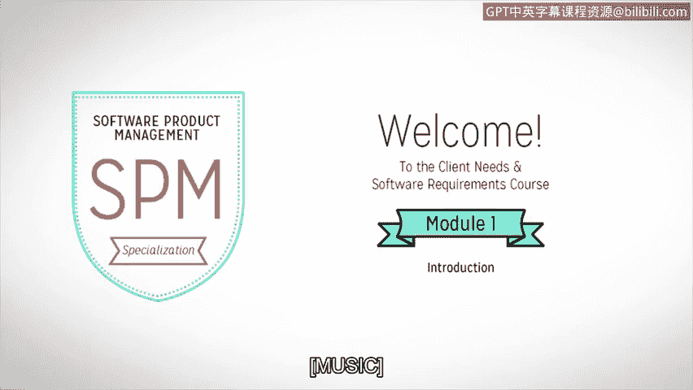

# 034：课程介绍

## 概述

在本节课中，我们将学习《客户需求与软件需求》课程的核心内容。课程将介绍如何理解客户与用户的需求，并将其转化为清晰的软件需求，以指导软件开发。

## 课程结构预览

我是Ken Wang，欢迎来到软件产品管理专项课程中的《客户需求与软件需求》课程。本课程是该专项课程的基础组成部分，描绘了专项课程结构中的一个支柱。

在介绍性课程中，我们提到开发更好的软件涉及三个目标：**做正确的产品**、**正确地做产品**以及**正确地管理产品**。

为了识别“正确的产品”，你必须理解你的客户和用户的需求。这不仅仅是他们想要什么，还包括他们需要解决什么问题、需要完成什么任务、谁将使用软件以及用户将如何与之交互。当你能够回答这些问题时，你就能帮助你的开发团队构建正确的产品。

为了实现“正确地做产品”和“正确地管理产品”，软件开发必须从一套清晰的软件需求开始，这些需求随后将被规划、设计、实现和测试。

在本课程中，你将学习如何从客户和用户那里收集需求。你还将学习如何将这些需求表达为一套需求规格，以启动软件开发和规划活动。

## 各模块内容简介

以下是本课程四个模块的主要内容介绍。

### 第一模块

在第一模块中，Bradley Pette将概述几种类型的健康需求，并解释如何处理需求变更以及避免范围蔓延的方法。该模块还将讨论需求与设计之间模糊边界的问题。

### 第二模块

在第二模块中，Morgan Ptzel将描述为人们制作产品时遇到的问题，并介绍收集他们需求的有效方法。她还将解释如何应用用例来捕获项目需要支持的任务。随后，你将了解如何应用两种视觉设计技术——线框图和故事板，这些技术在产品早期讨论中非常有用。

### 第三模块

在第三模块中，Bradley将回来讨论敏捷需求技术。具体来说，他将描述用于表达需求的**用户故事**、用于验证需求的**验收测试**、用于确定优先级的**项目待办事项列表**以及用于组织需求的**故事地图**。

### 第四模块

在第四也是最后一个模块中，Morgan将回来概述有效的软件需求和用户故事需要具备的几个标准。同时，她将指出需要注意的歧义迹象，以确保需求不会被误解。

## 总结

在本节课中，我们一起预览了《客户需求与软件需求》课程的全貌。到本课程结束时，你将掌握一套实用的技术，用于收集客户和用户的需求，并清晰地表达这些需求。你将能够应用这些技术来构建更好的软件产品，即“正确的产品”。