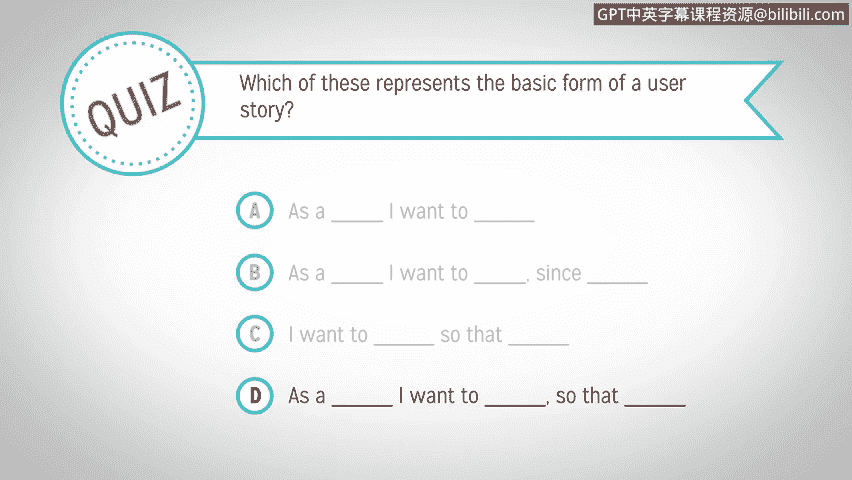

# 038：客户需求与软件需求

## 概述
在本节课中，我们将要学习软件需求的不同类型，特别是用户需求。我们将了解用户需求是什么，为什么它们至关重要，以及如何以清晰、结构化的方式来表达它们。

---

上一节我们讨论了业务需求和业务规则，它们关注的是产品的整体存在原因和构建规则。本节中我们来看看与产品用户直接相关的需求类型。

### 用户需求
用户需求明确规定了用户能够使用产品完成哪些任务。用户是指最终会使用你软件的个人，因此他们常被称为“最终用户”。由于最终用户对产品的成功至关重要，通常需要花费大量时间来制定这些需求。

事实上，用户需求很可能是开发团队最需要正确把握的需求。因为这些需求定义了最终用户如何与产品互动，定义了产品应为用户做什么。它们可以被视为正在开发产品的核心功能。

在本课程后面，我们将花时间讨论如何恰当地获取用户需求，并将其转化为具体的、可操作的开发任务。我们还将讨论如何创建好的用户需求，以及表达它们的一些不同方式。

所以，用户需求就是用户能用你的产品完成的任务。

以下是表达用户需求的两种常见方式：

1.  **用例**
    用例是展示系统与用户之间关系的好方法。我们将在下一个模块中更详细地介绍它们。请注意，在用例中，我们具体展示了不同的用户场景以及他们与系统交互的方式。

2.  **用户故事**
    用户故事的一般结构是：**作为一个 `<角色>`，我想要 `<功能>`，以便于 `<价值>`**。
    这种结构允许我们以确保首先考虑用户需求的方式来表述需求。例如：**作为一名软件产品经理，我想要创建用户故事，以便于我能更好地表达客户的需求**。

---

然而，客户需求通常以这种形式出现：“客户应该能够在系统中查看和支付账单。” 需求常常以模糊、非具体的术语给出。这当然不是客户的错，但这是软件产品经理必须解决的一个常见障碍，以确保他们的开发团队知道如何最好地构建产品。

对我而言，这是软件产品管理中最有回报的方面之一。能够将客户的需求提炼成具体、实在的东西，通常会带来一种满足感和条理性，就像一切都各归其位。

---

### 知识检查
以下哪项代表了用户故事的基本形式？
A. 作为一个 `<角色>`，我想要 `<功能>`。
B. 作为一个 `<角色>`，我想要 `<功能>`，因为 `<原因>`。
C. 我想要 `<功能>`，以便于 `<价值>`。
D. 作为一个 `<角色>`，我想要 `<功能>`，以便于 `<价值>`。

**正确答案是 D**：作为一个 `<角色>`，我想要 `<功能>`，以便于 `<价值>`。它遵循这种形式，以确保我们捕捉到需求的“谁”（角色）、“什么”（功能）和“为什么”（价值）。

---

## 总结
本节课中我们一起学习了用户需求。我们了解到用户需求定义了最终用户能够用产品做什么，是产品的核心功能。我们探讨了表达用户需求的两种主要方式：用例和用户故事，并重点掌握了用户故事“作为一个...，我想要...，以便于...”的标准结构。理解并清晰定义用户需求，是将模糊的客户需求转化为可执行开发任务的关键一步。