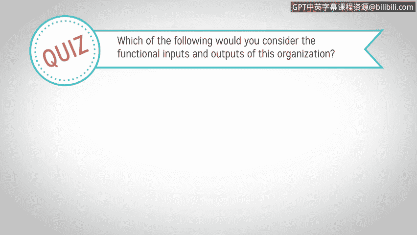

# 039：功能需求 🔧

在本节课中，我们将要学习一种由开发团队负责的需求类型——功能需求。我们将了解它的定义、如何描述它，并通过实例来加深理解。

---

## 功能需求的定义

上一节我们介绍了需求的不同类型，本节中我们来看看**功能需求**。

功能需求是指产品**应该执行或支持的行为**。它们可以通过输入、输出以及对行为本身的描述来表达。

---

## 一个简单的例子

想象一个场景：客户向你提出一个项目构想。他们想要一个移动销售点产品，该产品能通过客户专有的信用卡读卡器接收信用卡付款，然后向用户发送包含交易详情的收据。客户还提到，该产品应满足最高的安全和视觉设计标准。

请记住，功能需求涉及输入和输出。在这个简单的例子中，我们有一个输入（来自信用卡读卡器的数据）和一个输出（交易收据）。因此，你可以说：系统必须从信用卡读卡器读取数据，并且系统还必须向最终用户发送交易收据。

请注意，为了简化，我们省略了相当多的功能需求。你可能会想到，系统应该接收来自商家的交易信息作为输入。然后，经过某些确认操作，系统应向买家展示交易信息，并最终获取他们的PIN码信息。在这个例子范围内，你可以想到相当多的功能需求。

---

## 需求的深度

需求本身也具有**一定的深度**。一个声明“用户应能使用密码键盘支付”的功能需求并不具体。这可以分解为几个更深入、更具体的要求，例如：
*   用户应能刷卡（借记卡或信用卡）。
*   用户应能将信用卡或借记卡插入芯片读卡器。
*   当卡片被刷卡或插入时，用户将能够输入其PIN码。

如果你不够具体，可能会导致规划中的问题。你可能以为自己要做的工作很少，但实际上却有很多。关于这一点，我将在本课程后面更详细地探讨，现在只需意识到需求具有深度即可。

---

## 如何表示功能需求

表示功能需求的一种方法是使用**信息流图**，如下图所示。

信息流图为你提供了一种图形化方式来显示系统所有组件的数据流和依赖关系。基本上，它展示了系统的各个组件是如何连接在一起的，让你了解系统作为一个整体是如何运作的。信息流图提供了你可以逻辑地审查整个系统的上下文。

如果你想了解更多关于信息流图的信息，请查看课程资源。

---

## 练习：识别功能输入与输出

想象一个场景：你正在建立一个非营利组织，为社区中的低收入通勤者翻新自行车。你从捐赠者那里收到铝制自行车以及用于购买工具的资金。然后，你使用这些东西让自行车重新工作，并将它们交付给你的客户。

以下哪一项应被视为该组织的功能输入和输出？

A. 输入：捐赠的自行车和购买的工具；输出：客户。
B. 输入：捐赠的资金；输出：可工作的自行车。
C. 输入：捐赠的资金和自行车；输出：可工作的自行车。
D. 输入：自行车中的铝材和捐赠的资金；输出：可工作的自行车。

**答案是 C**。该组织接收资金和自行车，然后进行维修并交付给客户。输入是捐赠的自行车和资金，因为工具是使用捐赠的资金购买的。这些工具是用于修复自行车的过程的一部分。

---

## 总结

本节课中我们一起学习了**功能需求**。我们了解到功能需求描述了产品应执行或支持的具体行为，通常通过输入、输出和行为描述来定义。我们通过移动支付和自行车翻新组织的例子，练习了如何识别功能需求及其输入输出。同时，我们认识到需求具有深度，需要具体化以避免规划问题，并简要介绍了使用信息流图来表示功能需求的方法。