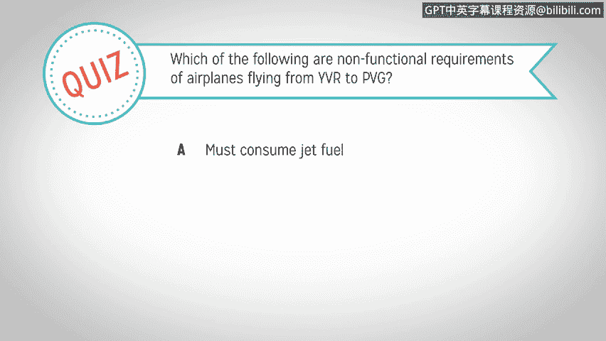

# 040：非功能性需求 🎯

在本节课中，我们将要学习软件需求中的另一个核心类别：非功能性需求。我们将通过具体例子来理解什么是非功能性需求，以及它与功能性需求有何不同。

上一节我们介绍了功能性需求，本节中我们来看看非功能性需求。

我们以移动销售点系统为例，回顾了客户提出的功能性需求。客户还提到，该产品应满足最高的安全标准和视觉设计标准。这最后一部分，关于产品满足最高安全标准和视觉设计的要求，就是我们所说的**非功能性需求**。

非功能性需求用于描述产品必须达到的性能水平。你可以将非功能性需求视为对功能性需求的补充。如果说功能性需求定义了**产品应该做什么**，那么非功能性需求则定义了**产品应该做得多好**。非功能性需求实际上关注的是产品的质量因素，因此有时它们也被称为**质量需求**。

以下是几种常见的非功能性需求类型及其示例：

**准确性需求**
假设客户希望你构建一个驾驶辅助系统。该系统能感知用户车辆与前车之间的距离，并在距离过近时自动刹车。该系统的一个非功能性需求就是传感器**必须达到极高的精度**。仅仅说“系统应读取距离并在达到阈值时刹车”是不够的。因为如果系统精度存在中等偏差，结果可能是灾难性的。因此，准确性和安全性要求是非功能性需求。

**可靠性需求**
考虑一个客户希望创建一个存储重要文档的数据库系统。该系统需要能够从灾难中恢复，以避免数据丢失。像这样的可靠性要求是非功能性需求。

**安全性需求**
如果这个数据库存储的是包含用户个人信息的敏感文档，那么让系统处于不安全、易受攻击的状态可能是不明智的。在这种情况下，你需要为信息建立**强加密**，并使整个系统难以被攻破。这些安全要求是非功能性需求。

**可用性需求**
以一个简单的网站邮箱注册表单为例。你可能见过这样的表单，它会检查用户邮箱的有效性，以最大程度减少拼写错误的风险。如果没有这种错误检查，许多邮件可能无法送达预期收件人。注册表单是否易于导航和填写？表单上应该有标签指示姓名应填写的位置，以防止信息填错。这两个要求——**错误预防**和**易用性/可学习性**——当然也是非功能性需求，它们也被称为可用性需求。

**效率需求**
假设客户希望你开发一款水下研究设备，该设备由电池供电。它必须足够小巧轻便，以便存放在小船上，同时又必须足够高效，能提供至少数小时的水下续航。其所有仪器必须能够实时、无延迟地执行功能。并且其电池应能快速充电。所有这些关于空间、功耗、时间和资源的要求，都是以效率为中心的非功能性需求。

**性能需求**
性能要求也是非功能性需求。性能需求的例子包括：系统需要**维持特定的响应时间**，或在短时间内**处理特定数量的请求**。

**可维护性需求**
想象一下，客户希望你开发一款软件，它能查询本地餐厅数据库并将其标注在地图上以便导航。客户还提到，他们设想未来将此软件扩展到另一个产品中，最终希望产品能标注其他地点，如纪念碑和旅游景点，并且当输入一个地点时，它应该能显示在地图上。要求软件足够灵活，能够扩展超出原始用途，这就是一个可维护性需求。这同样是非功能性需求。

由此可见，非功能性需求在软件规划中也占据了很大一部分。

让我们快速回顾一下我们提到的非功能性需求类型：**准确性**、**可靠性**、**安全性**、**可用性**、**效率**、**性能**和**可维护性**。

---

**练习题 ✍️**

飞机每天从加拿大温哥华国际机场飞往中国上海浦东国际机场。这些飞机必须遵守航班时刻表，其航程受所携带燃油量的限制。

以下哪项是飞机从YVR飞往PVG的非功能性需求？

A. 必须消耗航空燃油。
B. 航班时刻表不得延误。
C. 必须能够单箱燃油完成YVR到PVG的飞行。
D. 满载乘客必须在不超过90秒内完成撤离。

**C和D是正确答案**。它们分别是性能和非功能性可用性需求。其他两个答案不是非功能性需求：A涉及飞机的输入（燃料类型），B涉及航班时刻表，与飞机本身的性能或质量无关。

---

本节课中我们一起学习了非功能性需求的概念及其多种类型。我们了解到，非功能性需求关注的是产品的“质量”和“表现”，它定义了系统运行的好坏程度，是功能性需求的重要补充，共同构成了完整的软件需求规格。