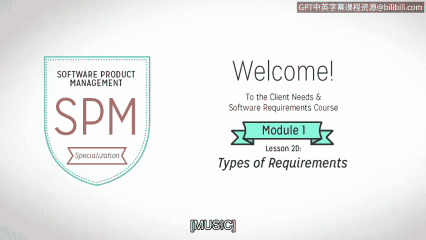
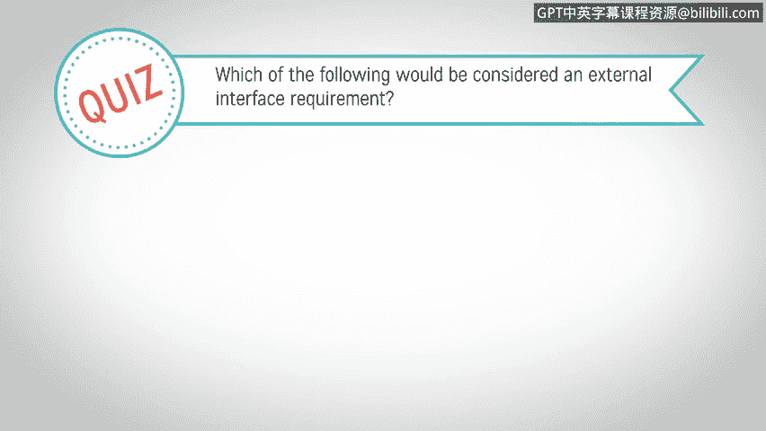

# 041：客户需求与软件需求

## 概述
在本节课中，我们将学习软件需求的不同类型，特别是外部接口、物理环境设置和开发约束这三种补充性需求。理解这些需求有助于我们更全面地定义产品，并为其设计和实现提供必要的上下文。

---

## 外部接口需求 🖇️

上一节我们介绍了用户、功能和非功能等核心需求类型，本节中我们来看看**外部接口需求**。

这种需求背后的概念很简单。通常，你的产品属于一个更大的系统。外部接口需求旨在勾勒出产品所处的位置。这里指的不是物理位置，而是指产品在逻辑上如何与产品外部的其他实体相关联。

这些接口还描述了通过何种媒介、协议、格式和兼容性级别来建立这些连接。简而言之，外部接口展示了产品本身如何与系统中的其他部分产生联系。

假设你有一个向最终用户显示信息并访问远程数据库的软件应用程序。该应用程序位于数据库和最终用户之间，并与两者各有一个外部接口。这些外部接口指明了应用程序与数据库交互所需的协议，以及信息应如何呈现给用户。

外部接口通常在数据流图上标识。数据流图在一个地方显示产品的所有组件，并明确展示在整个系统中数据如何与外部实体进行传递。

因此，外部接口只是对产品在整个系统内其他实体间的逻辑位置的一种描述。不要将外部接口与产品的物理位置混淆，后者实际上是一种单独的需求类型，称为产品的物理环境设置。

以下是外部接口需求的一个示例：
*   产品必须能够与客户数据库和广告服务器通信。

---

## 物理环境设置需求 🌡️

了解了产品如何与外界连接后，接下来我们需要考虑产品所处的**物理环境**。

物理环境设置需求描述了产品应如何围绕其物理环境进行设计。例如，如果你要为撒哈拉沙漠的建筑设备开发一个GPS追踪器，你会希望确保它能承受极端高温、灰尘、噪音和振动。如果你是为南极洲的应用开发这个系统，那么你会希望产品能承受极端寒冷。所有这些都是在指定物理环境设置需求时需要考虑的因素。

以下是物理环境设置需求的示例：
*   产品必须能够承受从不少于50米的高度跌落造成的冲击。
*   产品必须能够承受每天10小时的阳光直射。

---

## 开发约束 🛠️

在指定了之前讨论的所有需求之后，你的开发团队是否有能力创造出你设计的产品？知道这个问题的答案非常重要。

开发约束概述了实现技术、约定、文档以及你的团队将使用的流程。它们也可能涉及开发团队将支持哪些设备或平台，或者他们在内存、带宽或处理能力方面受到的使用限制。

通常最好在规范阶段的后期再指定这些约束，这样产品的愿景就不会被现有技术所限制。技术在进步，产品也应如此。最后讨论开发约束，可以避免你过早地使用旧技术和能力进行设计。

以下是开发约束的示例：
*   产品必须能够在电池供电下持续运行六小时。

---

## 课程总结

本节课中，我们一起学习了用于表达客户需求的不同需求类型。让我们回顾一下：
1.  首先，我们讨论了可能影响你项目的需求类型，即**业务需求**和**业务规则**。
2.  然后，我们讨论了几种核心需求类型，即**用户需求**、**功能需求**和**非功能需求**。
3.  最后，我们讨论了几种为产品的最终设计和实现提供额外上下文的需求，即**外部接口**、**物理环境设置**和**开发约束**。

接下来，我们将讨论如何管理不断变化的需求并控制产品范围。