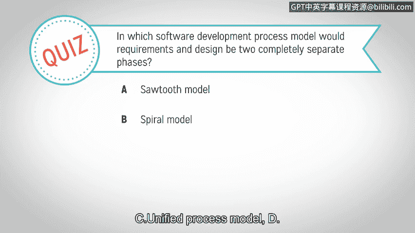

# 043：客户需求与软件需求

## 概述
在本节课中，我们将要学习软件项目中“需求”与“设计”的区别，以及为何清晰地区分两者对项目成功至关重要。我们将探讨过早引入设计决策可能带来的问题，并提供如何保持需求纯粹性的实用建议。

## 需求与设计的区别
上一节我们讨论了需求变更如何导致范围蔓延。本节中，我们来看看需求与设计有何不同，以及这对软件项目意味着什么。

在形成一组需求与设计一个产品之间，存在一个模糊的边界。通常，**需求**强调产品的 **“是什么”**。即，我的客户需要我开发什么，产品才能成功？而**设计**则强调产品的 **“如何实现”**。即，开发团队将如何实现产品以满足客户的需求？

如果你没有学习过《软件过程与敏捷实践》课程，可以跳过这个测验。

在哪个软件开发过程模型中，需求和设计是两个完全独立的阶段？
A. 锯齿模型
B. 螺旋模型
C. 统一过程模型
D. V模型
E. 瀑布模型

在**瀑布模型**中，需求和设计是完全独立的活动。根据这个模型，需求在产品设计之前独立制定，以确保需求不受设计限制的约束。也就是说，这里的需求只关注问题本身，而不涉及解决方案。

## 现代开发中的模糊边界
在现代迭代和并行开发过程中，开发团队通常会同时处理需求和设计。开发团队在构思需求时考虑到设计元素是非常普遍的。此外，客户也可能带着期望的设计特性来设想他们的产品，而不是关注他们真正的问题或需求。这就是为什么需求和设计经常被结合或混淆。

例如，理解产品的一个简单方法是将你的需求置于产品草图的背景中。这可以帮助你规划需求的正确性、一致性和清晰度。一旦你的需求以这种视觉方式放在一起，就很容易看出它们是否作为一个逻辑整体组合在一起。

模糊这个边界是可以的。然而，要注意不要让这个概念走得太远。

## 过早设计的风险
如果你过早地关注设计解决方案，最终可能会无意中忽略根本需求，并对你的产品施加不必要的约束。

例如，假设你的任务是开发一个在用户设备上运行并与远程服务器交互的应用程序。如果你的需求规定“产品应使用Java编程语言编写”，那么你就是在对开发团队施加不必要的设计约束。如果编写一个Web应用程序并使用不同的编程语言更有意义呢？本质上，你不希望仅仅因为当时看起来最好，就过早地为产品做出设计决策。

这个原则可以扩展到超越编程语言等总体设计原则的层面。

请看这个例子，看看你能否找出这个需求有什么问题。你的客户说，他们希望用户点击“确定”来提交请求。给你一个提示：如果产品界面只使用物理按钮进行输入呢？

## 识别并避免设计渗入需求
这些小的设计影响可能很棘手。在这个例子中，客户对产品施加了一个“点击”要求。他们本质上是在说，用户必须使用非常特定的输入设备来控制如何进行选择。如果你将这个需求应用到移动设备上，这个术语并不能完美地转化。在那种情况下，他们可能是“点击”按钮，而不是“单击”它。更好的说法是类似“用户提交请求”。

在制定需求时，请记住以下问题：
*   解决方案只是一种可能的选择吗？
*   解决方案是唯一可能的吗？
*   解决方案是否针对了错误的问题？
*   解决方案只是为了吸引开发者的兴趣吗？
*   客户是否更关注解决方案？

当你在构思产品时思考这些问题，你的产品质量将真正得到提高。

## 总结
本节课中，我们一起学习了设计如何以不良方式渗入需求。现在你知道了这种情况是如何发生的，你就能更好地避免它。在构建需求时，要时刻注意如何避免过早地对产品施加特定的设计解决方案。

这就是本节课，也是本模块的全部内容。希望我对什么是需求、为什么需要需求，以及在创建需求时需要考虑的一些事情，给了你一个清晰的认识。在下一个模块中，Morgan将与你讨论如何获取和表达用户需求。祝你学习愉快。😊