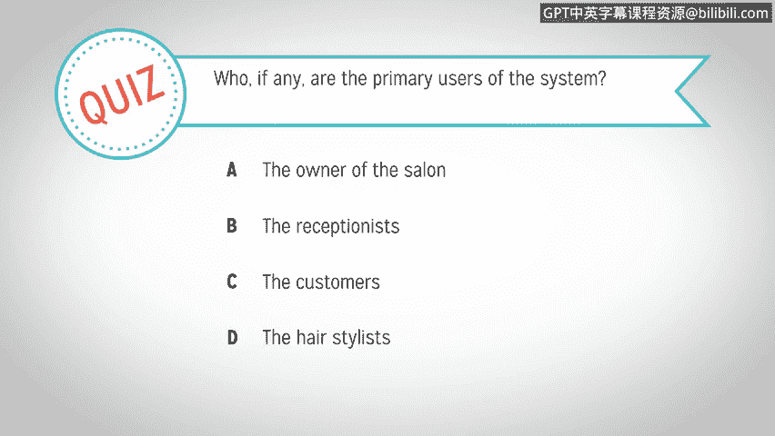

# 045：客户需求与软件需求

## 🧑‍💻 课程概述
在本节课中，我们将要学习软件开发过程中一个至关重要的环节：用户考量。我们将探讨谁是产品的最终使用者，以及如何通过理解不同用户的角色和需求来构建成功的产品。

---

## 👥 核心概念：用户与利益相关者

开发软件时，最重要的事情之一是考虑最终用户。你为谁制作这个产品？谁将使用这个产品？你可能开发出自己认为有史以来最棒的产品，但如果用户不喜欢这个产品，或者他们无法操作这个产品，那么它就会失败。

在科技行业尤其如此，用户拥有众多选择。如果市场上存在一个对最终用户来说更容易使用的类似产品，他们就会选择那个产品。想想市场上所有的任务管理应用程序。花点时间在你手机的应用商店里搜索“任务管理器”。有成千上万种不同的应用，有些很棒，有些很糟糕。但正如你所见，用户有选择权，如果他们不喜欢某个应用，就会转向下一个。

对于网络应用来说，这一点或许更为关键。竞争对手仅需一次点击即可访问，无需下载和安装新的应用程序。由此可见，时刻牢记你的最终用户非常重要。这就是我们本节课要讨论的内容。

在开发产品时，你必须考虑哪些用户方面？首先，让我们回顾一下我将要使用的一些术语。

*   **最终用户**或**用户**：指任何将直接使用产品的人。
*   **利益相关者**：指任何受项目成功影响或对项目成功有影响的人。这包括最终用户，但也包括其他人，例如客户、最终用户的管理员和系统管理员。
*   **用户界面**：指最终用户将与之交互的任何东西。以一个应用程序为例，后台有许多东西在运作以使其正常运行，但这些都不是用户界面。用户界面是你在使用应用程序时能看到的一切，例如窗口、按钮、滚动条、复选框和文本框等元素共同构成了用户界面。

---

## 🔍 深入解析利益相关者

上一节我们介绍了用户和利益相关者的基本概念，本节中我们来看看利益相关者的具体分类。利益相关者通常被分为三类用户：主要用户、次要用户或三级用户。

*   **主要用户**：指实际使用产品的人。我们将主要用户称为最终用户。
*   **次要用户**：指偶尔使用产品或通过中介使用产品的人。
*   **三级用户**：指受产品使用影响或对产品做出决策的人。

让我们看一个次要用户的例子。在我们的餐厅点餐系统示例中，服务员可以被视为次要用户。他们不是产品的目标用户，但他们必须具备产品的工作知识以便协助顾客。他们也可能使用应用程序来帮助顾客点餐。

你的客户将是三级用户。让我们再看一下我们的例子，特别是针对4至12岁儿童的儿童友好页面。客户指定此页面应显示儿童菜单，包含可玩的游戏，并且简单到足以让儿童自己选择食物。对于这个页面，儿童是主要用户，因为他们是页面的预期使用者。儿童的监护人将是次要用户。监护人需要知道页面如何运作，以便他们可以帮助孩子，但他们可能大部分时间不会使用这个页面。你的客户杰米是三级用户，但餐厅老板也是三级用户，因为应用程序的成功与否会影响他们。

成功的产品会考虑到所有利益相关者的需求。

让我们更详细地看看我们的儿童菜单例子。如果主要用户（儿童）无法弄清楚如何使用菜单，他们就会失去兴趣。儿童的注意力持续时间不是很长，所以你必须迅速吸引他们。如果食物选择不适合儿童，或者如果儿童能够选择不止一份餐点，那么监护人（次要用户）可能就不会允许孩子使用该应用程序。如果应用程序太难使用并影响了餐厅老板的生意，那么他们就不会满意并拒绝该产品。

---

## 💡 案例分析：美发沙龙预约系统

为了加深理解，我们来看另一个利益相关者的例子。你为一家美发沙龙制作了一个在线预约系统。该系统由沙龙老板请求并资助。该系统允许沙龙的顾客致电或到访，并由接待员在系统上为他们预约。顾客也可以选择创建一个在线账户，并通过沙龙的网站自行预约。发型师也可以请接待员查看他们在特定日期是否有预约。

那么，谁是这个系统的主要用户（如果有的话）？A. 沙龙老板；B. 接待员；C. 顾客；D. 发型师。

以下是分析：
*   由于沙龙老板请求并资助了该系统，他们是客户和三级用户。
*   发型师通过中介（接待员）使用系统，所以他们是次要用户。
*   当顾客致电沙龙并让接待员为他们预约时，顾客也可以被视为次要用户。
*   接待员和顾客都直接访问系统。如果他们定期使用它，那么他们都是主要用户。

因此，正确答案是 B 和 C。

---

## 📝 课程总结
本节课中，我们一起学习了在软件开发中考虑用户的重要性。我们定义了**最终用户**、**利益相关者**和**用户界面**等核心术语，并详细分析了**主要用户**、**次要用户**和**三级用户**这三类利益相关者。通过餐厅儿童菜单和美发沙龙预约系统的例子，我们明白了成功的产品必须平衡并满足所有利益相关者的需求，尤其是直接使用产品的主要用户。牢记这一点，是避免产品失败、在竞争激烈的市场中脱颖而出的关键。