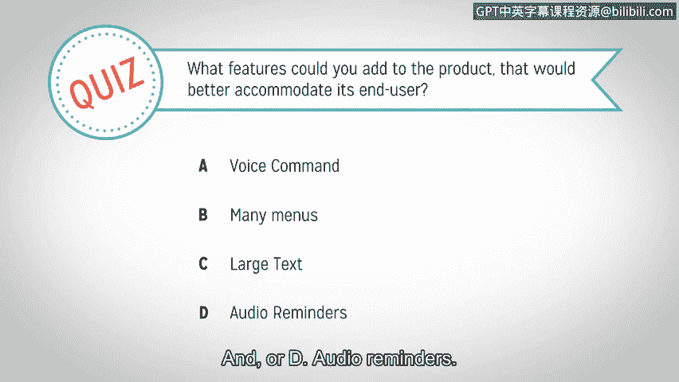

# 046：13_02_3-2-2a-用户考量

在本节课中，我们将学习如何根据已确定的目标用户群体，来调整和设计产品以满足他们的特定需求。我们将探讨人类与计算机交互的基础概念，并分析在面向不同用户群体（如儿童和老年人）进行开发时需要考虑的关键因素。

## 明确主要受众

上一节我们确定了产品的目标用户。本节中我们来看看如何根据主要受众的需求来定制产品。

识别产品的主要受众至关重要。这有助于我们根据用户的导航和功能需求来量身定制产品的设计。

以儿童菜单为例，我们的主要用户是儿童。有许多方法可以使产品迎合儿童，例如使用鲜艳的色彩、图像和声音。

## 人机交互基础

研究最终用户如何与技术产品互动的学科被称为**人机交互**。HCI本身可以是一门课程。我们将介绍一些基础知识，但如果你对此感兴趣，建议你进一步研究。这是一个非常引人入胜的计算领域。

以下是关于面向最终用户开发的一些挑战：

*   **用户难以表达需求**：用户通常很难说出他们需要什么，但他们往往会告诉你他们不喜欢什么。这通常源于他们不了解软件的可能性。
*   **开发者需要创新**：开发者必须创造性地思考，以开发出新颖、有吸引力的产品。
*   **用户的习惯偏见**：用户通常更习惯使用他们知道如何操作的劣质产品，而不是对他们来说是新的、更优质的产品。

这引出一个问题：我们在这里试图做什么？为什么我们要为那些只会使用旧产品的客户开发新产品？这就是为什么开发用户友好、直观的用户界面如此重要。它鼓励用户走出他们的舒适区。但这只有在产品易于学习和使用的情况下才有效。

## 开发者的视角

创建直观、用户友好的产品是开发者经常面临的一个挑战。

你可能已经注意到，工程师、科学家和程序员并不能代表主流人群。开发者不像普通最终用户那样思考。对开发者来说完全合理的事情，对外行人来说可能毫无意义。开发者可能优先考虑后端技术的先进性，因此有时他们很难为更广泛的人群设计出直观的产品。

作为软件产品经理，理解用户的思维方式非常重要。有一种建议认为，为初学者和专家这两个极端进行设计是理想的。如果你能做到这一点，中间群体往往就能自行适应。

当你与开发者一起设计产品或测试产品时，请牢记最终用户：他们能够理解这个产品是如何工作的吗？

## 案例分析：为老年人设计应用

现在，让我们通过一个案例来具体应用这些考量。

一个代表患有糖尿病的老年人的协会联系你的团队，希望开发一款移动应用程序，让老年人能够追踪他们的血糖水平。协会代表明确指出，用户年龄将在65岁以上。此外，应用程序必须足够简单，无需协助即可使用。

为了更好适应其最终用户，你可以为产品添加哪些功能？A. 语音命令，B. 多层菜单，C. 大号文字，和/或 D. 音频提醒。

为老年人开发可能很困难。他们的感官可能不太好，这可能限制他们能做的事情。由于他们不是在技术时代长大的，他们的技术技能往往不太先进；因此，一个拥有多层菜单的产品可能让他们难以操作。

添加语音命令和大号文字等功能是适应老年最终用户的好方法。语音命令帮助那些无法在小键盘上打字的人，大号文字则更易于阅读。为他们设置提醒将是一个很棒的功能，然而，你可能希望通过多种模式（不仅仅是音频）进行通知。例如，让手机发出声音、在屏幕上显示弹出窗口并振动。这将引起大多数用户的注意。因此，最佳答案是A和C。

## 更多人类限制因素

本节课中我们一起学习了如何根据主要用户群体定制产品，探讨了人机交互的基本概念以及开发者与用户在思维上的差异，并通过一个为老年人设计应用的案例进行了实践分析。理解并适应最终用户的能力和限制，是创造成功软件产品的关键。