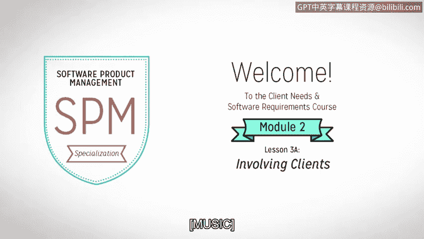

# 049：客户需求与软件需求

## 概述
在本节课中，我们将学习如何通过与客户深入沟通，将模糊的需求转化为清晰、具体的软件功能描述。我们将以餐厅点餐系统为例，演示如何通过提问来明确客户需求，并了解让客户持续参与开发过程的重要性。

---

## 从模糊需求到具体功能

上一节我们介绍了需求获取的重要性，本节中我们来看看如何通过提问来澄清一个模糊的需求。

以本模块开始时提到的餐厅点餐系统为例。你的客户杰米提出的一个功能是：顾客可以使用系统下单。这个描述非常模糊，因为实现这个需求的方式有很多种。

这是一个通过提出更直接的问题来弄清楚杰米究竟如何设想该功能的好机会。

以下是你可以提出的一些问题：
*   顾客如何进行选择？
*   当一桌有多位顾客时，系统应如何处理？
*   每桌的点餐是否有最低或最高限额？
*   顾客如何将订单发送到厨房？

---

## 客户的具体设想

在听到上述直接问题后，杰米给出了更详细的回答：

“我为之前描述得如此模糊而道歉。在我设想中，顾客与应用程序交互时，每张餐桌应配备一台或多台平板电脑供顾客点餐。他们可以浏览食物图片。如果顾客想了解更多关于某道菜的信息，可以点击它；如果他们想点这道菜，就点击‘下单’按钮。这会将他们带到另一个页面，在那里他们可以指定对餐点的修改以及可能有的任何饮食限制，然后再将订单发送到厨房。当一桌有多位顾客时，我希望它的工作方式类似于在线购物系统的购物车。我希望当平板电脑在餐桌上传递时，每位顾客都可以选择自己的订单。或者，也可以由一个人输入所有人的订单，这没关系。同一账单上的所有订单必须从一台平板电脑提交。额外的平板电脑是供人们浏览菜单或为另一张账单点餐用的。点餐不应有最低或最高限额。当所有订单都已输入并定制完成后，顾客可以通过点击‘提交订单’将订单发送到厨房。”

---

## 客户参与的重要性

在听到对直接问题的回答后，你对“顾客可以使用点餐系统下单”这句话的实际含义有了清晰得多的理解。

让你的客户参与进来并考虑最终用户，是你工作中非常重要的一部分。即使在需求获取之后，你的客户也应该在整个开发过程中持续参与。他们应该在那里回答问题，就设计选择提供建议，并对可运行的版本提供反馈。

我们为你提供了一份资源，列出了许多你可以向客户提出的好问题。如果你在沟通中卡住了，可以将这份资料带到客户会议中并参考它。你可以在课程资源中找到它。

---

## 下一步：需求的表示

现在你已经获取了需求，接下来需要学习如何表示它们。这就是你将在本模块剩余部分学习的内容。

---

## 总结
本节课中我们一起学习了如何通过提出具体问题来澄清客户的模糊需求，并以餐厅点餐系统为例进行了详细拆解。我们认识到，让客户持续参与开发过程，对于确保软件产品符合预期至关重要。接下来，我们将学习如何有效地表示这些已明确的需求。