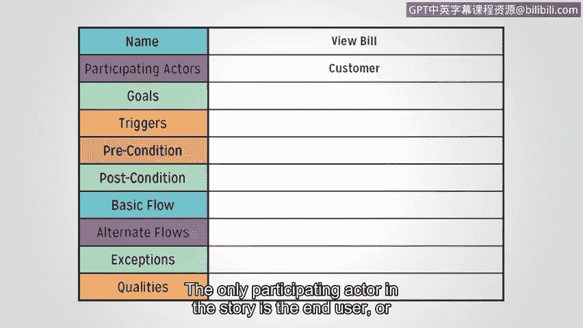
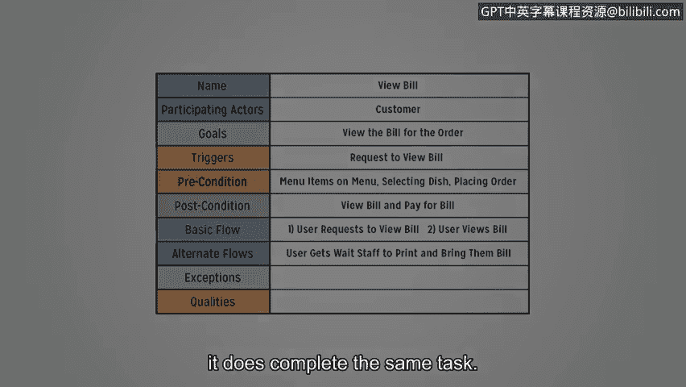
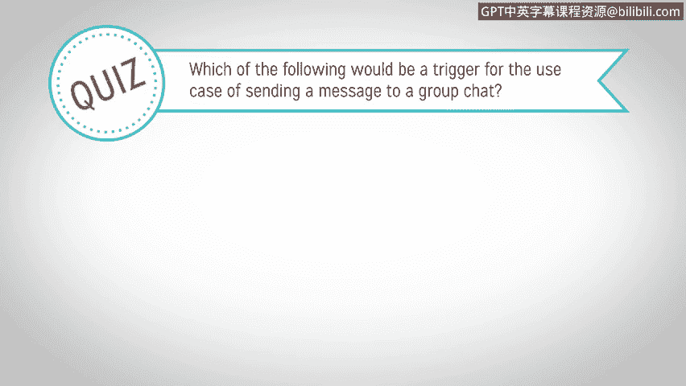

# 050：用例

在本节课中，我们将要学习一个在软件需求分析中至关重要的工具——用例。我们将了解用例的概念、核心组成部分，并通过具体示例学习如何编写一个完整的用例描述。

## 概述

用例是由伊瓦尔·雅各布森在1986年提出的概念。自此，它成为一种描述产品功能所支持任务的流行方式。用例是一种识别、澄清和组织任务细节的方法。它由用户与系统之间一系列可能的顺序交互组成，发生在特定环境中，旨在达成特定目标。

## 用例描述的构成要素

一个用例描述通常由以下几个部分组成：用例名称、参与者、目标、触发器、前置与后置条件、基本流程、异常情况以及质量要求。

以下是每个组成部分的详细说明：

1.  **用例名称**：需要为用例起一个描述任务、简单且简短的名字。
2.  **参与者**：需要识别参与用例的角色。角色是个人承担的职责，例如餐厅顾客、厨房厨师或服务员。参与者名称应描述他们与产品的交互行为，而非具体人名，以保证通用性。
3.  **目标**：需要明确用例旨在达成的特定目标。
4.  **触发器**：触发器是促使用例开始的事件，例如按下某个按钮。
5.  **前置与后置条件**：前置条件是在该用例发生前必须满足的条件。后置条件是在用例完成后达成的条件。
6.  **基本流程**：基本流程是用例中所有发生步骤的逐步说明。它应代表一个“晴天场景”，即最佳情况或一切正常运作的场景。如有必要，其他场景可作为备选流程进行概述。
7.  **异常情况**：异常情况突出说明了用例无法正常工作的任何情形。对于异常，需要识别其在基本流程中可能发生的步骤，并提供解决问题的替代步骤。
8.  **质量要求**：质量要求是希望满足的任何质量规范，例如非功能性需求，如在特定时间内完成场景或使用特定量的内存。

总体而言，用例描述从参与者的角度概述了任务。它不涉及产品幕后的运作。同时，描述应独立于技术，不绑定于特定的用户界面平台。

## 用例示例分析

上一节我们介绍了用例的构成要素，本节中我们通过一个具体场景来应用这些知识。

杰克正在使用一个即时通讯应用程序。他想给他的朋友莎莉发一条消息，告诉她他参加她的派对要迟到了。他打开应用程序，搜索她的名字。他点击他们的对话，然后输入消息：“嘿，莎莉，我要迟到了。待会儿见。”然后他按下发送。莎莉看到了消息并回复了杰克。

如果要为此场景编写一个用例，你会将谁列为参与者？
A. 消息发送者
B. 消息接收者
C. 莎莉
D. 杰克

在定义参与者时，我们希望它们是通用角色，因此不应使用实际姓名。尽管莎莉和杰克是这个特定场景的最终用户，但并非每次用例发生时都是他们。我们需要更通用的描述。消息发送者和消息接收者是很好的参与者名称，因为两个用户都参与了此场景。这意味着答案A和B是正确的。

## 构建用例图与详细用例

现在你已经了解了用例描述的结构，让我们进一步将其应用到我们的餐厅应用示例中。

一个好的起点是创建一个**用例图**。这是产品支持的所有任务的高级可视化表示。它识别了参与者及其参与的用例。在餐厅场景中，我们有顾客、儿童顾客和厨房员工。他们各自的用例在图中与他们相连。边界内是产品可以支持的所有用例。

让我们选取其中一个任务并将其转化为一个详细的用例。我们将查看允许顾客查看账单的需求。

假设这是第一个用例，对应产品待办列表中的需求，因此我们将给这个用例分配ID号1。

以下是该用例的详细描述：

*   **名称**：查看账单
*   **参与者**：顾客（最终用户）
*   **目标**：查看其订单的账单
*   **触发器**：顾客在应用程序中请求查看账单
*   **前置条件**：菜单上有菜单项；用户已选择菜品；用户已下单
*   **后置条件**：顾客可以查看账单并支付账单
*   **基本流程**：
    1.  顾客从应用程序请求查看账单。
    2.  顾客查看账单。
*   **备选流程**：用户让服务员打印并送来账单（这不是晴天场景，因为它需要更多工作，但完成了相同的任务）。
*   **异常情况**：可能发生的异常是未订购任何菜品，因此用例目标未达成。在这种情况下，应显示错误消息。在我们的基本流程中，步骤2是“顾客查看账单”。如果订单中没有菜品，我们希望显示错误消息。我们将在用例中通过写“步骤2a：如果未订购菜品，则显示错误消息”来体现这一点。
*   **质量要求**：账单加载时间少于10秒。通常，质量要求是非功能性需求，有助于在开发过程中设定质量标准。

## 触发器辨析练习

你正在使用一个允许用户创建和使用群组消息线程的软件产品。群聊参与者可以被添加到群聊中，并且这些参与者都可以看到在该线程中发送的消息。

以下哪一项是“向群聊发送消息”这个用例的触发器？
A. 参与者有一条想要发送给群组的消息。
B. 参与者输入消息。
C. 参与者打开群聊。
D. 参与者点击发送按钮。

触发器是促使用例发生的事件。在这个场景中，我们的用例是“发送消息”。要触发这个事件，参与者会有一条想要发送给群组的消息。这促使参与者打开群聊、输入消息并按下发送。因此，A是正确答案。答案B、C和D都是将发生的基本流程中的步骤。

## 总结

本节课中我们一起学习了用例这一强大的需求分析工具。用例是描述产品功能所支持任务的标准方法，它从用户（参与者）的角度出发，通过定义名称、参与者、目标、触发器、条件、流程、异常和质量要求，清晰地勾勒出交互场景。用例图则提供了产品支持的所有任务及其参与者的高层视图。用例有助于组织和阐述任务及其步骤，并能指导开发工作。接下来，我们将学习一些有助于组织和可视化产品需求的设计技术。