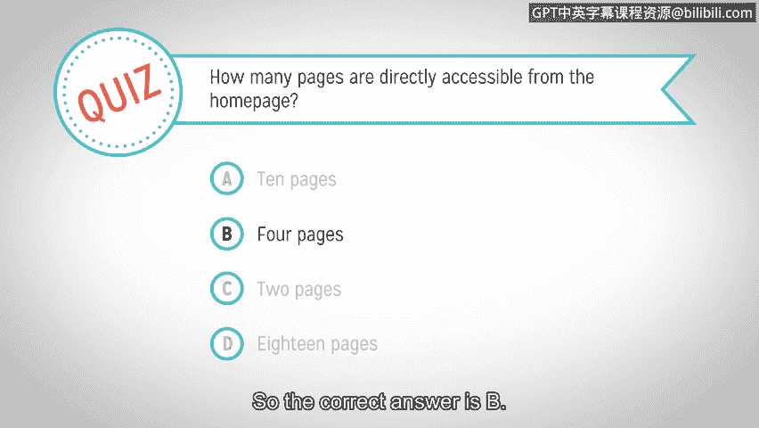

# 052：故事板

## 概述
在本节课中，我们将要学习一种重要的需求可视化工具——故事板。我们将了解故事板的起源、两种主要类型及其在软件开发中的具体应用。通过本课，你将掌握如何使用故事板来规划用户交互、统一团队愿景并细化产品需求。

***

如果你之前听说过故事板，那很可能是在电影行业的背景下。这是因为这种实践起源于电影行业。想一想制作一部电影所涉及的所有角色。故事板有助于让每个人都围绕导演的愿景达成一致。

故事板是对交互过程的顺序视觉化呈现。连环画就是一种故事板。它按顺序视觉化地讲述一个故事。在电影行业，故事板用于规划画面中的元素位置、镜头如何移动，并提供场景的感觉。他们会在投入服装、道具、摄影、特效和剪辑之前完成这项工作。

在软件开发中，故事板可以通过几种不同的方式使用。无论如何使用，它们都按顺序讲述了最终用户如何与产品交互的故事。

***

## 电影式故事板
第一种使用故事板的方式类似于电影故事板。这种类型的故事板贯穿了高层次的用户体验。

以下是创建此类故事板的步骤：
1.  首先，需要识别涉及的参与者以及他们将如何使用产品。这里识别的不是电影演员。如果你还记得关于用例的课程，你会记得我们将情境中的主动用户称为参与者。
2.  如果产品具有多个功能，那么需要为每个参与者在每种情境下使用产品的情况创建一个新的序列。

让我们使用我们的餐厅应用程序来看一个例子。

史密斯一家决定去Brampton Pasta餐厅。他们坐在餐桌旁，使用桌上的平板电脑浏览菜单。他们在应用程序上浏览菜品并下单。厨房的厨师收到了他们的订单。食物准备好后被送到餐桌，史密斯一家享用了一顿美味的晚餐。用餐结束后，母亲在应用程序上查看并支付账单。

这种类型的故事板涵盖了产品被使用的各种情境。通过观察每个用户将在何时以及如何使用产品，你的开发团队可以创建或改进功能。正如之前所说，考虑用户是开发的重要组成部分。

你还可以通过为每个用户赋予角色来扩展故事板，添加更多关于用户的背景故事。例如，在我们刚刚看到的史密斯一家的场景中，你可以详细说明他们的年龄、喜欢的菜肴、过敏史、种族背景和/或收入水平。你可以细化这个场景，以展示故事板和需求如何扩展以解决某些问题。

如果产品有多个功能，你需要为每个功能制作一个故事板。例如，这个应用程序有一个儿童菜单，需要一个新的故事板。你还需要用另一个故事板来涵盖账单支付功能。

这种电影风格的故事板对于让整个开发团队达成共识也很有用。它有助于牢记产品的愿景。故事板的另一个用途是用于营销或演示目的，你可以轻松地向他人展示产品的预期使用方式和时机。

***

### 示例分析
你正在开发一个道路救援应用程序。该应用程序具有检查路况的功能。你的开发团队为你提供了此功能的电影风格故事板。

弗兰克即将开始公路旅行，他望向窗外，看到正在下雪。他想知道道路是否因此被积雪覆盖且湿滑。弗兰克打开他的道路救援应用程序，检查他路线的路况。应用程序告诉他最短的路线有危险，他应该选择另一条路线。弗兰克采取了建议的路线，并安全抵达目的地。

以下哪些（如果有的话）会是与此故事板相关的需求？
A. 作为司机，我希望输入出发地和目的地，让应用程序计算路线。
B. 作为司机，我希望应用程序跟踪我的行程，如果我没有到达目的地，则通知紧急联系人。
C. 作为司机，我希望危险路线用红色高亮显示。
D. 作为司机，我希望建议更安全的路线。
E. 作为司机，如果我的车辆在高速公路上静止45分钟，我希望自动向我的位置派遣道路救援。

从这个故事板中，我们可以看到路线是根据提供的出发地和目的地计算的。高风险路线用红色高亮显示，并且建议了更安全的路线。因此，A、C和D是正确答案。B和E可能是应用程序的功能，但并未在此特定故事板中描绘。

***

## 界面流程故事板
另一种故事板制作方式更深入地涉及软件设计。其目的是更详细地展示用户将如何与产品的用户界面进行交互。

这种类型的故事板展示了用户与产品之间所有交互的顺序。它是线框图和用例基本流程的结合。它展示了产品的每个状态以及用户如何到达该状态。在大多数产品中，每个状态将由用户界面中的一个独立线框图或页面来描绘。每个状态之间的用户转换点用带箭头的线描绘。

让我们继续使用餐厅的例子，看看这种类型的故事板是什么样子。

顾客看到的第一个屏幕是主页。从该页面，顾客可以点击一道菜进入菜品详情页，或点击儿童菜单按钮进入儿童页面。在菜品详情页，顾客可以点击订购该菜品，然后进入菜品定制页面。菜品定制完成后，顾客可以点击下单并返回主页。

这种类型的故事板是在开发前可视化需求的好方法，它提供了一个机会来讨论支持用户任务可能遗漏或多余的元素。用户应该能直观地知道他们在产品中的位置以及下一步该做什么。故事板展示了线框图。在故事板中，只要有箭头存在，线框图中就需要一个用户界面元素（如按钮）来进入下一个线框图。技术作者也可以使用故事板作为创建和组织培训材料的指南。

***

### 示例分析
你拿到一个包含10个不同页面的故事板。从主页出发，有四个箭头，每个箭头指向一个不同的页面。有两个页面有箭头指向主页。故事板上总共有18个箭头。有多少个页面可以直接从主页访问？
A. 10页
B. 4页
C. 2页
D. 18页

在故事板中，每个屏幕代表一个页面。可以从特定页面直接访问的页面具有从该页面发出并指向可访问页面的箭头。因此，由于有四个箭头从主页发出并指向四个不同的页面，这意味着有四个页面可以直接从主页访问，所以正确答案是B。

***

## 总结
本节课中，我们一起学习了故事板这一强大的需求沟通工具。我们探讨了两种主要类型：**电影式故事板**和**界面流程故事板**。两种类型的故事板都很有价值，因为它们有助于形成需求，并且都关注用户做什么以及产品中需要什么。

你会发现产品的视觉化呈现在于客户和开发人员讨论时非常有帮助。用故事板演示功能将帮助你引出更多需求并完善现有需求。电影风格的故事板适用于高层次地模拟用户与产品的交互。它也是让整个团队在产品目标上达成共识的好方法。第二种类型的故事板是增强版的线框图，用于更详细地确定与产品的交互。这种类型将更多地被开发团队用来设计需求。这是一种确保整个开发团队了解产品功能和流程的有用技术。