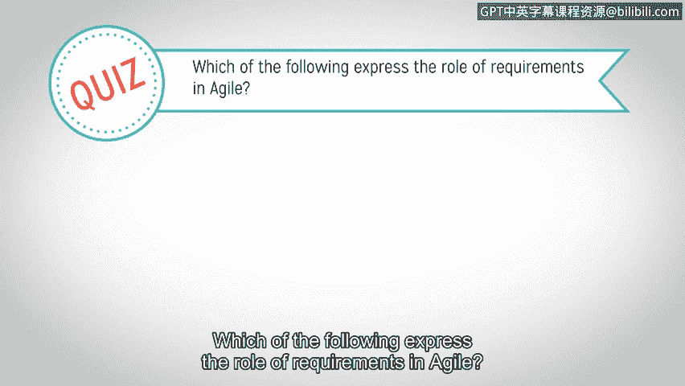

# 053：敏捷需求

欢迎来到《客户需求与软件需求》课程的本模块。

我们将基于之前模块已涵盖的内容进行扩展。在上一个模块中，摩根详细介绍了用户考量。她描述了如何让客户和最终用户参与进来，以确保为他们构建正确的产品。她还谈到了通过用例、线框图和故事板来表达这些需求的方法。

在那个模块中，我们概述了如何确定客户需求。在本模块中，我将概述如何通过将其置于敏捷框架内来表述这些需求。我将向您展示需求如何融入敏捷软件开发的范畴，以及表达和管理需求的各种方式。

## 敏捷原则回顾

在入门课程中，摩根谈到了敏捷及其12条核心原则。让我们快速回顾一下摩根介绍的这些原则。

以下是敏捷的12条核心原则：

1.  通过早期和持续交付有价值的软件来满足客户。
2.  频繁地交付可工作的软件。
3.  将可工作的软件作为衡量进度的主要标准。
4.  欢迎需求变更。
5.  关注技术卓越和良好设计。
6.  以可持续的步伐进行开发。
7.  专注于简洁性，最大化未完成的工作量。
8.  围绕有动力的个体构建项目。
9.  关注自组织团队。
10. 业务人员和开发人员之间每日协作。
11. 鼓励面对面交流。
12. 定期反思团队行为并相应调整。

## 与需求最相关的敏捷原则

在12条敏捷原则中，哪些与需求最相关？

A. 欢迎需求变更。
B. 鼓励面对面交流。
C. 专注于简洁性。
D. 频繁交付可工作的软件。

实际上，所有这些答案都是正确的。它们各自以不同的方式反映了需求。然而，为了讨论需求和敏捷，我想特别指出其中两条。

第一条是**欢迎需求变更**。这可能显而易见，但至关重要。敏捷基于软件是动态的这一概念。它是一个开放的事物，无法一次性定义，然后基于那个单一的定义进行构建。通常，您的客户会在开发过程中改变对产品功能的看法。对于那些没有考虑到需求变更必然性的项目来说，这可能是灾难性的。当您构思需求时，欢迎需求变更的敏捷原则至关重要。要带着贯彻执行的意图来制定它们，但不要自欺欺人地认为它们不会随着产品的成长而改变。这只是软件开发方式的本质。

第二条我想强调的原则是**鼓励面对面交流**。这对于获取正确的需求也至关重要。根据敏捷方法，需求应在开放和协作的环境中从客户那里获取。产品的愿景应由您的客户决定。然后，作为软件产品经理，您的工作是共同解决问题，细化该愿景，以确定项目中哪些需求在范围内。您需要一起完成这项工作。关键在于让每个人都在同一个房间里，可以公开讨论产品中希望包含的功能，识别可以或必须完成的事项。这不仅能让您更有效地当场确定有价值的事项，也为您的团队与客户之间的未来沟通树立了先例。

## 需求在敏捷中的角色

以下哪项表达了需求在敏捷中的角色？

A. 需求中等重要，定义截止日期更重要。
B. 需求完全不重要，敏捷是编写代码的过程。
C. 需求应预先定义且不改变。
D. 需求很重要，并且应该能够在整个开发过程中改变。

需求在敏捷中极其重要。它们帮助我们理解客户，并确保我们为客户构建正确的产品。它们还帮助我们确保我们正确地构建产品。因此，正确答案是 **D**。

与客户坐下来讨论那些必然会变化的需求，是Scrum中经常使用的实践。Scrum是一种敏捷方法论，我们在《软件流程与敏捷实践》课程中有详细介绍，不要错过。

## 总结

我想在本课中概述的是，需求是敏捷不可或缺的一部分。另一方面，敏捷也为需求增添了大量质量，只要您在创建需求时遵循其实践。

既然我们已经建立了敏捷与需求之间的一些联系，让我们进入下一课。在那里，我将告诉您关于表达敏捷需求的最常见形式：用户故事。到时见。