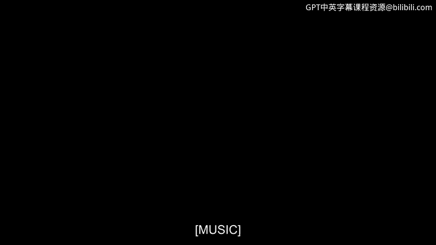
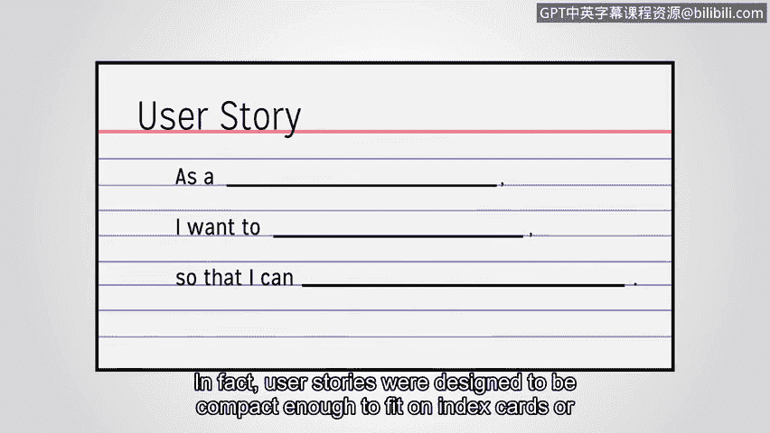

# 054：用户故事 📝

在本节课中，我们将学习敏捷开发中表达需求的核心技术之一：用户故事。我们将了解用户故事的定义、结构、重要性，并学习如何编写和评估高质量的用户故事。

上一节我们介绍了如何将传统需求与敏捷实践相结合。本节中，我们来看看一种具体的敏捷需求表达方式：用户故事。

## 什么是用户故事？🤔

用户故事是一种表达需求的简单方式。在之前的模块中，我们学习了用例、线框图和故事板，这些都是表达需求的技术。用户故事是另一种实现相同目的的方法。

用户故事旨在将系统的所有需求保持为一致的格式。它们易于编写、阅读和评估。

## 用户故事的结构 📐

用户故事遵循一个非常具体的格式：

**`作为 <角色>， 我想要 <功能>， 以便于 <价值>`**

*   **第一部分（作为…）**：指明需求是为哪个**利益相关者角色**而制定的。例如“管理员”或“访客用户”。在我们的餐厅菜单应用示例中，利益相关者是顾客和厨房员工。这有助于明确需求旨在支持谁，它规定了需求的 **“谁”**。
*   **第二部分（我想要…）**：描述利益相关者希望使用产品解决的**任务或功能**。这是需求的核心，通常也是人们想到“需求”时最先想到的部分。这部分规定了需求的 **“什么”**。
    *   例如，在餐厅应用中，具体任务可能是：“我想要浏览我所在餐厅的菜单”、“我想看到儿童菜单”或“我想查看已收到的订单”。
*   **第三部分（以便于…）**：说明首先**为什么**需要这个用户故事。这部分在创建用户故事时经常被忽略，但它提供了对需求的关键洞察。它为需求提供了关于其提供的**价值或收益**的背景，并与产品的目标或愿景保持一致。这部分规定了需求的 **“为什么”**。

因此，一个完整的用户故事可能如下所示：
> **`作为儿童顾客，我想要看到儿童菜单，以便于我了解哪些餐食和游戏能吸引我。`**

你可以看到它是如何作为一个整体结合在一起的。

## 知识测验 ✏️

让我们测试一下你对用户故事结构的理解。

假设你正在与客户合作一个手机游戏项目。他们给出了一个需求：“我希望能够使用方向键控制我的角色。”

你会如何构建这个需求以符合用户故事的形式？

A. 作为玩家，我希望能够使用方向输入方法控制我的角色，以便我能在游戏世界中导航。
B. 我希望能够使用方向输入方法控制我的角色。
C. 为了在世界中导航，角色应该能够使用方向键移动。
D. 不做任何更改，这已经是一个用户故事了。

**正确答案是 A**。一个用户故事应该符合“作为…，我想要…，以便于…”的形式。请注意，这个用户故事在描述输入设备时更加通用，以专注于实际需求，而不是特定的解决方案。

## 用户故事的优势 💪

现在，将用户故事与常见的需求表达方式进行比较。通常，你会看到需求使用模糊的语言表达，没有太多描述。例如：“用户应该能够看到儿童菜单”。

了解了用户故事的创建方式后，你是否理解了它们为何如此构建？它们为需求带来了极大的清晰度，而不会陷入技术细节的泥潭。你可以在一个简洁的小包裹中获得“谁”、“什么”和“为什么”。

拥有这样简短、简洁的用户故事还有一个额外的好处：你可以轻松地将它们写下来以便跟踪。事实上，用户故事的设计足够紧凑，可以写在索引卡或便利贴上。

通过这种方式，所有的用户故事都可以以一种非常直观、具体且信息丰富的方式展示和组织。将故事写在索引卡上，可以轻松地将它们按相关主题分组，并在需求不可避免地发生变化时进行重组。

## 总结 📋

本节课中，我们一起学习了用户故事。用户故事是一种遵循 **`作为 <角色>， 我想要 <功能>， 以便于 <价值>`** 格式的敏捷需求表达技术。它明确了需求的“谁”、“什么”和“为什么”，使需求更加清晰、易于管理和沟通。通过将用户故事写在卡片上，团队可以直观地组织和调整需求，更好地适应项目变化。